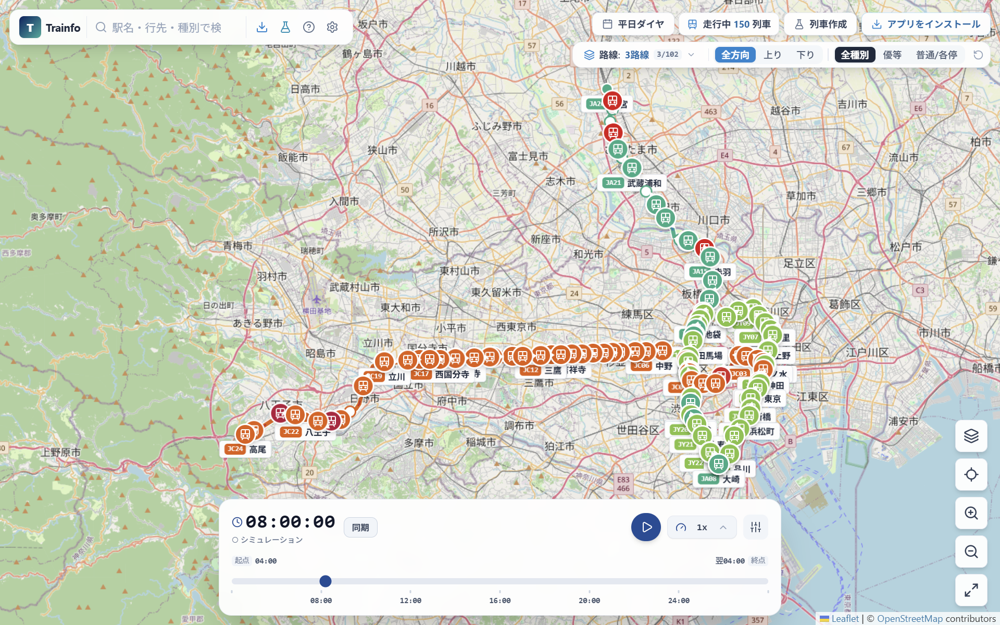

# Trainfo（鉄道リアルタイム運行シミュレーター）

<div align="center">


首都圏・北関東・甲信越・東北・東海・近畿・山陽エリアにまたがる 24事業者・全174路線（ユニーク2,970駅 / 駅ID 3,467駅 / 延べ3,505駅）の鉄道ネットワークを対象に、時刻表データ（平日・土休日ダイヤ）と実測に基づく路線形状データから列車の現在位置・走行状態・直通運転・併結分割運転を地図上に表示する鉄道運行シミュレーターです。

[](https://github.com/GenbuHase/Trainfo/actions/workflows/deploy.yml)
[](https://opensource.org/licenses/MIT)




</div>

---

## 主な機能

### 1. 24事業者・全174路線の広域路線網

新幹線7路線をはじめ、首都圏主要幹線・郊外路線・東京メトロ全線・東北・北関東・甲信越・東海・近畿・山陽エリアの接続路線まで、24事業者・全174路線を統合しています。

<details>
<summary>収録路線一覧（24事業者・全174路線）</summary>

#### JR東日本（78路線）

##### 新幹線（5路線）

- JR東北新幹線（東京〜新青森・全23駅）
- JR上越新幹線（東京〜新潟・全12駅）
- JR北陸新幹線（東京〜敦賀・全24駅）
- JR山形新幹線（福島〜新庄・全11駅）
- JR秋田新幹線（盛岡〜秋田・全6駅）

##### 首都圏・近郊幹線（33路線）

- JR山手線（環状線・全30駅）
- JR京浜東北線・根岸線（大船〜大宮・全47駅）
- JR上野東京ライン（東京〜上野・全2駅 / 宇都宮・高崎・常磐線と東海道線の直通系統）
- JR湘南新宿ライン（大宮〜大船・全12駅 / 宇都宮・高崎線と東海道・横須賀線の直通系統）
- JR東海道線（東京〜熱海・全21駅）
- JR横須賀線（東京〜久里浜・全19駅）
- JR中央線（東京〜高尾・全24駅）
- JR中央・総武線各駅停車（三鷹〜千葉・全39駅）
- JR総武快速線（東京〜千葉・全10駅）
- JR宇都宮線（上野〜黒磯・全33駅）
- JR高崎線（上野〜高崎・全24駅）
- JR伊東線（熱海〜伊東・全6駅）
- JR常磐線快速（上野〜取手・全10駅）
- JR常磐線各駅停車（綾瀬〜取手・全14駅）
- JR埼京線（大崎〜大宮・全19駅）
- JR武蔵野線（府中本町〜西船橋・東京・海浜幕張、鶴見・横浜方面支線対応・全34駅）
- JR京葉線（東京〜蘇我・西船橋支線対応・全18駅）
- JR横浜線（東神奈川〜八王子・全20駅）
- JR南武線（川崎〜立川 / 尻手〜浜川崎支線対応・全30駅）
- JR鶴見線（鶴見〜扇町 / 海芝浦支線 / 大川支線対応・全13駅）
- 相鉄・JR直通線（羽沢横浜国大〜新宿・全7駅）
- JR川越線（大宮〜川越〜高麗川・全11駅）
- JR八高線（八王子〜高麗川〜高崎・全24駅）
- JR青梅線（立川〜奥多摩・全25駅）
- JR五日市線（拝島〜武蔵五日市・全7駅）
- JR総武本線（千葉〜銚子・全22駅）
- JR成田線（佐倉〜松岸 / 成田空港支線 / 我孫子支線対応・全28駅）
- JR外房線（千葉〜安房鴨川・全27駅）
- JR内房線（蘇我〜安房鴨川・全30駅）
- JR東金線（大網〜成東・全5駅）
- JR久留里線（木更津〜上総亀山・全14駅）
- JR常磐線（取手～いわき）（取手〜いわき・全35駅）
- JR常磐線（いわき～仙台）（いわき〜仙台・全35駅）

##### 北関東・甲信越・東北在来線（40路線）

- JR両毛線（小山〜新前橋・全18駅）
- JR中央本線（高尾〜塩尻・全38駅）
- JR篠ノ井線（塩尻〜篠ノ井〜長野・全19駅）
- JR大糸線（松本～南小谷）（松本〜南小谷・全33駅）
- JR上越線（高崎〜宮内〜長岡・全36駅）
- JR信越本線（高崎～横川）（高崎〜横川・全8駅）
- JR信越本線（直江津～新潟）（直江津〜新潟・全42駅）
- JR白新線（新潟〜新発田・全10駅）
- JR羽越本線（新津〜秋田・全60駅）
- JR東北本線（黒磯～福島）（黒磯〜福島・全24駅）
- JR東北本線（福島～仙台）（福島〜仙台・全20駅）
- JR東北本線（仙台～一ノ関）（仙台〜一ノ関・全22駅）
- JR東北本線（利府支線）（岩切〜利府・全3駅）
- JR東北本線（一ノ関～盛岡）（一ノ関〜盛岡・全20駅）
- JR仙山線（仙台〜羽前千歳・全18駅 / 奥羽本線山形直通対応）
- JR仙石線（あおば通〜石巻・全32駅）
- JR仙石東北ライン（塩釜〜高城町・全2駅 / 東北本線と仙石線・石巻線の直通系統）
- JR石巻線（小牛田〜女川・全14駅）
- JR奥羽本線（福島～新庄）（福島〜新庄・全35駅）
- JR奥羽本線（新庄～大曲）（新庄〜大曲・全20駅）
- JR奥羽本線（大曲～秋田）（大曲〜秋田・全9駅）
- JR奥羽本線（秋田～青森）（秋田〜青森・全40駅）
- JR田沢湖線（盛岡〜大曲・全18駅）
- JR北上線（北上〜横手・全15駅 / 代行バス運行対応）
- JR釜石線（花巻〜釜石・全24駅 / 東北本線盛岡直通対応）
- JR山田線（盛岡〜宮古・全15駅 / 代行バス運行対応）
- JR八戸線（八戸〜久慈・全24駅）
- JR大湊線（野辺地〜大湊・全11駅 / 青い森鉄道八戸直通対応）
- JR津軽線（青森〜三厩・全18駅 / 代行バス運行対応）
- JR五能線（東能代〜川部・全43駅 / 奥羽本線直通対応）
- JR男鹿線（追分〜男鹿・全9駅 / 奥羽本線秋田直通対応）
- JR磐越東線（いわき〜郡山・全16駅）
- JR磐越西線（郡山〜新津・全42駅）
- JR只見線（会津若松〜小出・全36駅）
- JR陸羽東線（小牛田〜新庄・全27駅 / 代行バス運行対応）
- JR陸羽西線（新庄〜余目・全10駅 / 羽越本線酒田直通対応）
- JR気仙沼線（前谷地〜柳津・全6駅）
- JR気仙沼線BRT（前谷地〜柳津〜志津川〜気仙沼・気仙沼市立病院経由対応・全26駅）
- JR大船渡線（一ノ関〜気仙沼・全14駅）
- JR大船渡線BRT（気仙沼〜陸前高田〜盛 / 上鹿折支線 / 陸前矢作支線対応・全27駅）

#### JR東海（15路線）

##### 新幹線（1路線）

- JR東海道新幹線（東京〜新大阪・全17駅）

##### 在来線（14路線）

- JR東海道本線（熱海～豊橋）（熱海〜豊橋・全43駅）
- JR東海道本線（豊橋～米原）（豊橋〜米原・新垂井線対応・全42駅）
- JR東海道本線（美濃赤坂線）（大垣〜美濃赤坂・全3駅）
- JR御殿場線（国府津〜沼津・全19駅）
- JR身延線（富士〜甲府・全39駅）
- JR飯田線（豊橋〜辰野・全94駅）
- JR中央本線（名古屋～塩尻）（名古屋〜塩尻・全40駅）
- JR太多線（多治見〜美濃太田・全8駅）
- JR高山本線（岐阜〜富山・全45駅）
- JR関西本線（名古屋～亀山）（名古屋〜亀山・全18駅）
- JR武豊線（大府〜武豊・全10駅）
- JR紀勢本線（亀山～新宮）（亀山〜新宮・全41駅）
- JR名松線（松阪〜伊勢奥津・全15駅）
- JR参宮線（多気〜鳥羽・全10駅）

#### JR西日本（33路線）

##### 新幹線（1路線）

- JR山陽新幹線（新大阪〜博多・全19駅）

##### 在来線（32路線）

- JR琵琶湖線（米原〜京都・全20駅）
- JR京都線（京都〜大阪・全17駅）
- JR神戸線（大阪〜神戸・全17駅）
- JR山陽本線（姫路～上郡）（姫路〜上郡・全9駅）
- JR赤穂線（相生〜東岡山・全19駅）
- JR大阪環状線（環状線・全19駅）
- JRゆめ咲線（西九条〜桜島・全4駅）
- JR東西線（京橋〜尼崎・全9駅）
- JR学研都市線（木津〜京橋・全24駅）
- JR宝塚線（尼崎〜篠山口・全21駅）
- JR福知山線（篠山口～福知山）（篠山口〜福知山・全10駅）
- JRおおさか東線（大阪〜久宝寺・全15駅）
- JR大和路線（加茂〜JR難波・全22駅）
- JR奈良線（京都〜奈良・全21駅）
- JR万葉まほろば線（奈良〜高田・全14駅）
- JR和歌山線（王寺〜和歌山・全36駅）
- JR阪和線（天王寺〜和歌山・全35駅）
- JR関西空港線（日根野〜関西空港・全3駅）
- JRきのくに線（和歌山〜新宮・全54駅）
- JR湖西線（山科〜近江塩津・全21駅）
- JR草津線（柘植〜草津・全11駅）
- JR北陸本線（米原～敦賀）（米原〜敦賀・全12駅）
- JR嵯峨野線（京都〜園部・全16駅）
- JR山陰本線（園部～城崎温泉）（園部〜城崎温泉・全26駅）
- JR舞鶴線（綾部〜東舞鶴・全6駅）
- JR小浜線（敦賀〜東舞鶴・全24駅）
- JR加古川線（加古川〜谷川・全21駅）
- JR播但線（姫路〜和田山・全18駅）
- JR姫新線（姫路〜上月・全13駅）
- JR和田岬線（兵庫〜和田岬・全2駅）
- JR関西本線（亀山～加茂）（亀山〜加茂・全12駅）
- JR大糸線（南小谷～糸魚川）（南小谷〜糸魚川・全9駅）

#### 東京メトロ（9路線）

- 東京メトロ銀座線（渋谷〜浅草・全19駅）
- 東京メトロ丸ノ内線（荻窪〜池袋 / 中野坂上〜方南町支線対応・全28駅）
- 東京メトロ日比谷線（中目黒〜北千住・全22駅）
- 東京メトロ東西線（中野〜西船橋・全23駅）
- 東京メトロ千代田線（代々木上原〜綾瀬〜北綾瀬支線対応・全20駅）
- 東京メトロ有楽町線（和光市〜新木場・全24駅）
- 東京メトロ半蔵門線（渋谷〜押上・全14駅）
- 東京メトロ南北線（目黒〜赤羽岩淵・全19駅）
- 東京メトロ副都心線（和光市〜渋谷・全16駅）

#### 東武鉄道（13路線）

- 東武スカイツリーライン（浅草〜東武動物公園・全30駅）
- 東武伊勢崎線（東武動物公園〜伊勢崎・全26駅）
- 東武亀戸線（曳舟〜亀戸・全5駅）
- 東武大師線（西新井〜大師前・全2駅）
- 東武佐野線（館林〜葛生・全10駅）
- 東武小泉線（館林〜西小泉 / 太田〜東小泉・全9駅）
- 東武桐生線（太田〜赤城・全8駅）
- 東武日光線（東武動物公園〜東武日光・全26駅）
- 東武宇都宮線（新栃木〜東武宇都宮・全11駅）
- 東武鬼怒川線（下今市〜新藤原・全9駅）
- 東武アーバンパークライン（大宮〜柏〜船橋・全35駅）
- 東武東上線（池袋〜寄居・全39駅）
- 東武越生線（坂戸〜越生・全8駅）

#### 西武鉄道（2路線）

- 西武池袋線（池袋〜吾野〜西武秩父・全36駅）
- 西武有楽町線（小竹向原〜練馬・全3駅）

#### 小田急電鉄（3路線）

- 小田急小田原線（新宿〜小田原・全47駅）
- 小田急江ノ島線（相模大野〜片瀬江ノ島・全17駅）
- 小田急多摩線（新百合ヶ丘〜唐木田・全8駅）

#### 東急電鉄（2路線）

- 東急東横線（渋谷〜横浜・全21駅）
- 東急新横浜線（日吉〜新横浜・全3駅）

#### 横浜高速鉄道（1路線）

- 横浜高速鉄道みなとみらい線（横浜〜元町・中華街・全6駅）

#### 相模鉄道（3路線）

- 相鉄新横浜線（新横浜〜西谷・全3駅）
- 相鉄本線（横浜〜海老名・全18駅）
- 相鉄いずみ野線（二俣川〜湘南台・全8駅）

#### 首都圏新都市鉄道（1路線）

- つくばエクスプレス（秋葉原〜つくば・全20駅）

#### 東京臨海高速鉄道（1路線）

- りんかい線（新木場〜大崎・全8駅）

#### 秩父鉄道（1路線）

- 秩父鉄道秩父本線（羽生〜三峰口・全37駅）

#### 富士山麓電気鉄道（1路線）

- 富士急行線（大月〜河口湖・全18駅）

#### 伊豆急行（1路線）

- 伊豆急行線（伊東〜伊豆急下田・全16駅）

#### 伊豆箱根鉄道（1路線）

- 伊豆箱根鉄道駿豆線（三島〜修善寺・全13駅）

#### 野岩鉄道（1路線）

- 野岩鉄道会津鬼怒川線（新藤原〜会津高原尾瀬口・全9駅）

#### 会津鉄道（1路線）

- 会津鉄道会津線（会津高原尾瀬口〜西若松・全21駅）

#### 北越急行（1路線）

- 北越急行ほくほく線（六日町〜犀潟・全12駅）

#### えちごトキめき鉄道（2路線）

- えちごトキめき鉄道妙高はねうまライン（妙高高原〜直江津・全10駅）
- えちごトキめき鉄道日本海ひすいライン（市振〜直江津・全13駅）

#### しなの鉄道（1路線）

- しなの鉄道北しなの線（長野〜妙高高原・全8駅）

#### IGRいわて銀河鉄道（1路線）

- IGRいわて銀河鉄道線（盛岡〜目時・全18駅）

#### 青い森鉄道（1路線）

- 青い森鉄道線（目時〜青森・全27駅）

#### 仙台空港鉄道（1路線）

- 仙台空港アクセス線（名取〜仙台空港・全4駅 / 東北本線仙台直通対応）

</details>

### 2. ターミナル駅での他路線時刻表への切り替え

複数の路線や事業者が乗り入れるターミナル駅（東京、新宿、渋谷、大宮、横浜、名古屋、京都、大阪、仙台、新潟、長野など）では、駅詳細パネルから同名の他社線や他路線の時刻表へボタン1つで切り替えられます。

### 3. 遅延ロードと加減速シミュレーション

- 全174路線の時刻表JSONを初期バンドルから分離し、表示中の路線データのみをオンデマンドで読み込んでメモリにキャッシュします。
- 選択路線の統合時刻表をメモ化するとともに、駅と列車のマーカーをキャッシュしてDOMの差分だけを更新します。設定画面では画面の更新頻度（10 / 20 / 30 / 60 / 120 FPS）を端末に応じて切り替えられます。
- 駅発着の前後区間ではスムーズステップ関数（$3t^2 - 2t^3$）を用いて速度を計算し、通過駅では巡航速度を保ったまま、停車駅では滑らかに減速・加速します。
- 土合駅や湯檜曽駅のように上り線と下り線でホームが大きく離れている駅では、ズームレベル14以上または駅選択時に両ホームのマーカーと連絡通路を展開表示します。

### 4. 会社別・エリア別の路線選択と表示絞り込み

- 路線選択パネルは全24事業者の一覧から選ぶ「会社別」と、関東（67路線）・甲信越（16路線）・東北（41路線）・東海（18路線）・近畿・関西（32路線）から選ぶ「エリア別」を切り替えられます。
- 路線名・事業者名・エリア名での入力検索に加え、特定の路線やグループの「のみ」ボタンでその対象だけを単独表示できます。
- 進行方向（全方向・上り・下り）および列車種別（全種別・優等・普通/各停）での絞り込みに対応しています。地図タイプも標準マップ、航空写真、ダークマップから選べます。

### 5. 列車追従と直通全区間タイムライン

- 選択した列車を地図の中央で自動追従します。追尾設定の「追尾中に他の列車を非表示にする」を有効にすると、対象列車（併結時は相手編成も含む）だけを地図上に残せます。
- 直通運転を行う列車を選択すると、現在走っている路線の停車駅一覧と、始発駅から終着駅までの全路線を通した停車駅一覧を切り替えられます。路線境界駅には路線カラー付きの境界区切りと種別・列車番号の変化が表示されます。
- 通過済み駅は折りたたんで直前1駅だけを表示する形と全駅展開を切り替えられ、併結運転を行う列車では連結相手の編成へ詳細表示を切り替えられます。

### 6. 試運転・臨時列車クリエイター

オリジナルの臨時列車や試運転列車を作成し、マップ上に走らせられる機能です。

- 複数路線をまたぐ直通ルートを構築でき、接続可能な他路線の候補提示と境界駅の自動調整に対応しています。
- 「種別標準」「全駅停車」「主要駅のみ停車」「始発・終着以外をすべて通過」の一括適用に加え、駅ごとの停車・通過切り替えと着発時刻・停車時間の手動編集ができます。
- 列車番号・列車名・編成両数（2 / 4 / 6 / 8 / 10 / 12 / 15両）・巡航速度（1〜400 km/h の数値入力または 30〜320 km/h のプリセット）・発車時刻に加え、種別名・略称・カラーを設定できます。
- 作成した列車プランをブラウザ（`localStorage`）に保存し、ドラッグ＆ドロップでの並び替えや名称変更、再設定ができます。

### 7. 時刻操作と遅延シミュレーション

- 04:00から翌04:00までの24時間サイクルで、スライダーや時間帯プリセット（早朝／始発、朝、昼、夕、深夜／終電、未明／夜行）から任意の時刻へ移動できます。
- 実時間同期に加え、`1x` から `3600x` まで12段階（1x / 2x / 5x / 10x / 30x / 60x / 120x / 300x / 600x / 1200x / 1800x / 3600x）の再生速度と一時停止に対応しています。
- 曜日による自動判定に加えて手動で平日ダイヤと土休日ダイヤを切り替えられ、遅延シミュレーション（定刻 / 全線+5分遅延 / 全線+15分大幅遅れ / ランダム局所遅延）も試せます。

### 8. 公式案内準拠の路線・種別カラー

各鉄道事業者の公式路線カラー・種別案内色と、公式駅ナンバリング制定路線におけるナンバリング配色を定義しています。詳細は [docs/LINE_COLORS_GUIDELINES.md](docs/LINE_COLORS_GUIDELINES.md) にまとめています。

---

## 技術スタック

| カテゴリ | 採用技術 | 用途 |
| :--- | :--- | :--- |
| Frontend Framework | React 19.2 + TypeScript 6.0 | UI構築・型安全な状態管理 |
| Build Tool / Linter | Vite 8.3 + Oxlint 1.81 | 高速HMR・動的コード分割・静的解析 |
| Map Engine | Leaflet 1.9 | 地図描画・カスタムオーバーレイ制御 |
| Styling | Tailwind CSS 4.3 + Lucide React 1.49 | レスポンシブUI・アイコン |
| Routing / Geometry | カスタム地理空間補間エンジン (`trackGeometry.ts`) | 方向別セグメント選択・Haversine距離計算・方位角算出 |
| Data Pipeline | Node.js CommonJS / ES Modules (`scripts/`) | 時刻表取得・直通リンカー・併結リンカー・通過駅時刻補間 |

---

## ディレクトリ構成

```text
Trainfo/
├── public/                        # 静的アセット・PWAマニフェスト・アイコン
├── src/
│   ├── components/
│   │   ├── Common/                # 駅ナンバリングバッジ・種別バッジ (Badges.tsx)
│   │   ├── Controls/              # 時刻操作・倍速・遅延コントローラー (TimeController.tsx)
│   │   ├── Debug/                 # 路線・種別確認用デバッグページ (DebugLinesPage.tsx)
│   │   ├── Header/                # 検索バー・ダイヤ切替・ステータス表示 (Header.tsx)
│   │   ├── Map/                   # Leaflet地図・フィルタードック・追従バー・カスタムフック群
│   │   ├── Modals/                # 試運転クリエイター (TestRunModal/)・設定・時刻表・ヘルプ等
│   │   └── Sidebar/               # 列車詳細・駅詳細パネル
│   ├── contexts/                  # アプリ全体・フィルター・選択・時刻シミュレーション・UI状態管理
│   ├── data/
│   │   ├── lines/                 # 174路線の駅・軌道・種別・時刻表JSONモジュール
│   │   ├── linesRegistry.ts       # 全174路線の統合レジストリ・5大エリア分類・同名駅検索
│   │   ├── timetableLoader.ts     # import.meta.glob による動的ロードとキャッシュ管理
│   │   ├── timetableData.ts       # 時刻変換・直通チェーン解決・駅時刻表統合
│   │   ├── trackGeometry.ts       # 路線形状データの補間・距離計算エンジン
│   │   └── trainTypePresets.ts    # 共通の列車種別カラー定数とプリセット定義
│   ├── hooks/                     # 列車自動追従フック (useTrainTracker.ts)
│   ├── services/                  # 位置計算・加減速補間・試運転管理・PWAサービス
│   ├── types/                     # TypeScript型定義 (LineId, TimetableTrip, Station 等)
│   └── utils/                     # 時刻計算ユーティリティ (timeUtils.ts)
├── scripts/
│   ├── common/
│   │   ├── yahoo/                 # Yahoo! 路線情報取得・時刻表ビルダー共通基盤
│   │   ├── throughLinker/         # 相互直通リンカー (connectionsConfig.cjs) と併結リンカー
│   │   └── timetableUtils.cjs     # 通過駅時刻補間・時刻正規化ユーティリティ
│   ├── lines/                     # 各路線固有の取得設定 (config.cjs)
│   ├── rebuildAllTimetablesFromCache.cjs # ローカルキャッシュからの全路線一括再構築
│   └── runThroughLinker.cjs       # 全174路線横断の直通・併結・駅時刻表再集約エントリポイント
└── docs/                          # 保守ガイド・路線追加手順・各種技術仕様書
```

---

## セットアップと起動方法

### 必要環境

- Node.js v20.0 以上推奨
- npm v10.0 以上

### 1. リポジトリのクローンと依存パッケージのインストール

```bash
git clone https://github.com/GenbuHase/Trainfo.git
cd Trainfo
npm install
```

### 2. 開発サーバーの起動

```bash
npm run dev
```

ブラウザで `http://localhost:5173/Trainfo/` を開くとアプリケーションが起動します。路線形状や種別カラーの確認用デバッグ画面は `http://localhost:5173/Trainfo/#debug`（または設定モーダル内のボタン）からアクセスできます。

### 3. 本番ビルドとプレビュー

```bash
# TypeScript型チェックと本番用バンドルの生成 (dist/ に出力)
npm run build

# ビルド成果物のローカルプレビュー
npm run preview
```

リポジトリには生成済みの時刻表JSON（`src/data/lines/<lineId>/`）が同梱されているため、通常のアプリ実行やビルドにAPIキーや外部サービス設定は不要です。

---

## 時刻表データの更新・保守用コマンド

時刻表データを再生成したり、直通運転・併結設定や品質監査を進めたりするときは次のコマンドを使います（手順の詳細は [docs/MAINTENANCE_GUIDE.md](docs/MAINTENANCE_GUIDE.md) と [docs/ROUTE_EXPANSION_PLAYBOOK.md](docs/ROUTE_EXPANSION_PLAYBOOK.md) に記載しています）。

### 直通運転リンク・併結処理・通過駅時刻補間の再実行

個別路線の時刻表を更新した後や、接続・併結ルールを変更した際は、以下のコマンドで全174路線の直通紐付け（`prevTripId` / `throughTripId`）、併結編成リンク（`coupling`）、駅発車標の再集約を一括更新できます。

```bash
node scripts/runThroughLinker.cjs
```

### キャッシュからの全路線一括再構築

ローカルキャッシュ（`scripts/cache/`）から全路線の時刻表生成と直通・併結リンカーを一括再実行する場合は以下を実行します。

```bash
node scripts/rebuildAllTimetablesFromCache.cjs
```

### 品質監査・整合性チェック

路線追加やダイヤ更新後に、駅座標のズレ、走行パスの連続性、直通・併結リンクの整合性、列車番号反映率を検査できます。

```bash
# 全路線の駅座標と線路ポリラインの乖離スキャン
npm run audit:stations

# 全路線の走行パス・セグメント接続の健全性監査
npm run audit:paths

# 全路線の併結列車および直通運転リンクの整合性監査
npm run audit:couplings

# 全174路線の時刻表・列車番号反映率の総合監査
node scripts/audit_all_lines_status.cjs
```

---

## ドキュメント一覧

設計仕様やデータパイプライン、路線追加手順は `docs/` 配下に整理されています。

- [docs/MAINTENANCE_GUIDE.md](docs/MAINTENANCE_GUIDE.md)（日常運用・保守ガイドと主要コマンド一覧）
- [docs/ROUTE_EXPANSION_PLAYBOOK.md](docs/ROUTE_EXPANSION_PLAYBOOK.md)（路線追加のPhase 1〜9実装手順とチェックリスト）
- [docs/LINE_COLORS_GUIDELINES.md](docs/LINE_COLORS_GUIDELINES.md)（全174路線のカラー定義一覧・設計ルール・公式駅ナンバリング方針）
- [docs/ASYMMETRIC_TRACK_ROUTING_GUIDELINES.md](docs/ASYMMETRIC_TRACK_ROUTING_GUIDELINES.md)（上下非対称路線・方向別軌道・ホーム分離駅の設計指針）
- [docs/SHARED_SECTION_SYSTEM_ROUTING_GUIDE.md](docs/SHARED_SECTION_SYSTEM_ROUTING_GUIDE.md)（共用区間および運転系統ベース路線定義への設計・移行ガイド）
- [docs/PASSING_STOP_INTERPOLATION_SPEC.md](docs/PASSING_STOP_INTERPOLATION_SPEC.md)（通過駅の推定通過時刻補間アルゴリズムと境界駅同期仕様）
- [docs/ODPT_INTEGRATION_KNOWLEDGE.md](docs/ODPT_INTEGRATION_KNOWLEDGE.md)（公共交通オープンデータ連携の知見と将来設計ガイド）

---

## 免責事項・データ出典

1. 非公式シミュレーター: 本アプリケーションは個人開発による鉄道運行可視化シミュレーターであり、実在する各鉄道事業者（JR東日本、JR東海、JR西日本、東京メトロ、東武鉄道、西武鉄道、小田急電鉄、東急電鉄、横浜高速鉄道、相模鉄道、首都圏新都市鉄道、東京臨海高速鉄道、秩父鉄道、富士山麓電気鉄道、伊豆急行、伊豆箱根鉄道、野岩鉄道、会津鉄道、北越急行、えちごトキめき鉄道、しなの鉄道、IGRいわて銀河鉄道、青い森鉄道、仙台空港鉄道 等）とは一切関係ありません。本アプリの内容に関して鉄道事業者へのお問い合わせは絶対に行わないでください。
2. 運行位置の推定値: 表示される列車の位置・速度・通過時刻は、公開されている時刻表データをもとに算出したダイヤ上の推定位置であり、実際の運行状況（遅延・運休・突発的な番線変更等）を反映するものではありません。
3. オープンデータの活用: 一部の時刻表データは、公共交通オープンデータセンター（ODPT）より提供されるオープンデータおよび「公共交通オープンデータチャレンジ」のAPIを利用して生成・加工しています。鉄道路線の形状データ（ポリライン座標）および駅位置座標の抽出には、[OpenStreetMap](https://www.openstreetmap.org/copyright) (© OpenStreetMap contributors, ODbL) のデータを利用しています。

---

## ライセンス

本プロジェクトは [MIT License](./LICENSE) のもとで公開されています。
