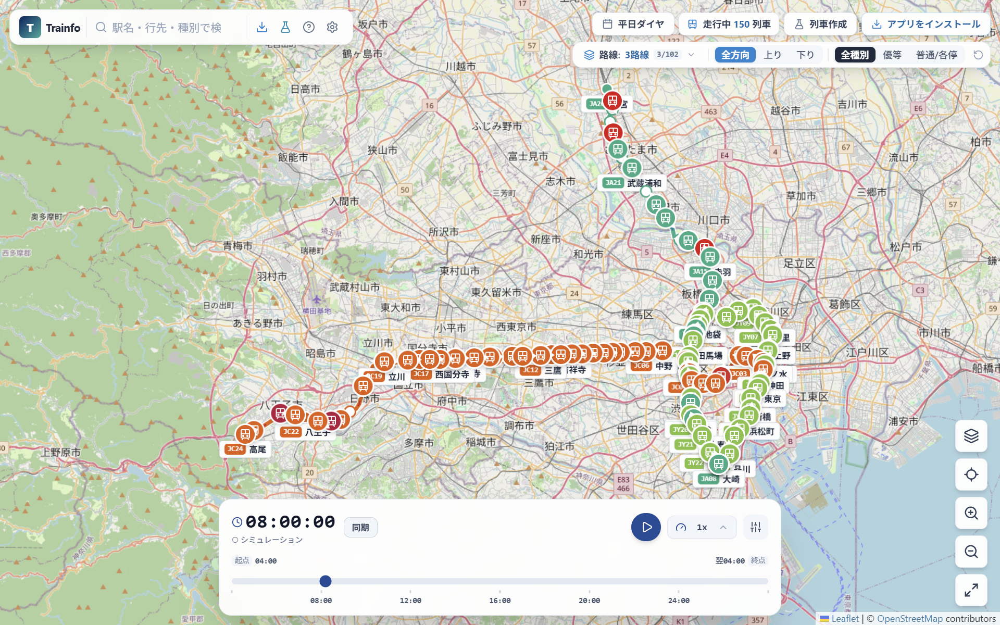

# Trainfo - 首都圏・北関東・甲信越・東北・東海 リアルタイム列車位置＆広域マルチ路線運行マップ

<div align="center">


### **Trainfo (トレインフォ)**
**首都圏・北関東・甲信越・東北・東海を網羅する13事業者・全48路線の公式時刻表に基づき、全列車の現在走行位置・種別・行先・遅延状況・相互直通運転をリアルタイムに描画するWebアプリケーション**

[](https://github.com/GenbuHase/Trainfo/actions/workflows/deploy.yml)
[](https://opensource.org/licenses/MIT)
[](https://react.dev/)
[](https://www.typescriptlang.org/)
[](https://vite.dev/)
[](https://tailwindcss.com/)
[](https://web.dev/explore/progressive-web-apps)

🌐 **[オンラインデモを体験する (GitHub Pages)](https://GenbuHase.github.io/Trainfo/)**

</div>

---

## 📸 スクリーンショット



---

## 🌟 主な機能

### 1. 🚆 13事業者・全48路線 リアルタイム列車位置シミュレーション
- **高精度な実線路追従 & 首都圏・北関東・甲信越・東北・東海広域ネットワークの再現**:
  - **東京メトロ**
    - **千代田線**（代々木上原〜北綾瀬：全20駅）
    - **有楽町線**（和光市〜新木場：全24駅）
    - **副都心線**（和光市〜渋谷：全16駅）
  - **東武鉄道**
    - **東武東上線**（池袋〜寄居：全39駅）
    - **東武越生線**（坂戸〜越生：全8駅）
  - **西武鉄道**
    - **西武池袋線**（池袋〜西武秩父：全36駅）
    - **西武有楽町線**（小竹向原〜練馬：全3駅）
  - **東急電鉄**
    - **東急東横線**（渋谷〜横浜：全21駅）
    - **東急新横浜線**（日吉〜新横浜：全3駅）
  - **横浜高速鉄道**
    - **みなとみらい線**（横浜〜元町・中華街：全6駅）
  - **相模鉄道（相鉄）**
    - **相鉄本線**（横浜〜海老名：全18駅）
    - **相鉄いずみ野線**（二俣川〜湘南台：全8駅）
    - **相鉄新横浜線**（新横浜〜西谷：全3駅）
  - **小田急電鉄**
    - **小田急小田原線**（新宿〜小田原：全47駅）
    - **小田急江ノ島線**（相模大野〜片瀬江ノ島：全17駅）
    - **小田急多摩線**（新百合ヶ丘〜唐木田：全8駅）
  - **秩父鉄道**
    - **秩父鉄道秩父本線**（羽生〜三峰口：全37駅）
  - **JR東日本**
    - **JR東北新幹線**（東京〜新青森：全23駅、最高速度320km/h、全線立体交差構造）
    - **JR上越新幹線**（東京〜新潟：全12駅、最高速度275km/h、山岳トンネル・豪雪地帯高速運転）
    - **JR東海道線**（東京〜熱海：全21駅、首都圏南西方面の大動脈幹線）
    - **JR伊東線**（熱海〜伊東：全6駅、特急踊り子・普通列車直通）
    - **JR横須賀線**（東京〜久里浜：全19駅、品鶴線経由・総武快速線直通）
    - **JR総武快速線**（東京〜千葉：全10駅、東京地下トンネル・複々線高速運転）
    - **JR宇都宮線（東北本線）**（上野〜黒磯：全33駅、上野東京ライン・湘南新宿ライン直通）
    - **JR高崎線**（上野〜高崎：全24駅、上野東京ライン・湘南新宿ライン・両毛線・上越線直通）
    - **JR湘南新宿ライン**（大宮〜大船：全12駅、山手貨物線・品鶴線経由広域縦断系統）
    - **JR上野東京ライン**（東京〜上野：全2駅、東北縦貫短絡ルート・直通幹線）
    - **JR両毛線**（小山〜新前橋：全18駅、高崎線直通・前橋発着便完全網羅）
    - **JR上越線**（高崎〜宮内：全35駅、新清水トンネル・谷川連峰越え山岳実線形横断）
    - **JR常磐線（各駅停車）**（綾瀬〜取手：全14駅、千代田線直通）
    - **JR常磐線（快速）**（品川〜取手：全13駅、上野東京ライン直通）
    - **JR常磐線（取手〜いわき）**（取手〜いわき：全35駅）
    - **JR常磐線（いわき〜仙台）**（いわき〜仙台：全35駅）
    - **JR埼京線**（大崎〜大宮：全19駅）
    - **JR川越線**（大宮〜高麗川：全11駅、川越〜高麗川の単線区間を含む全線）
    - **JR八高線**（八王子〜高崎：全24駅）
    - **JR武蔵野線**（府中本町〜西船橋：全26駅、直通区間含む全45駅）
      - 京葉線直通: 西船橋 ↔ 東京方面、西船橋 ↔ 海浜幕張方面
      - 中央線直通（むさしの号）: 八王子 ↔ 立川 ↔ 国立 ↔ 新小平 ↔ 大宮
      - 大宮支線直通（しもうさ号）: 大宮 ↔ 武蔵浦和 ↔ 南浦和 ↔ 西船橋 ↔ 新習志野・海浜幕張
    - **相鉄・JR直通線**（羽沢横浜国大〜新宿：全7駅）
    - **JR中央線**（東京〜高尾：全24駅）
    - **JR中央本線**（高尾〜塩尻：全38駅）
    - **JR青梅線**（立川〜奥多摩：全25駅）
    - **JR五日市線**（拝島〜武蔵五日市：全7駅）
    - **JR篠ノ井線**（塩尻〜長野：全19駅、信越本線直通区間含む）
    - **JR大糸線（東日本区間）**（松本〜南小谷：全33駅）
  - **JR東海**
    - **JR東海道線（熱海～沼津）**（熱海〜沼津：全4駅、JR東日本東海道線直通区間）
  - **JR西日本**
    - **JR大糸線（西日本区間）**（南小谷〜糸魚川：全9駅、非電化ローカル線区）
  - **東京臨海高速鉄道**
    - **りんかい線**（新木場〜大崎：全8駅）
  - **首都圏新都市鉄道**
    - **つくばエクスプレス（TX）**（秋葉原〜つくば：全20駅、最高速度130km/h、全線立体交差構造）

### 2. 🔄 複数社を跨ぐシームレスな相互直通運転 & 自動追尾ハンドオーバー
- **最大5社・5路線を跨ぐ完全貫通直通ネットワーク（進行方向前方指向連鎖 / Forward-Pointing Chain）**:
  - **上野東京ライン ↔ 東海道線 ↔ 宇都宮線・高崎線・常磐線快速（首都圏南北貫通幹線）**:
    - 沼津・熱海・小田原 ↔ 東京 ↔ 上野 ↔ 大宮 ↔ 宇都宮・黒磯 / 高崎・前橋（両毛線直通）/ 取手・水戸・いわき。東京〜上野間の連絡線を介して都心を貫通する大動脈ネットワークをリアルタイム追尾。
  - **湘南新宿ライン ↔ 東海道線・横須賀線 ↔ 高崎線・宇都宮線（広域縦断ネットワーク）**:
    - 小田原・逗子 ↔ 大船 ↔ 横浜 ↔ 新宿 ↔ 池袋 ↔ 大宮 ↔ 高崎・前橋 / 宇都宮。山手貨物線・品鶴線経由の南北直通系統を完全追尾。
  - **横須賀線 ↔ 総武快速線（東京地下トンネル直通）**:
    - 久里浜・横須賀・逗子・大船・横浜 ↔ 東京 ↔ 錦糸町・市川・船橋・津田沼・千葉・成田空港・君津・上総一ノ宮。東京駅地下ホームを介した直通運転。
  - **東海道線 ↔ 伊東線 ↔ 東海道線（静岡地区: 熱海〜沼津）**:
    - 東京方面 ↔ 熱海 ↔ 伊東（特急踊り子・普通）、東京方面 ↔ 熱海 ↔ 三島・沼津（JR東日本・JR東海の越境直通）。
  - **高崎線 ↔ 両毛線 ↔ 上越線**:
    - 高崎駅・新前橋駅を介した前橋方面（両毛線直通）および渋川・水上・宮内方面（上越線）への相互直通・広域接続。
  - **相鉄 ↔ 東急 ↔ 地下鉄 ↔ 東武 / 西武 広域直通（海老名〜小川町・飯能）**:
    - 相鉄本線・いずみ野線（海老名・湘南台）↔ 相鉄新横浜線 ↔ 東急新横浜線 ↔ 東急東横線 ↔ 東京メトロ副都心線 ↔ 東武東上線（森林公園・小川町）/ 西武池袋線（飯能・小手指）。
    - 5社局を直通する長大ルートにおいて、各社の境界駅（西谷、新横浜、日吉、渋谷、和光市/小竹向原）を跨いでも列車が消失することなくシームレスに追尾。
  - **東急東横線 ↔ みなとみらい線 ↔ 東京メトロ副都心線 ↔ 東武東上線 / 西武池袋線（5社相互直通）**:
    - 元町・中華街〜横浜〜渋谷〜池袋〜森林公園・飯能を結ぶFライナーやS-TRAINの完全貫通追尾。
  - **相鉄・JR直通線 ↔ 相鉄新横浜線・本線 ↔ JR埼京線・川越線**:
    - 海老名〜西谷〜羽沢横浜国大〜武蔵小杉〜大崎〜新宿〜大宮〜川越。境界駅を跨いでも本来の最終目的地を透過的に案内。
  - **小田急小田原線 ↔ 江ノ島線 ↔ 多摩線**:
    - 相模大野駅・新百合ヶ丘駅を介した快速急行・急行・各駅停車等の相互直通運転。
  - **川越線 ↔ 埼京線 ↔ りんかい線**:
    - 川越〜大宮〜新宿〜大崎〜新木場を透過的に維持・案内。
  - **西武池袋線 ↔ 西武有楽町線 ↔ 東京メトロ有楽町線・副都心線**:
    - S-TRAIN（豊洲・元町中華街 ↔ 所沢・西武秩父）を含む全区間を追尾。
  - **東京メトロ千代田線 ↔ JR常磐線（各駅停車）**:
    - 代々木上原〜大手町〜北千住〜綾瀬〜松戸〜柏〜我孫子〜取手の相互直通運転。
  - **西武池袋線・西武秩父線 ↔ 秩父鉄道秩父本線**:
    - 御花畑駅・西武秩父駅の短絡連絡線を介した三峰口・長瀞方面直通運転。
  - **中央線 ↔ 青梅線 ↔ 五日市線**:
    - 立川駅・拝島駅を介した青梅特快・快速・各駅停車の相互直通運転。
  - **八高線 ↔ 川越線**:
    - 高麗川駅での相互直通運転（八王子〜高麗川〜川越）。
  - **中央線 ↔ 中央本線**:
    - 高尾駅を跨ぐ特急（あずさ・かいじ・富士回遊等）および普通列車の相互直通。
- **全区間始発駅（customOrigin）＆終着駅（End-to-End）の動的解決**:
  - 直通先路線に移っても本来の始発駅情報（例: 「海老名発 小川町行き」）を失わず、正確なトリップ全体像を透過表示。
- **自動ハンドオーバー & 路線自動追加**:
  - 追尾中の列車が路線境界を越えて別路線のトリップに移行した際、自動的にカメラ追従を継承。
  - 遷移先路線が非選択状態であっても自動的に選択路線リストに追加し、見失うことなく追尾を継続。

### 3. 🚉 広域ターミナル・同名駅クロスオーバーリンク
- 乗換駅や接続駅で、同一駅名を持つ別路線の駅詳細・発車標・時刻表へワンタップで遷移可能：
  - **東京駅**: JR東海道線（`JT-01`）↔ JR上野東京ライン（`JU-01`）↔ JR横須賀線・総武快速線（`JO-19`）↔ JR中央線（`JC-01`）↔ JR常磐線快速直通 ↔ JR東北新幹線 ↔ JR上越新幹線
  - **上野駅**: JR宇都宮線（`JU-02`）↔ JR高崎線（`JU-02`）↔ JR上野東京ライン（`JU-02`）↔ JR常磐線快速（`JJ-01`）↔ JR東北新幹線 ↔ JR上越新幹線
  - **品川駅**: JR東海道線（`JT-03`）↔ JR横須賀線（`JO-17`）↔ JR常磐線快速直通
  - **新橋駅**: JR東海道線（`JT-02`）↔ JR横須賀線（`JO-18`）
  - **横浜駅**: JR東海道線（`JT-05`）↔ JR横須賀線（`JO-13`）↔ JR湘南新宿ライン（`JS-08`）↔ 東急東横線（`TY-21`）↔ みなとみらい線（`MM-01`）↔ 相鉄本線（`SO-01`）
  - **大船駅**: JR東海道線（`JT-07`）↔ JR横須賀線（`JO-09`）↔ JR湘南新宿ライン（`JS-01`）
  - **武蔵小杉駅**: JR横須賀線（`JO-15`）↔ JR湘南新宿ライン（`JS-15`）↔ 相鉄・JR直通線（`JS-15`）↔ 東急東横線（`TY-11`）
  - **小田原駅**: JR東海道線（`JT-16`）↔ 小田急小田原線（`OH-47`）
  - **熱海駅**: JR東海道線（`JT-21`）↔ JR伊東線（`JT-21`）↔ JR東海 東海道線（`CA-00`）
  - **赤羽駅**: JR宇都宮線（`JU-04`）↔ JR高崎線（`JU-04`）↔ JR湘南新宿ライン（`JS-22`）↔ JR埼京線（`JA-15`）
  - **大宮駅**: JR宇都宮線（`JU-07`）↔ JR高崎線（`JU-07`）↔ JR湘南新宿ライン（`JS-24`）↔ JR埼京線・川越線（`JA-26`）↔ JR武蔵野線直通（むさしの号・しもうさ号）↔ JR東北新幹線 ↔ JR上越新幹線
  - **高崎駅**: JR高崎線 ↔ JR上越線 ↔ JR八高線 ↔ JR上越新幹線
  - **新前橋駅**: JR上越線 ↔ JR両毛線
  - **小山駅**: JR宇都宮線 ↔ JR両毛線 ↔ JR東北新幹線
  - **千葉駅**: JR総武快速線（`JO-28`）
  - **宮内駅**: JR上越線
  - **仙台駅**: JR東北新幹線 ↔ JR常磐線
  - **北千住駅**: 東京メトロ千代田線（`C-18`）↔ JR常磐線快速（`JJ-05`）↔ つくばエクスプレス（`TX-05`）
  - **綾瀬駅**: 東京メトロ千代田線（`C-19`）↔ JR常磐線各駅停車（`JL-19`）
  - **渋谷駅**: JR湘南新宿ライン（`JS-19`）↔ JR埼京線（`JA-10`）↔ 相鉄・JR直通線（`JS-19`）↔ 東京メトロ副都心線（`F-16`）↔ 東急東横線（`TY-01`）
  - **新宿駅**: JR中央線（`JC-05`）↔ JR埼京線（`JA-11`）↔ JR湘南新宿ライン（`JS-20`）↔ 相鉄・JR直通線（`JS-20`）↔ 小田急小田原線（`OH-01`）
  - **池袋駅**: 東武東上線（`TJ-01`）↔ JR埼京線（`JA-12`）↔ JR湘南新宿ライン（`JS-21`）↔ 東京メトロ有楽町線（`Y-09`）↔ 東京メトロ副都心線（`F-09`）↔ 西武池袋線（`SI-01`）
  - **新横浜駅**: 東急新横浜線（`SH-01`）↔ 相鉄新横浜線（`SO-52`）
  - **日吉駅**: 東急東横線（`TY-13`）↔ 東急新横浜線（`SH-03`）
  - **西谷駅**: 相鉄本線（`SO-08`）↔ 相鉄新横浜線（`SO-08`）
  - **二俣川駅**: 相鉄本線（`SO-10`）↔ 相鉄いずみ野線（`SO-10`）
  - **羽沢横浜国大駅**: 相鉄新横浜線（`SO-51`）↔ 相鉄・JR直通線（`SO-51`）
  - **和光市駅**: 東武東上線（`TJ-11`）↔ 東京メトロ有楽町線（`Y-01`）↔ 東京メトロ副都心線（`F-01`）
  - **相模大野駅**: 小田急小田原線（`OH-28`）↔ 小田急江ノ島線（`OE-01` / `OH-28`）
  - **新百合ヶ丘駅**: 小田急小田原線（`OH-23`）↔ 小田急多摩線（`OT-01` / `OH-23`）
  - **立川駅**: JR中央線（`JC-19`）↔ JR青梅線（`JC-19`）↔ JR中央本線
  - **拝島駅**: JR青梅線（`JC-55`）↔ JR五日市線（`JC-55`）↔ JR八高線
  - **坂戸駅**: 東武東上線（`TJ-26`）↔ 東武越生線（`TJ-26`）
  - **越生駅**: 東武越生線（`TJ-47`）↔ JR八高線
  - **高麗川駅**: JR川越線 ↔ JR八高線
  - **西武秩父駅 / 御花畑駅**: 西武池袋線（`SI-36`）↔ 秩父鉄道秩父本線（`CR-31` 御花畑駅）
  - **小川町駅 / 寄居駅**: 東武東上線（`TJ-33` / `TJ-39`）↔ JR八高線 ↔ 秩父鉄道秩父本線（`CR-20` 寄居駅）
  - **熊谷駅**: 秩父鉄道秩父本線（`CR-09`）↔ JR高崎線 ↔ JR上越新幹線
  - **羽生駅**: 秩父鉄道秩父本線（`CR-01`）
  - **新木場駅**: 東京メトロ有楽町線（`Y-24`）↔ りんかい線（`R-01`）
  - **八王子駅**: JR中央線（`JC-22`）↔ JR八高線 ↔ 武蔵野線むさしの号
  - **南流山駅**: JR武蔵野線（`JM-16`）↔ つくばエクスプレス（`TX-10`）
  - **武蔵浦和駅**: JR埼京線（`JA-21`）↔ JR武蔵野線（`JM-26`）
  - **南小谷駅**: JR東日本 大糸線 ↔ JR西日本 大糸線
  - **塩尻駅**: JR中央本線 ↔ JR篠ノ井線

### 4. ⚡ オンデマンド動的時刻表ローディング & 高性能アーキテクチャ
- **オンデマンド動的時刻表ローディング (Dynamic Timetable Loading)**:
  - 初期バンドルサイズを従来の **66MBから1.4MBへ97.8%削減**。
  - 選択中の路線および直通先路線の時刻表JSONのみを動的にストリーミング取得し、初期ロード時間の極小化と省メモリ化を実現。
- **モジュラーカスタムフック & Context レイヤー分離**:
  - `TrainMap` の肥大化を解消し、6つの単一責務カスタムフック（`useLeafletMap`, `useTrackPolylines`, `useStationMarkers`, `useTrainMarkers`, `useMapCamera`, `useGeolocation`）に分離。
  - 状態管理を `SimulationContext`, `SelectionContext`, `FilterContext`, `UIContext` に階層化し、コンポーネント再レンダリングを局所化。
- **モバイルパフォーマンス最適化（白化・フリーズ解消 & 60fps安定化）**:
  - **GPUレイヤー合成負荷の極小化**: マーカーの重い `filter: drop-shadow` を廃止し軽量な CSS `shadow-md` に置き換え。選択時のみ `train-pulse`（`animate-ping`）を DOM 生成することで、非選択列車約390台による常時 GPU アニメーション負荷を全廃し、モバイル（iOS Safari / WebKit等）での VRAM 枯渇による白画面クラッシュ（White Screen of Death）を完全解消。
  - **タイル白抜け＆リサイズ暴走防止**: Leaflet の `fadeAnimation: false` を設定しズーム・パン中のタイル透明化を遮断。`ResizeObserver` に 150ms デバウンスを導入し、アニメーション中の連続リサイズによるフリーズを防止。
  - **駅マーカー（778駅）のキャッシュ＆差分更新**: 駅選択時の `clearLayers()`（全破棄・全再生成）を廃止し、選択駅要素の CSS クラス差分のみを即座に更新。
  - **再レンダリングのスロットリング**: `SimulationContext` において秒数が変化していない描画フレームの更新を完全スキップし、毎秒数十回の無駄な全ツリー再計算を抑制。
  - **CSS Containment**: マーカー要素に `contain: layout style; will-change: transform;` を指定し、リフロー影響範囲を局所化。

### 5. 🎛️ 事業者別セレクター & マップ直結フィルタードック（DisplayFilterDock）
- **事業者ごとの階層化マルチ路線選択**:
  - 全48路線を運行事業者（東京メトロ、東武鉄道、西武鉄道、東急電鉄、横浜高速鉄道、相模鉄道、小田急電鉄、JR東日本、JR東海、JR西日本、東京臨海高速鉄道、首都圏新都市鉄道、秩父鉄道）の13社ごとにグループ化。
  - 「全選択」「全解除」や事業者ごとの一括オン/オフ、個別路線の自在な組み合わせ表示に対応。
  - 選択状態に合わせて地図カメラが全駅をピッタリ包含する最適範囲へスムーズに自動フィット。
- **直感的なマップ直結フィルター（ドックUI）**:
  - **進行方向絞り込み**: 「すべての方向」「上り方面のみ」「下り方面のみ」
  - **列車種別絞り込み**: 「すべての種別」「優等・快速のみ（特急・急行・快速等）」「各駅停車・普通のみ」

### 6. 🎯 列車追従バー（TrackingBar）& 2段組着発時刻表示
- **リアルタイム列車追従バー**:
  - 列車を選択すると画面下部にステータスバーが表示され、種別・公式列車番号（`2425T`、`1001レ`等）・行先・編成両数・現在速度（km/h）・遅延状況を表示。
  - カメラ追尾のON/OFFをワンタップで切り替え可能。
- **2段組着発時刻表示**:
  - 全停車駅の「〇〇:〇〇着」「〇〇:〇〇発」をリアルタイム表示。
  - 駅での停車時間、通過待ち、緩急接続（待避停車）を正確に可視化。
- **電光掲示板スタイルの駅発車標**:
  - 先発・次発・次々発の発車標表示および全列車時刻表モーダル閲覧機能。

### 7. ⏱️ タイムトラベル＆超高速倍速コントローラー
- **鉄道運行日基準（04:00〜翌04:00）の完全24時間タイムスライダー**: 早朝初電から深夜終電、および日跨ぎ運行列車（夜行特急アルプス等）まで、シームレスに巻き戻し・早送り・追尾可能。
- **最大3600倍速再生**: `1x`, `2x`, `5x`, `10x`, `30x`, `60x`, `120x`, `300x`, `600x`, `1200x`, `1800x`, `3600x` の12段階で1日のダイヤ推移を通覧（最大1秒で1時間進行）。
- **ダイヤ種別切替**: 「平日ダイヤ」と「土休日ダイヤ」をワンクリックで切り替え。
- **時間帯プリセット**:
  - 🌅 朝ラッシュ（08:00）: 最も過密な運行パターン
  - ☀️ 昼デイタイム（13:00）: 平常運転ダイヤ
  - 🌆 夕ラッシュ（18:30）: 帰宅時間帯の混雑ダイヤ
  - 🌙 深夜終電帯（24:15）: 各方面への最終連絡便
- **現在時刻同期**: ワンクリックで実時間に同期。

### 8. ⚠️ ダイヤ遅延シミュレーション
- **運行障害シナリオ**:
  - 定刻（平常運転）
  - 全線+5分遅延
  - 全線+15分大幅遅れ
  - ランダム局所遅延（列車や駅ごとに異なる現実的な遅れをシミュレート）
- 運行情報バッジ（平常運転 / 遅延情報）が連動して切り替わります。

### 9. 📲 PWA（Progressive Web App）アプリインストール対応
- **デスクトップ＆スマホへのネイティブインストール**:
  - Chrome、Edge、Android、iOS（Safari「ホーム画面に追加」）でブラウザ枠なしの全画面ネイティブアプリ体験。
- **Service Worker による高速起動＆オフラインキャッシュ**:
  - アプリケーションシェルおよび地図タイルをインテリジェントにローカルキャッシュ。電波の届きにくい地下やトンネル内でも快適に動作。
- **専用インストールモーダル**:
  - 各OSに応じた丁寧なインストールガイドを提供。

### 10. 🎨 公式準拠の運行系統カラーリング & 駅ナンバリングバッジ
- **公式ラインカラー & 列車種別**:
  - 各社のCI・運行基準に準拠したカラーリング（東海道線オレンジ、伊東線ブルー、横須賀・総武快速スカイブルー、宇都宮線オレンジ、高崎線オレンジ、湘南新宿ラインオレンジ、上野東京ラインパープル、両毛線マゼンタ、上越線アクアブルー、東北新幹線常盤グリーン、上越新幹線ピンク、東横線レッド、相鉄ネイビーブルー、みなとみらいネイビー、東急新横浜パープル、小田急ブルー、東武ブルー、埼京エメラルド、武蔵野オレンジ、TXディープブルー、中央線オレンジバーミリオン、青梅・五日市線オレンジ、中央東線ブルー、常磐線エメラルドグリーン、千代田線グリーン、篠ノ井オレンジ、有楽町ゴールド、副都心ブラウン、西武オレンジ、秩父鉄道ブルー等）を精緻に再現。
- **マルチライン駅ナンバリングバッジ**:
  - `JT` (JR東海道線・JR伊東線)
  - `CA` (JR東海 東海道線)
  - `JO` (JR横須賀線・JR総武快速線)
  - `JU` (JR宇都宮線)
  - `TK` (JR高崎線)
  - `JS` (JR湘南新宿ライン・相鉄JR直通線)
  - `UT` (JR上野東京ライン)
  - `RY` (JR両毛線)
  - `JOE` (JR上越線)
  - `TS` (JR東北新幹線)
  - `JOS` (JR上越新幹線)
  - `TY` (東急東横線)
  - `SH` (東急新横浜線)
  - `MM` (横浜高速鉄道みなとみらい線)
  - `SO` (相鉄本線・相鉄いずみ野線・相鉄新横浜線)
  - `OH` (小田急小田原線)
  - `OE` (小田急江ノ島線)
  - `OT` (小田急多摩線)
  - `TJ` (東武東上線・東武越生線)
  - `JA` (JR埼京線・川越線)
  - `JM` (JR武蔵野線)
  - `JE` (JR京葉線)
  - `JC` (JR中央線・青梅線・五日市線)
  - `CO` (JR中央本線)
  - `HA` (JR八高線)
  - `SN` (JR篠ノ井線)
  - `OIE` (JR東日本 大糸線)
  - `OW` (JR西日本 大糸線)
  - `JK` (JR京浜東北線)
  - `C` (東京メトロ千代田線)
  - `JL` (JR常磐線各駅停車)
  - `JJ` (JR常磐線快速)
  - `JN` (JR常磐線 取手〜いわき)
  - `JSD` (JR常磐線 いわき〜仙台)
  - `CR` (秩父鉄道秩父本線)
  - `R` (東京臨海高速鉄道りんかい線)
  - `Y` (東京メトロ有楽町線)
  - `F` (東京メトロ副都心線)
  - `SI` (西武池袋線・西武有楽町線・西武秩父線)
  - `TX` (つくばエクスプレス)

---

## 🛠️ 技術スタック

| 分類 | 技術 / ライブラリ |
| :--- | :--- |
| **フロントエンド** | [React 19](https://react.dev/), [TypeScript 5.x / 6.x](https://www.typescriptlang.org/) |
| **PWA / オフライン** | [Progressive Web Apps](https://web.dev/explore/progressive-web-apps), Web App Manifest, Service Worker |
| **ビルドツール / Linter** | [Vite 8](https://vite.dev/) (with [Rolldown](https://rolldown.rs/) / [Oxc](https://oxc.rs/)), [Oxlint](https://oxc.rs/) |
| **スタイリング** | [Tailwind CSS v4](https://tailwindcss.com/), [Lucide React](https://lucide.dev/) |
| **地図描画** | [Leaflet](https://leafletjs.com/), [OpenStreetMap](https://www.openstreetmap.org/) |
| **データ基盤** | Yahoo! 乗換案内スクレイピング基盤, 駅探公式列車番号突合基盤, 汎用直通リンカー基盤, OpenStreetMap Overpass API |
| **デプロイ・CI/CD** | [GitHub Actions](https://github.com/features/actions), [GitHub Pages](https://pages.github.com/) |

---

## 📂 ディレクトリ構成

```text
Trainfo/
├── docs/                               # ドキュメント・アセット
│   ├── ROUTE_EXPANSION_PLAYBOOK.md     # 路線追加完全手順書・設計標準マニュアル
│   ├── ODPT_INTEGRATION_KNOWLEDGE.md   # ODPT活用ナレッジ＆将来設計ガイド
│   ├── logo.svg
│   └── screenshot.png
├── public/                             # 静的公開ファイル
│   ├── icons/                          # PWAアプリアイコン群 (192, 512, maskable, apple-touch)
│   ├── manifest.webmanifest            # W3C Web App Manifest
│   ├── sw.js                           # PWA Service Worker (キャッシュ & オフライン対応)
│   └── logo.svg
├── scripts/                            # データ生成・直通リンク・テストスクリプト群
│   ├── runYahooImporter.cjs            # Yahoo! 乗換案内 共通インポーター CLI
│   ├── runThroughLinker.cjs            # 汎用直通リンカー CLI（全接続ペア自動結合）
│   ├── enrich_train_numbers.cjs        # 駅探ハイブリッド突合・公式列車番号エンリッチメント
│   ├── generateIcons.cjs               # PWAアイコン自動生成スクリプト
│   ├── common/
│   │   ├── yahoo/                      # 共通時刻表スクレイピング基盤
│   │   │   ├── YahooClient.cjs         # HTTPクライアント & キャッシュ制御
│   │   │   ├── YahooStationTimetableScraper.cjs # 駅時刻表スクレイパー
│   │   │   ├── YahooTrainDetailScraper.cjs     # 列車詳細（着発時刻）スクレイパー
│   │   │   └── YahooTimetableBuilder.cjs       # ダイヤ合成 & 汎用通過・秒補間
│   │   └── throughLinker/              # 汎用直通リンカー基盤
│   │       ├── connectionsConfig.cjs   # 全路線の直通ペア宣言的設定
│   │       └── throughLinkerEngine.cjs # 直通トリップ探索・時刻補正エンジン
│   └── lines/                          # 全48路線のスクレイパー設定（config.cjs）
├── src/
│   ├── components/
│   │   ├── Common/                     # 駅ナンバリング・種別バッジ（Badges.tsx）
│   │   ├── Controls/                   # タイムスライダー・各種操作パネル（TimeController.tsx）
│   │   ├── Header/                     # ヘッダー・路線選択ドロワー（Header.tsx）
│   │   ├── Map/                        # Leaflet 地図描画・DisplayFilterDock・TrackingBar
│   │   │   └── hooks/                  # Leaflet地図・マーカー・カメラ・GPS制御カスタムフック群
│   │   ├── Modals/                     # 時刻表・設定・ヘルプ・PWAインストールモーダル
│   │   └── Sidebar/                    # 駅詳細（StationDetail）・列車詳細（TrainDetail）
│   ├── contexts/                       # グローバル状態管理レイヤー（Context API）
│   │   ├── AppProviders.tsx            # Context統合プロバイダー
│   │   ├── SimulationContext.tsx       # シミュレーション時刻・再生制御
│   │   ├── SelectionContext.tsx        # 選択路線・駅・列車管理
│   │   ├── FilterContext.tsx           # 表示フィルター（種別・方向等）
│   │   └── UIContext.tsx               # モーダル・サイドバー・UI状態
│   ├── data/
│   │   ├── lines/                      # 全48路線のデータモジュール（stations, track, timetables）
│   │   ├── linesRegistry.ts            # プラグイン型 路線統合レジストリ（13事業者グループ化）
│   │   ├── timetableLoader.ts          # オンデマンド動的時刻表ローダー（66MB→1.4MB軽量化）
│   │   ├── stations.ts                 # 統合駅データユーティリティ
│   │   ├── trackGeometry.ts            # 統合軌道・補間計算エンジン
│   │   └── timetableData.ts            # 統合時刻表ユーティリティ
│   ├── hooks/
│   │   └── useTrainTracker.ts          # 直通列車自動追従・耐障害ハンドオーバーフック
│   ├── services/
│   │   ├── pwaService.ts               # PWA Service Worker & インストール管理
│   │   └── trainSimulation.ts          # リアルタイム列車走行シミュレーションエンジン
│   ├── types/                          # TypeScript 型定義 (LineDefinition, TrainTypeKey等)
│   ├── App.tsx                         # メインアプリケーションコンポーネント
│   └── main.tsx                        # エントリーポイント
├── package.json
└── vite.config.ts
```

---

## 📖 開発・設計ドキュメント

- 👉 [**Trainfo 路線追加完全プレイブック（docs/ROUTE_EXPANSION_PLAYBOOK.md）**](docs/ROUTE_EXPANSION_PLAYBOOK.md): 新路線追加の手順、OSM線路抽出、Yahoo! データ設定、直通ハンドオーバー設計、ハマりどころ防止策
- 👉 [**上下非対称路線・方向別軌道ルーティング設計指針（docs/ASYMMETRIC_TRACK_ROUTING_GUIDELINES.md）**](docs/ASYMMETRIC_TRACK_ROUTING_GUIDELINES.md): 上越線（新清水トンネル vs 湯檜曽ループ線）、東海道新垂井線など上下線非対称区間の軌道設計仕様書: 新路線追加の手順、OSM線路抽出、Yahoo! データ設定、直通ハンドオーバー設計、ハマりどころ防止策
- 👉 [**ラインカラー＆アクセントカラー選定ガイドライン（docs/LINE_COLORS_GUIDELINES.md）**](docs/LINE_COLORS_GUIDELINES.md): 全48路線のラインカラー・アクセントカラー選定基準、出典、種別カラー対応仕様書
- 👉 [**ODPT活用ナレッジ＆将来設計ガイド（docs/ODPT_INTEGRATION_KNOWLEDGE.md）**](docs/ODPT_INTEGRATION_KNOWLEDGE.md): 公共交通オープンデータの活用可能性と推奨アーキテクチャ
- 🛠️ **路線・種別デバッグ画面**: ブラウザで `/#debug`（または設定モーダル内のメニュー）を開くと、全48路線および列車種別のカラー設定・定義一覧を確認できます。

---

## 🚀 ローカルでの動かし方

### 前提条件
- [Node.js](https://nodejs.org/) (v20.x 以上推奨)
- npm (v10.x 以上)

### 1. リポジトリのクローン
```bash
git clone https://github.com/GenbuHase/Trainfo.git
cd Trainfo
```

### 2. 依存パッケージのインストール
```bash
npm install
```

### 3. 開発サーバーの起動
```bash
npm run dev
```
ブラウザで `http://localhost:5173/` を開くとアプリケーションが起動します。

> [!NOTE]
> **ダークマップについて**: デフォルトではAPIキー不要なOSMダークモードが自動適用されます。CARTO公式のDark Matterタイルを利用したい場合は、`.env` 等で `VITE_CARTO_API_KEY=your_key` を設定してください（[CARTO Basemaps](https://carto.com/basemaps/apikey/) で無料取得可能）。

### 4. ダイヤ・時刻表データの再取得・ビルド（任意）
```bash
# 例: 東急東横線のダイヤをYahoo!から再生成
node scripts/runYahooImporter.cjs --line tokyu_toyoko

# 公式列車番号（trainNumber）のエンリッチメント（例: 東横線）
node scripts/enrich_train_numbers.cjs tokyu_toyoko

# 汎用直通リンカーの実行（全48路線の直通ペアを自動照合・結合）
node scripts/runThroughLinker.cjs
```

### 5. プロダクションビルド＆プレビュー
```bash
npm run build
npm run preview
```

---

## 🚢 デプロイ (GitHub Pages)

### GitHub Actions による自動デプロイ（推奨）
1. 本リポジトリの **Settings** > **Pages** を開きます。
2. **Build and deployment** の **Source** を **「GitHub Actions」** に設定します。
3. `master` または `main` ブランチにコミットをプッシュすると、自動的にビルド＆デプロイが実行されます。

---

## ⚠️ 免責事項・データ出典

- **免責事項**:  
  本アプリケーションは個人が学習・研究目的で制作した非公式のファンメイドシミュレータです。**東京地下鉄株式会社（東京メトロ）、東武鉄道株式会社、西武鉄道株式会社、東急電鉄株式会社、横浜高速鉄道株式会社、相模鉄道株式会社、小田急電鉄株式会社、東日本旅客鉄道株式会社（JR東日本）、東海旅客鉄道株式会社（JR東海）、西日本旅客鉄道株式会社（JR西日本）、東京臨海高速鉄道株式会社、首都圏新都市鉄道株式会社、秩父鉄道株式会社、LINEヤフー株式会社および関係各社とは一切関係ありません**。  
  本アプリに表示される列車の運行状況・時刻・位置情報はシミュレーション値であり、実際の運行管理システムや運行ダイヤとは差異が生じる場合があります。
- **データ出典**:  
  - 時刻表・運行情報: Yahoo! 乗換案内（路線情報）
  - 地図データ: © [OpenStreetMap](https://www.openstreetmap.org/copyright) contributors
  - ラインカラー情報: ニコニコ大百科「[鉄道路線のラインカラー一覧](https://dic.nicovideo.jp/a/%E9%89%84%E9%81%93%E8%B7%AF%E7%B7%9A%E3%81%AE%E3%83%A9%E3%82%A4%E3%83%B3%E3%82%AB%E3%83%A9%E3%83%BC%E4%B8%80%E8%A6%A7)」（各社公式Webサイト・駅ナンバリングサインシステム準拠）

---

## 📄 ライセンス

本プロジェクトは [MIT License](LICENSE) のもとで公開されています。
