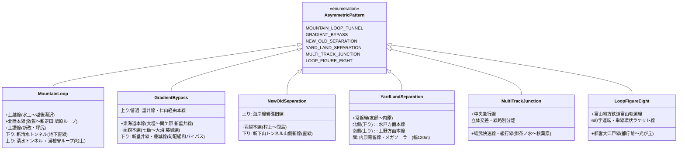
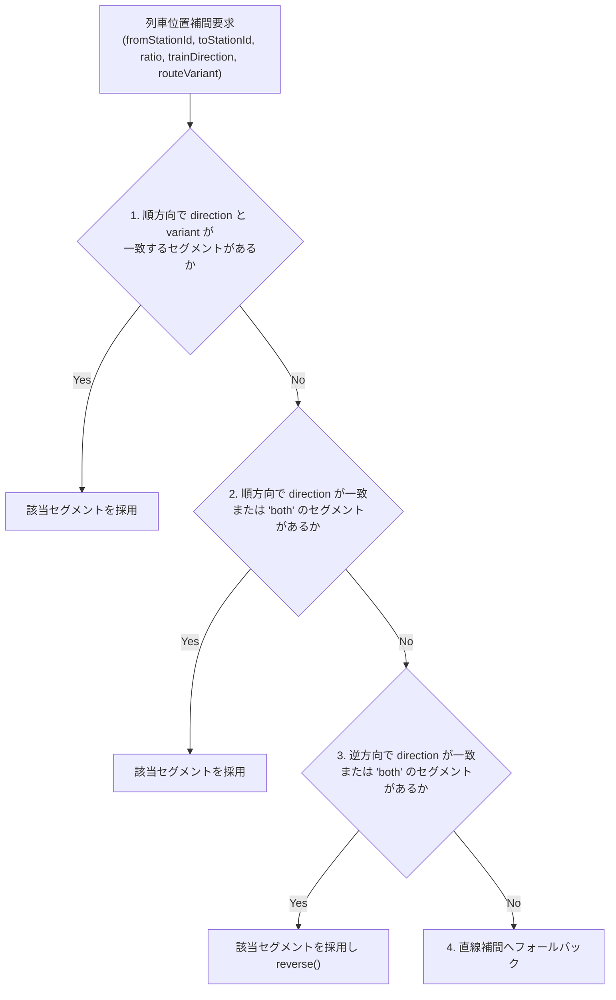
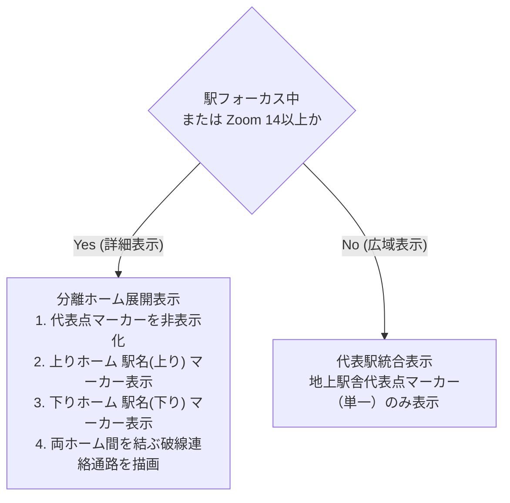
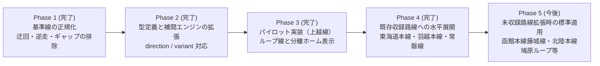

# 上下線非対称路線・方向別軌道ルーティング設計指針

本ドキュメントは、上りと下りで物理的に線路・経由駅・線形が異なる路線（上下非対称路線）を Trainfo でシミュレーションするための設計仕様、データ構造、実装ガイドラインをまとめた技術仕様書です。

---

## 1. 背景と課題

### 従来の単一代表軌道設計

従来の Trainfo では1つの駅間（`fromStationId` と `toStationId`）に対して1本の代表ポリライン（`TrackSegment`）のみを定義し、逆方向の列車はポリラインを反転（`reverse()`）して補間計算していました。

```text
【従来の方式】
水上 ---> (新清水トンネル: 単一セグメント) ---> 土合
水上 <--- (新清水トンネルを reverse() して逆走) <--- 土合
※ 湯檜曽ループ線（上り線）が地図にも列車位置にも存在しない
```

### 発生する課題

1. 地図上に描画される軌道が1本しかないため、上越線では新清水トンネル（下り）か湯檜曽ループ線（上り）のどちらか一方しか表示できず、ループ線や別線複線の線形を可視化できませんでした。
2. 下り列車用セグメントしか存在しない場合、上り列車が本来走行するループ線を通らず、下り線専用の長大トンネル内を逆走します。
3. データ作成時に地上駅（上りホーム）と地下駅（下りホーム）のノードが混在すると、最短経路探索が坑口へ向かって 1km 以上逆走・Uターンする異常パスを生成する原因となります。

---

## 2. 全国の代表的事例パターン分類

上下線で経路が異なる路線は、主に以下の6パターンに分類されます。



| パターン | 主な路線・対象区間 | 下り線 (`outbound`) | 上り線 (`inbound`) | 離脱幅と特有の課題 | 実装状況 |
| :--- | :--- | :--- | :--- | :--- | :--- |
| 山岳長大トンネルとループ線 | JR上越線（水上〜越後湯沢） | 新清水トンネル（湯檜曽・土合は地下ホーム） | 清水トンネルおよび湯檜曽・松川ループ線（湯檜曽・土合は地上ホーム） | 最大約2.5km。地上と地下でホーム位置・標高が異なる | 実装済（分離ホーム・ズーム連動） |
| 下り勾配緩和別線 | JR東海道本線（大垣〜関ケ原） | 新垂井線（下り特急等専用、垂井駅非経由） | 本線（垂井経由。上り全列車と下り普通列車） | 最大約2.5km。列車種別により下りでも経由ルートが分かれる | 実装済 |
| 別線複線化（新旧線分離） | JR羽越本線（村上〜間島） | 新下山トンネル新線（山側直線ルート） | 海岸線旧線（海岸沿い旧線ルート） | 最大約768m。特急いなほおよび普通列車が上下線別ルートを走行 | 実装済 |
| 操車場跡・基地用地による分離 | JR常磐線（友部〜内原） | 北側本線（水戸・いわき方面） | 南側本線（土浦・上野方面） | 最大約121m（約2km並走）。間に内原電留線が立地 | 実装済 |
| 下り勾配緩和別線 | JR函館本線（七飯〜大沼） | 藤城線（下り貨物・特急専用高架別線、途中駅なし） | 本線（仁山駅経由、急勾配・スイッチバック） | 経由駅と距離が異なる | 将来検討（未収録） |
| 環状・6の字運転 | 都営大江戸線（光が丘〜都庁前） | 放射部（光が丘〜都庁前）と環状部（都庁前〜大門〜両国〜都庁前）の連続運転 | 同一駅（都庁前）に異なる方向から2度入線する構造 | 環状重複時の進行判定が必要 | 将来検討（未収録） |

---

## 3. 推奨アーキテクチャ仕様

既存データとの後方互換性を保ちながら、方向別・経路別セグメントを表現する構造です。

### 3.1 軌道データ型定義の拡張（`src/types/index.ts`）

```typescript
export interface TrackSegment {
  segmentId?: string;
  fromStationId: string;
  toStationId: string;
  fromName?: string;
  toName?: string;
  coordinates: [number, number][];

  /**
   * 走行方向（省略時または 'both' は双方向共用線路）
   * - 'outbound': 下り列車専用軌道
   * - 'inbound': 上り列車専用軌道
   * - 'both': 上下共用複線/単線（デフォルト）
   */
  direction?: 'inbound' | 'outbound' | 'both';

  /**
   * 経路バリアント識別子（同一方向で複数経路が存在する場合）
   * 例: 'shinsimizu' (新清水トンネル), 'loop' (湯檜曽ループ)
   *     'tarui_main' (垂井経由), 'shintarui' (新垂井線経由)
   *     'fujishiro' (藤城線), 'niyama' (仁山経由本線)
   */
  variant?: string;
}
```

### 3.2 地図描画層の全軌道レンダリング

地図コンポーネント（Leaflet Polyline レイヤー）は、セグメントの `direction` や `variant` にかかわらず登録されているすべての軌道セグメントを一括描画します。これにより、地図上に新清水トンネル（直線）と湯檜曽ループ線（円形）の両方の線路が同時に表示されます。

### 3.3 列車位置補間エンジン（`interpolateTrackPosition`）

`ActiveTrain` は進行方向 `direction`（`inbound` / `outbound`）を保持しています。列車位置計算関数は進行方向と経路バリアントに応じて最適なセグメントを選択します。



```typescript
// src/data/trackGeometry.ts
export function interpolateTrackPosition(
  fromStationId: string,
  toStationId: string,
  ratio: number,
  trainDirection?: Direction,
  routeVariant?: string,
  customSegments?: TrackSegment[]
): { lat: number; lng: number; heading: number; bearing: number } {
  const segments = customSegments || getCombinedTrackSegments();
  const dir = trainDirection || 'outbound';

  // 1. 完全一致（方向 + バリアント）
  let segment = segments.find(s =>
    s.fromStationId === fromStationId &&
    s.toStationId === toStationId &&
    (s.direction === dir || s.direction === 'both' || !s.direction) &&
    (!routeVariant || s.variant === routeVariant)
  );

  let isReverse = false;

  // 2. 順方向（方向一致または双方向）
  if (!segment) {
    segment = segments.find(s =>
      s.fromStationId === fromStationId &&
      s.toStationId === toStationId &&
      (s.direction === dir || s.direction === 'both' || !s.direction)
    );
  }

  // 3. 逆方向フォールバック
  if (!segment) {
    segment = segments.find(s =>
      s.fromStationId === toStationId &&
      s.toStationId === fromStationId &&
      (s.direction === 'both' || !s.direction)
    );
    if (segment) isReverse = true;
  }

  // (以降は距離積算・lookahead 方位角算出ロジックを実行)
}
```

### 3.4 ホーム分離駅の座標スナップ仕様（`platformCoordinates`）

土合駅や湯檜曽駅のように地上ホームと地下ホームで物理位置が異なる駅に対応するため、`Station` 定義にホーム別座標を持たせます。

```typescript
export interface Station {
  id: string;
  name: string;
  lat: number; // 代表駅舎座標
  lng: number;

  // ホーム別座標（上下線で大きく異なる場合のみ定義）
  platformCoordinates?: {
    inbound?: { lat: number; lng: number; altitude?: number };  // 上りホーム (例: 地上)
    outbound?: { lat: number; lng: number; altitude?: number }; // 下りホーム (例: 地下70m)
  };
}
```

- `direction === 'outbound'` のセグメント端点は `s.platformCoordinates?.outbound || { lat: s.lat, lng: s.lng }` に一致させます。
- `direction === 'inbound'` のセグメント端点は `s.platformCoordinates?.inbound || { lat: s.lat, lng: s.lng }` に一致させます。

### 3.5 ホーム分離駅の表示仕様（`useStationMarkers.ts`）

`platformCoordinates` が設定された駅の地図表示は、`src/components/Map/hooks/useStationMarkers.ts` で制御します。



通常広域表示（ズーム14未満かつ非フォーカス）では代表点マーカーのみを表示し、地図上の表示密度を抑えます。ズーム14以上または駅フォーカス時には代表点マーカーから上りホームと下りホームの2つのマーカー（例: `土合 (上り)`、`土合 (下り)`）を展開表示し、両ホーム間を結ぶ破線の連絡通路を描画します。

---

## 4. 代表路線の実装具体例

### 4.1 上越線（水上〜越後湯沢: 山岳長大トンネルとループ線）

```typescript
export const JOETSU_TRACK_SEGMENTS: TrackSegment[] = [
  // ... (高崎 〜 水上: 双方向共用)

  // 【水上 〜 湯檜曽】
  {
    segmentId: 'JOE-14_JOE-15_DOWN',
    fromStationId: 'JOE-14',
    toStationId: 'JOE-15',
    direction: 'outbound',
    variant: 'shinsimizu',
    coordinates: [ /* 水上地上 -> 新清水トンネル坑口 -> 湯檜曽地下ホーム (3.58km) */ ]
  },
  {
    segmentId: 'JOE-15_JOE-14_UP',
    fromStationId: 'JOE-15',
    toStationId: 'JOE-14',
    direction: 'inbound',
    variant: 'loop',
    coordinates: [ /* 湯檜曽地上ホーム -> 水上地上 (3.55km) */ ]
  },

  // 【湯檜曽 〜 土合】
  {
    segmentId: 'JOE-15_JOE-16_DOWN',
    fromStationId: 'JOE-15',
    toStationId: 'JOE-16',
    direction: 'outbound',
    variant: 'shinsimizu',
    coordinates: [ /* 湯檜曽地下ホーム -> 新清水トンネル直進 -> 土合地下ホーム (3.60km) */ ]
  },
  {
    segmentId: 'JOE-16_JOE-15_UP',
    fromStationId: 'JOE-16',
    toStationId: 'JOE-15',
    direction: 'inbound',
    variant: 'loop',
    coordinates: [ /* 土合地上ホーム -> 清水トンネル -> 湯檜曽ループ線周回 -> 湯檜曽地上ホーム (6.66km) */ ]
  },

  // ... (土合 〜 土樽: 下りは新清水トンネル、上りは清水トンネル・松川ループ線)
];
```

### 4.2 羽越本線（村上〜間島: 新旧線分離）

```typescript
// src/data/lines/jr_uetsu_main/trackGeometry.ts
export const UETSU_MAIN_TRACK_SEGMENTS: TrackSegment[] = [
  // ...
  // 【村上 〜 間島】（下り山側新線: 109点、最大離脱 768m）
  {
    segmentId: 'UE-15_UE-16',
    fromStationId: 'UE-15',
    toStationId: 'UE-16',
    fromName: '村上',
    toName: '間島',
    direction: 'outbound',
    coordinates: [ /* 村上駅下り本線 -> 新下山トンネル直線新線 -> 間島駅下り本線 (109点) */ ],
  },
  // 【間島 〜 村上】（上り海岸線旧線: 139点）
  {
    segmentId: 'UE-16_UE-15_UP',
    fromStationId: 'UE-16',
    toStationId: 'UE-15',
    fromName: '間島',
    toName: '村上',
    direction: 'inbound',
    coordinates: [ /* 間島駅上り本線 -> 海岸線岩礁旧線 -> 村上駅上り本線 (139点) */ ],
  },
  // ...
];
```

### 4.3 常磐線（友部〜内原: 内原操車場跡地・内原電留線）

```typescript
// src/data/lines/jr_joban_toride_iwaki/trackGeometry.ts
export const JOBAN_TORIDE_IWAKI_TRACK_SEGMENTS: TrackSegment[] = [
  // ...
  // 【友部 〜 内原】（下り北側本線: 56点、最大離脱 121m、間に内原電留線）
  {
    fromStationId: 'JTI-13',
    toStationId: 'JTI-14',
    fromName: '友部',
    toName: '内原',
    direction: 'outbound',
    coordinates: [ /* 友部駅 -> 北側本線 -> 内原駅 (56点) */ ],
  },
  // 【内原 〜 友部】（上り南側本線: 66点）
  {
    fromStationId: 'JTI-14',
    toStationId: 'JTI-13',
    fromName: '内原',
    toName: '友部',
    direction: 'inbound',
    coordinates: [ /* 内原駅 -> 南側本線 -> 友部駅 (66点) */ ],
  },
  // ...
];
```

---

## 5. 自動幾何監査スクリプトでの検証基準

`audit_all_tracks.cjs` および `audit_all_lines_paths.cjs` では以下の4つの判定を行います。

実線形妥当性判定として、`variant === 'loop'` が明示されているセグメントは直線比率 1.5 〜 2.5 の迂回を正規の幾何形状として許容します。鋭角スパイク・逆走検出は、セグメント単体内に 135度以上の鋭角Uターン（駅構内渡り線によるトゲや逆走）が含まれないかを確認する基準です。端点整合性では、`direction === 'outbound'` セグメントの端点を `outbound` ホーム座標または駅代表点と 0m で一致させ、`direction === 'inbound'` セグメントの端点も `inbound` ホーム座標または駅代表点と 0m で一致させます。最後に `npm run audit:paths` を実行し、当該区間を通過するすべての下り・上りトリップが欠落なく自方向のセグメントを通過できるかを検証します。

---

## 6. 移行進捗状況



Phase 1 〜 3（完了）では全路線の基準軌道正規化、`TrackSegment` への `direction` 拡張、上越線（ループ線と分離ホーム表示）の実装を完了しています。Phase 4（完了）では収録中の全174路線から上下線分離区間を精査し、東海道本線（新垂井線）、羽越本線（村上〜間島）、常磐線（友部〜内原）の3線区に対応しました。Phase 5（今後）では函館本線藤城線や北陸本線鳩原ループ線など新規路線の追加時に、本設計指針およびプレイブックに従って上下非対称ルーティングを適用する予定です。
