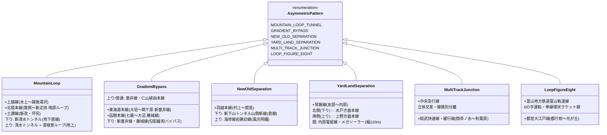
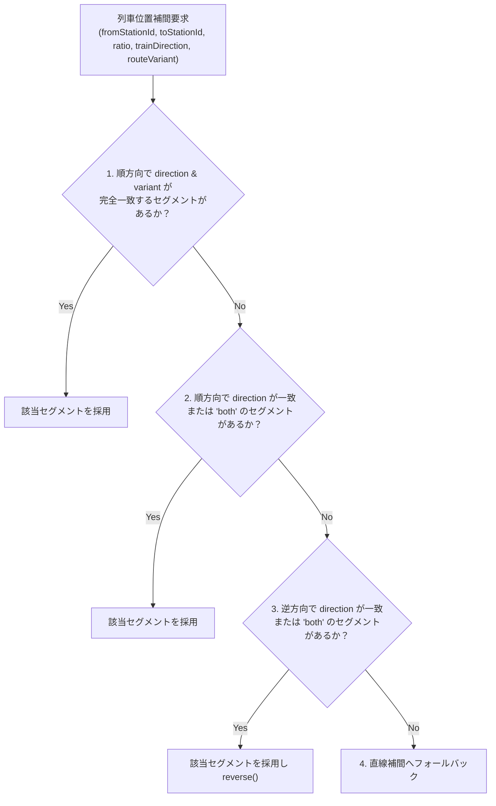
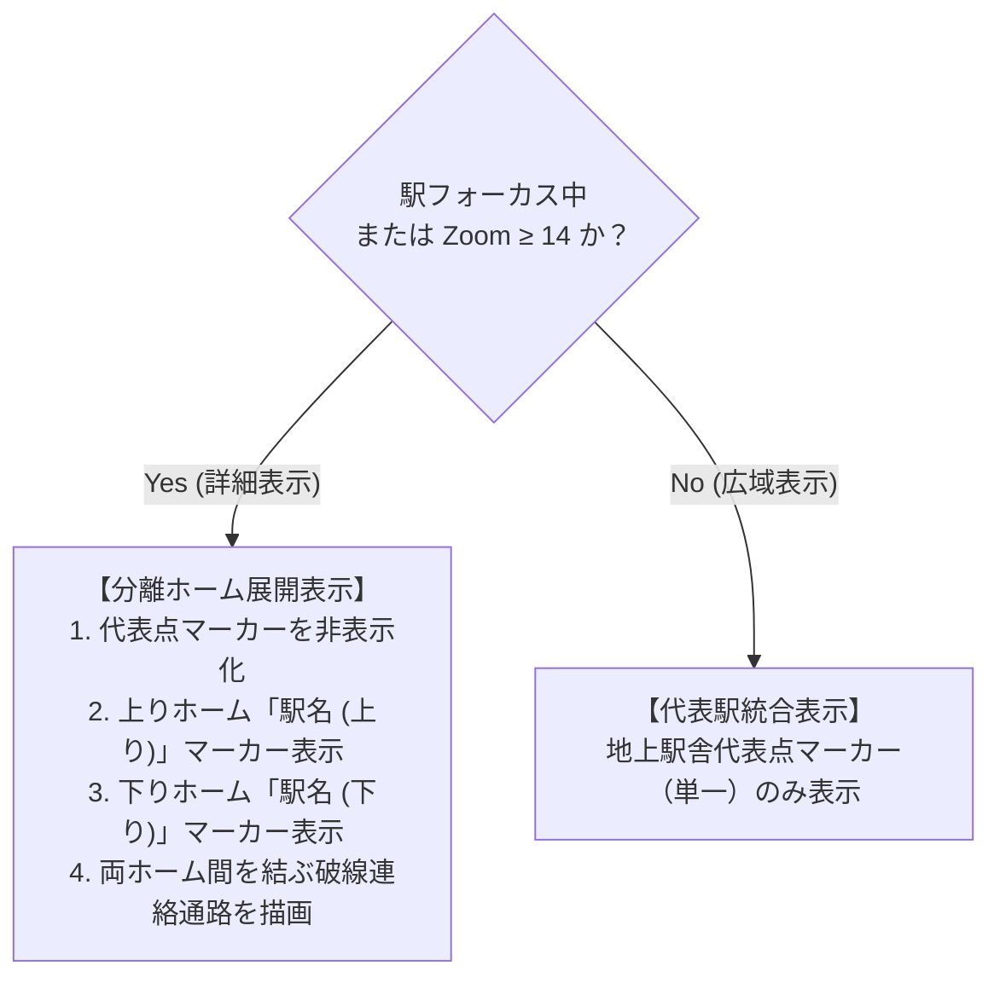
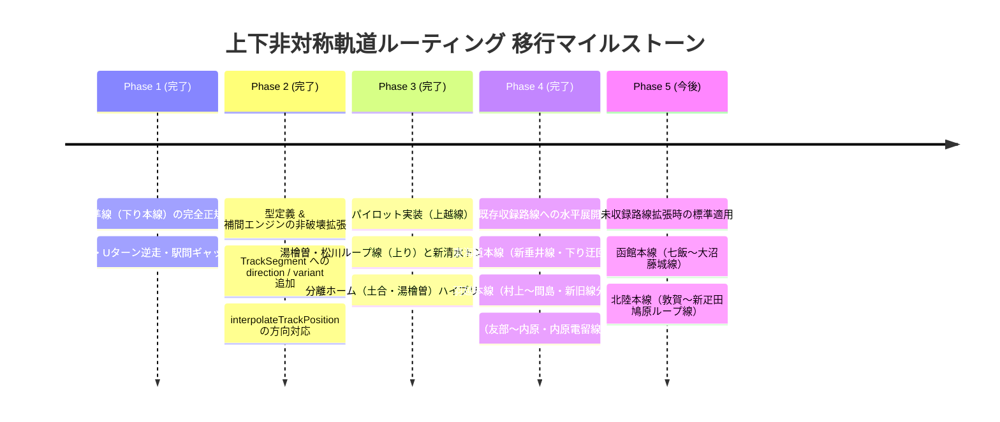

# 上下線非対称路線・方向別軌道ルーティング設計指針

本ドキュメントは、上りと下りで物理的に線路・経由駅・線形が異なる路線（上下非対称路線）を Trainfo において高精度に表現・シミュレーションするための設計仕様、データ構造、および実装ガイドラインをまとめた技術標準書です。

---

## 1. 背景と課題

### 従来のアーキテクチャ（単一代表軌道設計）
従来の Trainfo では、1 つの駅間（`fromStationId` と `toStationId`）に対して 1 本の代表ポリライン（`TrackSegment`）のみを定義し、逆方向の列車はポリラインを反転（`reverse()`）して補間計算を行っていました。

```text
【従来の方式】
水上 ──── (新清水トンネル: 単一セグメント) ────> 土合
水上 <─── (新清水トンネルを reverse() して逆走) ─── 土合
※ 湯檜曽ループ線（上り線）が地図にも列車位置にも一切存在しない
```

### 発生する課題
1. **地図表示の欠落**:
   - 地図上に描画される軌道が 1 本しかないため、上越線の場合「新清水トンネル（下り）」か「湯檜曽ループ線（上り）」のどちらか一方しか描画できず、全国的に有名なループ線や複線の線形美を可視化できない。
2. **列車走行シミュレーションの乖離**:
   - 下り列車用セグメントしか存在しない場合、上り列車が本来走行するループ線を通らず、下り線専用の長大トンネル内を逆走する。
3. **データ作成時の異常往復ループ誘発**:
   - 地上駅（上りホーム）と地下駅（下りホーム）のノードが混在した場合、ダイクストラ探索が坑口へ向かって 1km 以上逆走・Uターンするような致命的な異常パスを生成する原因となる。

---

## 2. 全国の代表的事例パターン分類

上下線で経路が異なる路線は、全国で主に以下の 6 パターンに分類されます。



| パターン | 主な路線・対象区間 | 下り線 (Outbound) | 上り線 (Inbound) | 離脱幅 / 特有の課題 | 実装状況 |
| :--- | :--- | :--- | :--- | :--- | :--- |
| **山岳長大トンネル vs ループ線** | **JR上越線**<br>(水上 〜 越後湯沢) | 新清水トンネル<br>(湯檜曽・土合は地下ホーム) | 清水トンネル + 湯檜曽・松川ループ線<br>(湯檜曽・土合は地上ホーム) | 最大 約2.5km<br>地上/地下でホーム標高・位置が大幅に異なる | **実装済**（分離ホーム・ズーム連動） |
| **下り勾配緩和別線** | **JR東海道本線**<br>(大垣 〜 関ケ原) | 新垂井線<br>(下り特急「しらさぎ」等専用、垂井駅非経由) | 本線（垂井経由）<br>(上り全列車 ＆ 下り普通列車が垂井経由) | 最大 約2.5km<br>列車種別によって下りでも経由ルート・経由駅が分かれる | **実装済**（既存稼働中） |
| **別線複線化（新旧線分離）** | **JR羽越本線**<br>(村上 〜 間島) | 新下山トンネル新線<br>(山側直線トンネルルート) | 海岸線旧線<br>(日本海の岩礁沿い旧線ルート) | 最大 約768m<br>特急「いなほ」および普通列車が上下線別ルートを走行 | **実装済** |
| **操車場跡・基地用地による分離** | **JR常磐線**<br>(友部 〜 内原) | 北側本線<br>(水戸・いわき方面) | 南側本線<br>(土浦・上野方面) | 最大 約121m（約2km並走）<br>広大な上下線間に内原電留線・メガソーラーが立地 | **実装済** |
| **下り勾配緩和別線** | **JR函館本線**<br>(七飯 〜 大沼) | 藤城線<br>(下り貨物・特急専用高架別線、途中駅なし) | 本線<br>(仁山駅経由、急勾配・スイッチバック) | 経由駅・距離が全く異なる | 将来検討（Trainfo未収録） |
| **環状・6の字運転** | **都営大江戸線**<br>(光が丘 〜 都庁前) | 放射部（光が丘〜都庁前）と環状部（都庁前〜大門〜両国〜都庁前）の連続運転 | 同一駅（都庁前）に異なる方向から2度入線する構造 | | 将来検討 |

---

## 3. 推奨アーキテクチャ仕様

既存のデータ互換性を完全に保ちながら（後方互換）、方向別・経路別セグメントを表現可能にするアーキテクチャです。

### 3.1 軌道データ型定義の拡張 ([`src/types/index.ts`](file:///c:/Users/Genbu/GitHub/github.com/GenbuHase/Trainfo/src/types/index.ts))

```typescript
export interface TrackSegment {
  segmentId?: string;
  fromStationId: string;
  toStationId: string;
  fromName?: string;
  toName?: string;
  coordinates: [number, number][];

  /**
   * 走行方向（省略時または 'both' は双方向共用線路）
   * - 'outbound': 下り列車専用軌道
   * - 'inbound': 上り列車専用軌道
   * - 'both': 上下共用複線/単線（デフォルト）
   */
  direction?: 'inbound' | 'outbound' | 'both';

  /**
   * 経路バリアント識別子（同一方向で複数経路が存在する場合）
   * 例: 'shinsimizu' (新清水トンネル), 'loop' (湯檜曽ループ)
   *     'tarui_main' (垂井経由), 'shintarui' (新垂井線経由)
   *     'fujishiro' (藤城線), 'niyama' (仁山経由本線)
   */
  variant?: string;
}
```

### 3.2 地図描画層（Map Component）の全軌道レンダリング
- 地図コンポーネント（Leaflet Polyline レイヤー）は、セグメントの `direction` や `variant` に関係なく、登録されている**すべての軌道セグメントを一括描画**します。
- これにより、地図上に「新清水トンネル（直線）」と「湯檜曽ループ線（円形）」の**両方の線路が同時に表示**され、実物の鉄道路線図と同様の立体的な配線が表示されます。

### 3.3 列車位置補間エンジン (`interpolateTrackPosition`) のアルゴリズム

`ActiveTrain` はすでに `direction: Direction`（`inbound` / `outbound`）を所持しています。  
列車位置計算関数は、列車の進行方向と経路バリアントに応じて最適なセグメントを優先選択します。



```typescript
// src/data/trackGeometry.ts
export function interpolateTrackPosition(
  fromStationId: string,
  toStationId: string,
  ratio: number,
  trainDirection?: Direction,
  routeVariant?: string,
  customSegments?: TrackSegment[]
): { lat: number; lng: number; heading: number; bearing: number } {
  const segments = customSegments || getCombinedTrackSegments();
  const dir = trainDirection || 'outbound';

  // 1. 完全一致（方向 + バリアント）
  let segment = segments.find(s => 
    s.fromStationId === fromStationId && 
    s.toStationId === toStationId &&
    (s.direction === dir || s.direction === 'both' || !s.direction) &&
    (!routeVariant || s.variant === routeVariant)
  );

  let isReverse = false;

  // 2. 順方向（方向一致または双方向）
  if (!segment) {
    segment = segments.find(s => 
      s.fromStationId === fromStationId && 
      s.toStationId === toStationId &&
      (s.direction === dir || s.direction === 'both' || !s.direction)
    );
  }

  // 3. 逆方向フォールバック
  if (!segment) {
    segment = segments.find(s => 
      s.fromStationId === toStationId && 
      s.toStationId === fromStationId &&
      (s.direction === 'both' || !s.direction)
    );
    if (segment) isReverse = true;
  }

  // (以降は従来の距離積算・lookahead 方位角算出ロジックを実行)
}
```

### 3.4 ホーム分離駅の座標スナップ仕様 (`platformCoordinates`)

土合駅や湯檜曽駅のように、地上ホームと地下ホームで物理位置が異なる駅に対応するため、`Station` 定義へホーム別座標を追加します。

```typescript
export interface Station {
  id: string;
  name: string;
  lat: number; // 代表駅舎座標
  lng: number;
  
  // ホーム別座標（上下線で大きく異なる場合のみ定義）
  platformCoordinates?: {
    inbound?: { lat: number; lng: number; altitude?: number };  // 上りホーム (例: 地上)
    outbound?: { lat: number; lng: number; altitude?: number }; // 下りホーム (例: 地下70m)
  };
}
```

- **セグメント端点スナップ規則**:
  - `direction === 'outbound'` のセグメントは `s.platformCoordinates?.outbound || { lat: s.lat, lng: s.lng }` にスナップ。
  - `direction === 'inbound'` のセグメントは `s.platformCoordinates?.inbound || { lat: s.lat, lng: s.lng }` にスナップ。

### 3.5 ホーム分離駅のUI表示仕様（高ズーム＆フォーカス連動ハイブリッド仕様）

`platformCoordinates` が設定された駅（土合・湯檜曽等）の地図上での視覚的表現は、[`useStationMarkers.ts`](file:///c:/Users/Genbu/GitHub/github.com/GenbuHase/Trainfo/src/components/Map/hooks/useStationMarkers.ts) により以下のハイブリッド方式で制御されます：



1. **通常広域表示（Zoom < 14 かつ非フォーカス）**:
   - 代表点マーカーのみを表示し、地図上の視覚的ノイズを抑制。
2. **高ズーム表示（Zoom ≥ 14）または駅フォーカス時**:
   - 自動的に代表点マーカーが分離され、上りホーム（`inbound`）と下りホーム（`outbound`）の2つのマーカー（例: `土合 (上り)`、`土合 (下り)`）を展開表示。
   - 両ホーム間を結ぶ破線の連絡通路ポリラインを描画し、物理的な地下階段・連絡通路の構造を視覚化。
   - これにより、モバイル版などで駅フォーカス時に縮尺が引き気味になっても、ユーザーが自由にズームインすれば分離ホームと地下駅の全貌を目視確認できます。

---

## 4. 代表路線の実装具体例

### 4.1 上越線（水上〜越後湯沢: 山岳長大トンネル vs ループ線）

```typescript
export const JOETSU_TRACK_SEGMENTS: TrackSegment[] = [
  // ... (高崎 〜 水上: 双方向共用)

  // 【水上 〜 湯檜曽】
  {
    segmentId: 'JOE-14_JOE-15_DOWN',
    fromStationId: 'JOE-14',
    toStationId: 'JOE-15',
    direction: 'outbound',
    variant: 'shinsimizu',
    coordinates: [ /* 水上地上 -> 新清水トンネル坑口 -> 湯檜曽地下ホーム (3.58km) */ ]
  },
  {
    segmentId: 'JOE-15_JOE-14_UP',
    fromStationId: 'JOE-15',
    toStationId: 'JOE-14',
    direction: 'inbound',
    variant: 'loop',
    coordinates: [ /* 湯檜曽地上ホーム -> 水上地上 (3.55km) */ ]
  },

  // 【湯檜曽 〜 土合】
  {
    segmentId: 'JOE-15_JOE-16_DOWN',
    fromStationId: 'JOE-15',
    toStationId: 'JOE-16',
    direction: 'outbound',
    variant: 'shinsimizu',
    coordinates: [ /* 湯檜曽地下ホーム -> 新清水トンネル直進 -> 土合地下ホーム (3.60km) */ ]
  },
  {
    segmentId: 'JOE-16_JOE-15_UP',
    fromStationId: 'JOE-16',
    toStationId: 'JOE-15',
    direction: 'inbound',
    variant: 'loop',
    coordinates: [ /* 土合地上ホーム -> 清水トンネル -> 湯檜曽ループ線周回 -> 湯檜曽地上ホーム (6.66km) */ ]
  },

  // ... (土合 〜 土樽: 下りは新清水トンネル、上りは清水トンネル・松川ループ線)
];
```

### 4.2 羽越本線（村上〜間島: 別線複線化・新下山トンネル新線 vs 海岸線旧線）

```typescript
// src/data/lines/uetsu_main/trackGeometry.ts
export const UETSU_MAIN_TRACK_SEGMENTS: TrackSegment[] = [
  // ...
  // 【村上 〜 間島】（下り山側新線: 109点、最大離脱 768m）
  {
    segmentId: 'UE-15_UE-16',
    fromStationId: 'UE-15',
    toStationId: 'UE-16',
    fromName: '村上',
    toName: '間島',
    direction: 'outbound',
    coordinates: [ /* 村上駅下り本線 -> 新下山トンネル直線新線 -> 間島駅下り本線 (109点) */ ],
  },
  // 【間島 〜 村上】（上り海岸線旧線: 139点、風光明媚な旧線）
  {
    segmentId: 'UE-16_UE-15_UP',
    fromStationId: 'UE-16',
    toStationId: 'UE-15',
    fromName: '間島',
    toName: '村上',
    direction: 'inbound',
    coordinates: [ /* 間島駅上り本線 -> 海岸線岩礁旧線 -> 村上駅上り本線 (139点) */ ],
  },
  // ...
];
```

### 4.3 常磐線（友部〜内原: 内原操車場跡地・内原電留線）

```typescript
// src/data/lines/joban_toride_iwaki/trackGeometry.ts
export const JOBAN_TORIDE_IWAKI_TRACK_SEGMENTS: TrackSegment[] = [
  // ...
  // 【友部 〜 内原】（下り北側本線: 56点、最大離脱 121m、間に内原電留線）
  {
    fromStationId: 'JTI-13',
    toStationId: 'JTI-14',
    fromName: '友部',
    toName: '内原',
    direction: 'outbound',
    coordinates: [ /* 友部駅 -> 北側本線 -> 内原駅 (56点) */ ],
  },
  // 【内原 〜 友部】（上り南側本線: 66点）
  {
    fromStationId: 'JTI-14',
    toStationId: 'JTI-13',
    fromName: '内原',
    toName: '友部',
    direction: 'inbound',
    coordinates: [ /* 内原駅 -> 南側本線 -> 友部駅 (66点) */ ],
  },
  // ...
];
```

---

## 5. 自動幾何監査スクリプト (`audit_all_tracks.cjs` / `audit_all_lines_paths.cjs`) での検証基準

上下非対称路線の導入に伴い、軌道監査スクリプトには以下の判定ロジックを組み込みます：

1. **実線形妥当性判定**:
   - `variant === 'loop'`（ループ線）として明示されているセグメントは、直線比率 1.5 〜 2.5 の迂回を「正規の幾何形状」として許容する。
2. **鋭角スパイク・逆走検出**:
   - セグメント単体内で 135 度以上の鋭角Uターンが存在しないこと（駅構内渡り線によるトゲ・逆走の検出）。
3. **端点整合性**:
   - `direction === 'outbound'` セグメントの端点は `outbound` ホーム座標（または駅代表点）と 0m スナップされていること。
   - `direction === 'inbound'` セグメントの端点は `inbound` ホーム座標（または駅代表点）と 0m スナップされていること。
4. **全便パストラバーサル監査 (`npm run audit:paths`)**:
   - 当該区間を通過するすべての下り・上りトリップが、欠落なく自方向のセグメントを正しく走査・通過できること。

---

## 6. 移行進捗状況



- **Phase 1 〜 3（完了）**:
  - 全路線の基準軌道正規化、`TrackSegment` への `direction` 拡張、上越線（ループ線＋分離ホームハイブリッド表示）の実装が完了。
- **Phase 4（完了）**:
  - Trainfo収録の全109路線の中から上下線分離区間を網羅精査し、**東海道本線（新垂井線）**、**羽越本線（村上〜間島）**、**常磐線（友部〜内原）** の3線区すべてで完全対応を達成。
- **Phase 5（今後）**:
  - 新規路線の追加時（函館本線藤城線、北陸本線鳩原ループ線等）に、本設計指針およびプレイブックに基づき標準ワークフローとして上下非対称ルーティングを適用。
