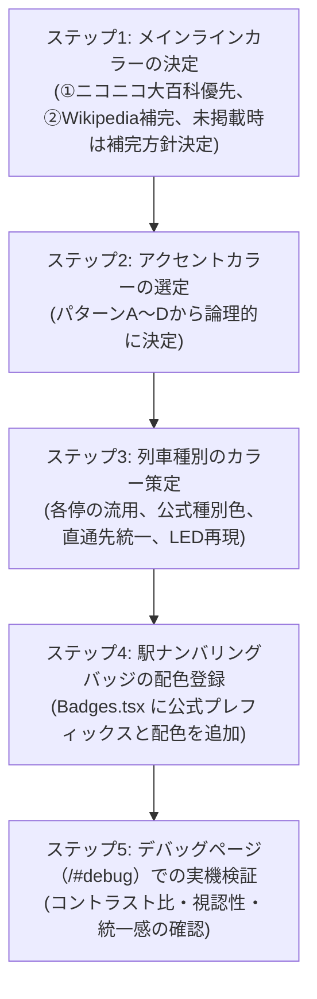

# Trainfo ラインカラー＆アクセントカラー選定ガイドライン

本ドキュメントは、Trainfo において各路線の `lineColor`（メインラインカラー）、`accentColor`（アクセントカラー）、および列車種別（`trainTypes.ts`）のカラーリングを決定・保守する際の選定方針、典拠、および全路線の選定根拠をまとめた仕様基準書です。

新規路線の追加時や既存路線のカラー見直し時は、必ず本ガイドラインの基準を遵守してください。

---

## 1. 選定の基本理念

Trainfo は、首都圏・甲信越・北関東・東北・東海の多数の鉄道事業者が同一マップ上に描画されるリアルタイム運行シミュレーターです。  
地図上での視認性の確保と、駅名標や車体サインシステムなどの**実世界の案内標識との親和性**を両立するため、統一された基準に基づいてカラーコードを定めています。

```text
┌────────────────────────────────────────────────────────────────────────┐
│ LineDefinition (src/types/index.ts)                                    │
│ ├── lineColor   : 公式サインシステム・運行情報に基づく「基本ラインカラー」       │
│ └── accentColor : 速達種別・直通相手路線・車両帯ツートン等の「副象徴カラー」     │
├────────────────────────────────────────────────────────────────────────┤
│ TrainTypeConfig (src/types/index.ts)                                   │
│ ├── local (各停) : 当該路線のラインカラーを流用・同期（例外あり）             │
│ └── 優等種別    : 各社公式種別案内色・実車発車標色・直通先統一カラーを適用     │
└────────────────────────────────────────────────────────────────────────┘
```

---

## 2. メインラインカラー（lineColor）の選定基準

メインラインカラーは、原則として以下の指定情報源を優先順位に従って参照し、公式抽出カラーコード（HEX値）を採用します。

### 情報源の優先順位
1. **優先①: [ニコニコ大百科「鉄道路線のラインカラー一覧」](https://dic.nicovideo.jp/a/%E9%89%84%E9%81%93%E8%B7%AF%E7%B7%9A%E3%81%AE%E3%83%A9%E3%82%A4%E3%83%B3%E3%82%AB%E3%83%A9%E3%83%BC%E4%B8%80%E8%A6%A7)**
   * 各社公式Webサイト・駅ナンバリング仕様・運行情報サインシステムから厳密に抽出されたカラーコードを最優先で採用します。
2. **優先②: [Wikipedia「日本の鉄道路線ラインカラー一覧」](https://ja.wikipedia.org/wiki/%E6%97%A5%E6%9C%AC%E3%81%AE%E9%89%84%E9%81%93%E3%83%A9%E3%82%A4%E3%83%B3%E3%82%AB%E3%83%A9%E3%83%BC%E4%B8%80%E8%A6%A7)**
   * ①に路線の掲載がない場合、または①のカラー情報が欠落している場合に参照します。
3. **①・②のどちらにも存在しない場合（未制定・未掲載路線）**:
   * その路線には独立した公式ラインカラーが制定されていない（または一覧未掲載）と判定します。
   * 代替措置として、**「事業者のコーポレートカラー」「代表車両の車体帯色」「運行系統の直通先案内色」** から合理的に選定し、コード内にコメントを記述するとともに、プロジェクト管理者・ユーザーへその旨を報告します（現行の未掲載路線および実車案内色準拠の種別一覧については [`docs/COLOR_AUDIT_REPORT.md`](COLOR_AUDIT_REPORT.md) を参照）。
   * 例:
     - 秩父鉄道秩父本線 (`chichibu`): 車両青帯色 `#01479d`
     - りんかい線 (`rinkai`): 東京臨海高速鉄道コーポレートカラー `#00418e`
     - 相鉄・JR直通線 (`sotetsu_jr_direct`): 埼京線案内色 `#00ac84` / 相鉄ネイビー `#002b66`

---

## 3. アクセントカラー（accentColor）の選定基準

アクセントカラーは、地図上での識別性向上や、列車詳細パネル・種別バッジ表示等のUI表現において**路線の固有性・アイデンティティ**を補強するカラーとして設定します。  
以下の4つのパターンのいずれかに基づいて選定します。

### パターンA: 代表的な優等・速達列車種別のシンボルカラー
その路線で最も象徴的な看板速達種別や優等列車の案内色を採用する。
* **JR中央線（快速）**: `#c9252d`（中央特快・通勤特快などの特快レッド）
* **JR青梅線**: `#16a34a`（青梅特快のグリーン）
* **JR埼京線・川越線**: `#00ac84`（川越線） / `#007ac1`（埼京線快速ブルー）
* **東京メトロ副都心線**: `#e05a00`（急行オレンジ）
* **東急東横線・東急新横浜線・みなとみらい線**: `#ea5504`（特急オレンジ）
* **秩父鉄道**: `#dc2626`（急行秩父路レッド）
* **JR東北新幹線**: `#e4007f`（はやぶさピンク）

### パターンB: 相互直通・接続相手路線のシンボルカラー
運行系統上密接に直通運転を行う相手路線、または接続路線のシンボルカラーを採用する。
* **JR中央本線（中央東線）**: `#eb5c01`（ブルーの中距離電車に対し、直通先の中央快速線オレンジバーミリオン）
* **JR武蔵野線**: `#cf1225`（オレンジの武蔵野線に対し、東京駅・海浜幕張方面直通先である京葉線のワインレッド）
* **相鉄・JR直通線**: `#002b66`（埼京線エメラルドに対し、直通先である相鉄の YOKOHAMA NAVYBLUE）
* **JR湘南新宿ライン・上野東京ライン**: `#ff871c`（直通各線の代表案内色オレンジ）

### パターンC: 企業のコーポレートカラーや車両帯のツートンカラー
車両帯に施されたペアカラーや、ブランドのコーポレートサブカラーを採用する。
* **東武東上線・越生線**: `#ed6d00`（東武フューチャーブルーに対する「東武ブライトオレンジ」）
* **つくばエクスプレス**: `#d20012`（TXディープブルーに対するペアカラー「TXスカーレットレッド」）
* **西武池袋線・西武有楽町線**: `#003a8c`（池袋線系統カラーに対する西武鉄道のシンボル「西武ブルー」）
* **相模鉄道各線**: `#0073bc`（YOKOHAMA NAVYBLUE に対する相鉄グループシンボルカラー「相鉄ブルー」）
* **東京臨海高速鉄道りんかい線**: `#00a3af`（70-000形車両の帯色であるターコイズブルー）
* **JR八高線**: `#e06a3b`（キハ110系気動車や電化区間車両の帯色であるテラコッタオレンジ）
* **JR伊東線**: `#ff871c`（伊東線グリーンに対する駅案内・東海道線直通オレンジ）
* **JR上越新幹線**: `#008000`（朱鷺色に対する新幹線共通グリーン）

### パターンD: 同色または案内用濃淡シェード（単一ラインカラー線区）
特段の優等列車やデュアルカラーが存在しない場合、ラインカラーと同色または視認性調整用の同系シェードを採用する。
* **東京メトロ千代田線** (`#00bb85`) / **有楽町線** (`#c1a470`)
* **JR横須賀線・総武快速線** (`#0074be`)
* **JR東海道線・宇都宮線・高崎線** (`#f68b1e`)
* **小田急電鉄各線** (`#2288cc` / `#0065af`)
* **JR大糸線**（東日本 `#957490` / 西日本 `#0068b7`）

---

## 4. 列車種別（trainTypes.ts）のカラーリング選定ルール

各路線の列車種別（`src/data/lines/<lineId>/trainTypes.ts`）に指定するカラー（`bgColor`、`textColor`、`borderColor`）は、以下の基準を厳格に適用します。

### 1. 各駅停車（`local`）はラインカラーを流用・同期
各駅停車・普通列車は、基本的に**その路線の `lineColor` と同一の配色**を適用します。これにより、マップ上で各駅停車を見た際にどの路線の列車かが直感的に識別できます。

### 2. 意図的例外: 実車幕・LED表示の再現を優先する路線
* **東武東上線・東武越生線**:
  東武鉄道の普通列車は、実車の方向幕（白地に黒文字）やフルカラーLED（黒地に白文字）の表示、ならびに**快速急行（青色）との誤認を防止するため、黒ベース（`#1e1c1c`）を維持**します。

### 3. 優等種別は各事業者の公式種別案内色を採用
情報源①・②の種別カラーテーブルに掲載されている公式案内色を採用します。
* **つくばエクスプレス**: 快速 `#d20012`、通勤快速 `#ea5504`、区間快速 `#00aa3b`
* **東急電鉄 / みなとみらい線**: 特急 `#ea5504`、通勤特急 `#e60012`、急行 `#c9252d`
* **西武鉄道**: 快速急行 `#0073bc`、急行 `#c9252d`、快速 `#008cd6`、準急 `#00a650`、通勤準急 `#00a650`、通勤急行 `#c9252d`
* **東武鉄道**: 快速急行 `#0073bc`、急行 `#c9252d`、快速 `#008cd6`、準急 `#00a650`、川越特急 `#e73799`（実車LED）
* **小田急電鉄**: 快速急行 `#e65100`、急行 `#d32f2f`、通勤急行 `#d32f2f`、準急 `#16a34a`、通勤準急 `#16a34a`、特急 `#be123c`
* **JR東海**: 特別快速 `#e65100`、新快速 `#0073bc`、快速 `#00897b`、区間快速 `#7b1fa2`

### 4. JR東日本線区: 駅発車標・車両LEDの定着色を採用
JR東日本には全社統一の公式種別カラーパレットが存在しないため、**駅発車標（LED/LCD）や車両行先表示器で定着している実車案内色**を採用します。
* **特急列車**: 全社共通で特急レッド・ボルドー系（`#d32f2f` / `#be123c` / `#e60012`）
* **中央特快 / 特別快速**: スカイブルー（`#0284c7`）
* **青梅特快**: グリーン（`#16a34a`）
* **常磐線特別快速**: 濃紺（`#003366`）
* **快速（東海道・宇都宮・高崎・埼京・上野東京等）**: ブルー（`#0073bc` / `#007ac1`）
* **快速アクティー / 快速ラビット / 快速アーバン**: オレンジ（`#e65100`）
* **通勤快速**: パープル系（`#9333ea` / `#7b1fa2`）またはレッド（`#d32f2f` / `#e60012`）

### 5. 相互直通運転種別の統一
複数路線を跨ぐ直通種別は、路線間で色がバラバラにならないよう、**直通先系統の公式色に統一**します。
* **S-TRAIN**: 西武池袋線・西武有楽町線・東京メトロ有楽町線・副都心線・東急東横線・みなとみらい線の全6路線で、公式の **黄緑（`#99cc00`）** に統一。
* **千代田線・常磐各停の小田急直通便**: 小田急仕様の準急（`#3cb371`）、通勤準急（`#2e8b57`）、急行（`#e05a00`）、特急（`#0065af`）に統一。
* **りんかい線・相鉄直通線の埼京線直通便**: 埼京線仕様の快速（`#007ac1`）、通勤快速（`#e60012`）に統一。

---

## 5. 全48路線の選定一覧（現行設定値・デバッグ表示順）

| # | 路線ID | 路線名 | 採用情報源 | lineColor | accentColor | 選定根拠・公式仕様 |
| :-: | :--- | :--- | :---: | :---: | :---: | :--- |
| 1 | `tojo` | 東武東上線 | ② | `#004098` | `#ed6d00` | 東武フューチャーブルー / 東武ブライトオレンジ |
| 2 | `ogose` | 東武越生線 | ② | `#004098` | `#ed6d00` | 東武フューチャーブルー / 東武ブライトオレンジ |
| 3 | `saikyo` | JR埼京線 | ① | `#00ac84` | `#007ac1` | 埼京線グリーン / 快速ブルー |
| 4 | `kawagoe` | JR川越線 | ① | `#a6a9ab` | `#00ac84` | 川越線グレー / 直通埼京線エメラルド |
| 5 | `rinkai` | 東京臨海高速鉄道りんかい線 | 未掲載(A) | `#00418e` | `#00a3af` | TWRコーポレートブルー / ターコイズブルー |
| 6 | `yurakucho` | 東京メトロ有楽町線 | ② | `#c1a470` | `#c1a470` | 有楽町線ゴールド |
| 7 | `fukutoshin` | 東京メトロ副都心線 | ② | `#9c5e31` | `#e05a00` | 副都心線ブラウン / 急行オレンジ |
| 8 | `chiyoda` | 東京メトロ千代田線 | ② | `#00bb85` | `#00bb85` | 千代田線グリーン |
| 9 | `joban_local` | JR常磐線各駅停車 | ① | `#9e9e9f` | `#00c18a` | 各停グレー / 駅案内エメラルドグリーン |
| 10 | `joban_rapid` | JR常磐線快速 | ① | `#00c18a` | `#00c18a` | 常磐線快速エメラルドグリーン |
| 11 | `joban_toride_iwaki` | JR常磐線（取手～いわき） | ① | `#0071c5` | `#0071c5` | 常磐線中距離ブルー |
| 12 | `joban_iwaki_sendai` | JR常磐線（いわき～仙台） | ① | `#0071c5` | `#0071c5` | 常磐線中距離ブルー |
| 13 | `tohoku_shinkansen` | JR東北新幹線 | ② | `#41934c` | `#e4007f` | 東北新幹線グリーン（若竹） / はやぶさピンク |
| 14 | `joetsu_shinkansen` | JR上越新幹線 | ② | `#f58d79` | `#008000` | 朱鷺色 / 新幹線共通グリーン |
| 15 | `tokaido` | JR東海道線 | ② | `#f68b1e` | `#f68b1e` | 東海道線オレンジ（※①の白飛びを抑え②の湘南色オレンジを採用） |
| 16 | `tokaido_shizuoka` | JR東海道線（熱海～沼津） | ② | `#ff7322` | `#ff7e1c` | JR東海 東海道本線CAオレンジ / コーポレートオレンジ |
| 17 | `ito` | JR伊東線 | ① | `#378640` | `#ff871c` | 伊東線グリーン / 駅案内・東海道線直通オレンジ |
| 18 | `yokosuka` | JR横須賀線 | ① | `#0074be` | `#0074be` | 横須賀線ブルー |
| 19 | `sobu_rapid` | JR総武快速線 | ① | `#0074be` | `#0074be` | 総武快速線ブルー |
| 20 | `utsunomiya` | JR宇都宮線 | ② | `#f68b1e` | `#f68b1e` | 宇都宮線オレンジ（※視認性向上のため②を採用） |
| 21 | `takasaki` | JR高崎線 | ② | `#f68b1e` | `#f68b1e` | 高崎線オレンジ（※視認性向上のため②を採用） |
| 22 | `shonan_shinjuku` | JR湘南新宿ライン | ① | `#de0515` | `#ff871c` | 湘南新宿ライン赤 / 直通各線案内オレンジ |
| 23 | `ueno_tokyo` | JR上野東京ライン | ① | `#8f0079` | `#ff871c` | 上野東京ライン紫 / 直通各線案内オレンジ |
| 24 | `ryomo` | JR両毛線 | ② | `#ffd400` | `#ffd400` | 両毛線イエロー |
| 25 | `joetsu` | JR上越線 | ② | `#00b3e6` | `#00b3e6` | 上越線スカイブルー |
| 26 | `seibu_ikebukuro` | 西武池袋線 | ② | `#ff6600` | `#003a8c` | 西武池袋線オレンジ / 西武ブルー |
| 27 | `seibu_yurakucho` | 西武有楽町線 | ② | `#ff6600` | `#003a8c` | 西武池袋線・有楽町線オレンジ / 西武ブルー |
| 28 | `tokyu_toyoko` | 東急東横線 | ② | `#da0442` | `#ea5504` | 東横線レッド / 特急オレンジ |
| 29 | `minatomirai` | 横浜高速鉄道みなとみらい線 | ② | `#09357f` | `#ea5504` | みなとみらい線紺色 / 直通特急オレンジ |
| 30 | `tokyu_shin_yokohama` | 東急新横浜線 | ② | `#8a1186` | `#ea5504` | 東急新横浜線パープル / 直通特急オレンジ |
| 31 | `sotetsu_shin_yokohama` | 相鉄新横浜線 | ② | `#041452` | `#0073bc` | YOKOHAMA NAVYBLUE / 相鉄ブルー |
| 32 | `sotetsu_main` | 相鉄本線 | ② | `#041452` | `#0073bc` | YOKOHAMA NAVYBLUE / 相鉄ブルー |
| 33 | `sotetsu_izumino` | 相鉄いずみ野線 | ② | `#041452` | `#0073bc` | YOKOHAMA NAVYBLUE / 相鉄ブルー |
| 34 | `sotetsu_jr_direct` | 相鉄・JR直通線 | 未掲載(A) | `#00ac84` | `#002b66` | 埼京線案内色 / 相鉄ネイビー |
| 35 | `hachiko` | JR八高線 | ① | `#a09d95` | `#e06a3b` | 八高線グレー / テラコッタオレンジ |
| 36 | `musashino` | JR武蔵野線 | ① | `#eb5c01` | `#cf1225` | 武蔵野線オレンジバーミリオン / 京葉線ワインレッド |
| 37 | `tsukuba_express` | 首都圏新都市鉄道つくばエクスプレス | ② | `#003b83` | `#d20012` | TXディープブルー / 快速レッド |
| 38 | `chuo` | JR中央線 | ① | `#eb5c01` | `#c9252d` | 中央線オレンジバーミリオン / 特快レッド |
| 39 | `chuo_main` | JR中央本線 | ① | `#0071c5` | `#eb5c01` | 中央東線ブルー / 直通中央線オレンジ |
| 40 | `ome` | JR青梅線 | ① | `#eb5c01` | `#16a34a` | 青梅線オレンジバーミリオン / 青梅特快グリーン |
| 41 | `itsukaichi` | JR五日市線 | ① | `#eb5c01` | `#e65100` | 五日市線オレンジバーミリオン / 青梅直通オレンジ |
| 42 | `chichibu` | 秩父鉄道秩父本線 | 未掲載(A) | `#01479d` | `#dc2626` | 秩父鉄道ブルー / 急行秩父路レッド |
| 43 | `shinonoi` | JR篠ノ井線 | ① | `#cb5f12` | `#b84e12` | 篠ノ井線ダークオレンジ |
| 44 | `oito_east` | JR大糸線（松本～南小谷） | ① | `#957490` | `#734185` | 大糸線パープル |
| 45 | `oito_west` | JR大糸線（南小谷～糸魚川） | ① | `#0068b7` | `#005294` | JR西日本コーポレートブルー |
| 46 | `odakyu_odawara` | 小田急小田原線 | ② | `#2288cc` | `#0065af` | 小田急ブルー / ロマンスカーメトロブルー |
| 47 | `odakyu_enoshima` | 小田急江ノ島線 | ② | `#2288cc` | `#0065af` | 小田急ブルー / ロマンスカーメトロブルー |
| 48 | `odakyu_tama` | 小田急多摩線 | ② | `#2288cc` | `#0065af` | 小田急ブルー / ロマンスカーメトロブルー |

---

## 6. 駅ナンバリングバッジの配色基準

各路線の駅ナンバリングバッジ（[`src/components/Common/Badges.tsx`](file:///c:/Users/Genbu/GitHub/github.com/GenbuHase/Trainfo/src/components/Common/Badges.tsx)）は、各社が公式に定めたサインシステムに従います。

### 原則
* **公式ナンバリングの完全準拠**:
  公式に制定されている駅ナンバリングプレフィックス（記号）および配色を厳格に採用します。
* **非公式ナンバリングの禁止・廃止**:
  公式に制定されていない線区（または未導入区間）に独自ナンバリングを新設することは禁止します。
  - 例: 高崎線は大宮以北の独自ナンバリングを廃止し、上野〜大宮間のみ宇都宮線と共通の `JU` を付与。
  - 例: 上野東京ラインは東京 `JU-01`、上野 `JU-02` として宇都宮線と共通扱い。
  - 例: 常磐線快速は公式仕様に準拠し上野を `JJ-01` とする。

---

## 7. 新規路線追加時のカラー決定ステップ

新規路線を追加する際は、以下の5つのステップに沿って配色を決定してください：



1. **ステップ1: メインラインカラー（`lineColor`）の決定**:
   - 情報源①（ニコニコ大百科「鉄道路線のラインカラー一覧」）を最優先で照合。
   - ①にない場合は情報源②（Wikipedia「日本の鉄道路線ラインカラー一覧」）を参照。
   - ①・②のいずれにも掲載がない場合は、事業者のコーポレートカラーや車体帯色等から合理的な代替色を選定し、その根拠を報告・記録する。
2. **ステップ2: アクセントカラー（`accentColor`）の選定**:
   - 本ドキュメント第3章の「パターンA〜D」から最も適した選定方針を選び、選定理由をコメントに明記する。
3. **ステップ3: 列車種別（`trainTypes.ts`）のカラー策定**:
   - 各駅停車は `lineColor` を流用（東武東上線・越生線のように実車表示を忠実に再現する黒ベース例外を除く）。
   - 優等種別は各社公式案内色、JR東日本線区は駅発車標・車両LED等の実車定着案内色を適用。
   - 直通種別（S-TRAIN等）は直通先各路線ですべて同一の公式カラーコードに統一。
4. **ステップ4: 駅ナンバリングバッジ（`Badges.tsx`）の配色登録**:
   - 公式の駅ナンバリングプレフィックスおよびカラーコードを `STATION_BADGE_COLORS` に登録。公式未制定区間への独自付番は行わない。
5. **ステップ5: デバッグページ（`/#debug`）での実機検証**:
   - ブラウザで `/#debug` を開き、新路線のカード、ラインカラーバー、アクセントカラー、列車種別バッジ、駅ナンバリングバッジが正常に描画され、ダーク背景とのコントラストが保たれていることを確認する。
