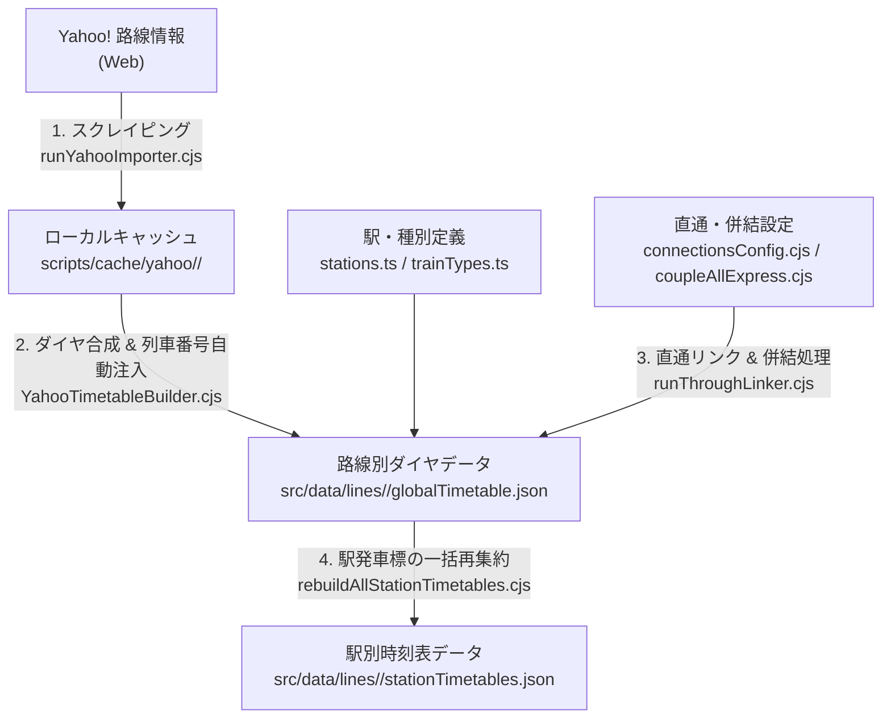

# Trainfo メンテナンス手順書（人力運用・保守ガイド）

本ドキュメントは、AIアシスタントを介さず**開発者自身の手（人力）で Trainfo の日常保守・ダイヤ改正対応・データ修正・新規路線追加を行うための実践手順書**です。

Trainfo のバックエンドデータ生成基盤は、宣言的な設定ファイル（`config.cjs` 等）と定型 CLI スクリプト群によって構成されており、決まったコマンドを実行するだけでデータの整合性が保たれるよう設計されています。

---

## 1. システム構成とデータパイプラインの全体像

### 1.1 パイプラインの流れ



### 1.2 主要ディレクトリ・ファイル一覧

| パス | 役割 | 手動編集の頻度 |
| :--- | :--- | :---: |
| `src/data/lines/<lineId>/stations.ts` | 路線内の駅一覧・座標・停車種別（`stoppingTypes`）の定義 | 中（新設・停車種別変更時） |
| `src/data/lines/<lineId>/trainTypes.ts` | 列車種別（各駅停車、快速、特急等）の名称・カラー定義 | 低 |
| `src/data/lines/<lineId>/trackGeometry.ts` | 駅間の線路形状（座標配列）データ | 低 |
| `src/data/lines/<lineId>/globalTimetable.json` | 全列車の運行ダイヤ・列車番号・直通先データ | 中（個別便の手動補正時） |
| `src/data/lines/<lineId>/stationTimetables.json` | 各駅の時刻表モーダル表示用データ（`globalTimetable.json` から自動生成） | **編集不要（自動生成）** |
| `scripts/lines/<lineId>/config.cjs` | Yahoo! スクレイパー用の駅ID・方面グループID・所要時間設定 | 中（路線追加・ダイヤ更新時） |
| `scripts/common/throughLinker/connectionsConfig.cjs` | 路線間の直通運転ペア定義ファイル | 中（直通路線追加時） |
| `src/data/linesRegistry.ts` | アプリ画面に表示する全路線の登録リスト & 乗換駅検索ヘルパー（`getAlternateStations`） | 中（路線追加時） |
| `src/data/timetableLoader.ts` | `import.meta.glob` によるダイヤJSONの動的遅延読み込み（Lazy Load）ローダー | **編集不要（自動検出）** |
| `src/utils/timeUtils.ts` | 鉄道運行日基準（04:00起点）の時刻変換・現在時刻解決共通ユーティリティ | 低 |

---

## 2. クイックリファレンス（よく使うコマンド一覧）

ターミナル（PowerShell / Bash）でプロジェクトルートから実行できる主要コマンドです。

### 2.1 開発・ビルドコマンド

| 目的 | コマンド |
| :--- | :--- |
| 開発サーバーの起動（ローカル確認） | `npm run dev` |
| 型チェック & 本番ビルド検証 | `npm run build` |
| コード静的解析（Linter） | `npm run lint` |

### 2.2 ダイヤ更新・同期コマンド

| 目的 | コマンド |
| :--- | :--- |
| **直通リンクの更新 & 全駅時刻表の再集約**（最も頻繁に使用） | `node scripts/runThroughLinker.cjs` |
| 単一路線のダイヤ取得・再生成（キャッシュ優先） | `node scripts/runYahooImporter.cjs --line <lineId>` |
| 単一路線の最新ダイヤ再取得（**ダイヤ改正時・キャッシュ無視**） | `node scripts/runYahooImporter.cjs --line <lineId> --fresh` |
| 全路線の公式列車番号を一括補完・同期 | `node scripts/enrich_train_numbers.cjs all` |
| キャッシュから全路線のダイヤを一括クリーン再構築 | `node scripts/rebuildAllTimetablesFromCache.cjs` |

### 2.3 品質監査（Audit）コマンド

| 目的 | コマンド | 合格基準 |
| :--- | :--- | :--- |
| **全路線の公式列車番号反映率チェック** | `node scripts/audit_all_lines_status.cjs` | 全路線（TX除く）が 🟢 `100%` |
| **駅座標と線路端点の吸着（ズレ）監査** | `npm run audit:stations` | 全駅の線路乖離が `0.0m` |
| **線路ジオメトリのトゲ・大ジャンプ監査** | `npm run audit:paths` | 異常な長距離ジャンプ・逆走がないこと |
| **併結列車・直通リンクの整合性監査** | `npm run audit:couplings` | エラー `0件` |

---

## 3. 日常メンテナンス手順（ケース別実践ガイド）

### ケース1: 特定の列車の「列車番号」「行先」「愛称」「時刻」を手動で直したい

特定の列車（例：臨時列車や一部便の行先表記など）をピンポイントで修正したい場合は、JSONファイルを直接編集するのが最も確実です。

1. **対象ファイルのオープン**:
   `src/data/lines/<lineId>/globalTimetable.json` をエディタで開きます。
2. **対象トリップの検索と編集**:
   発車時刻や `tripId`、`trainNumber` で検索し、以下のプロパティを修正して保存します。
   ```json
   {
     "tripId": "WD_INB_Y-22_1829_77815",
     "lineId": "yurakucho",
     "trainId": "77815",
     "trainNumber": "B1853M",        // ← 表示される公式列車番号
     "trainType": "strain",          // ← 種別ID (trainTypes.ts で定義されたもの)
     "trainName": "S-TRAIN 103号",   // ← 特急名・列車愛称（任意）
     "direction": "inbound",
     "originStationId": "Y-22",
     "destinationStationId": "Y-06",
     "customOrigin": "豊洲",          // ← 他線始発の場合の表示始発駅名（任意）
     "customDestination": "小手指",   // ← 他線直通の場合の表示行先駅名（任意）
     "cars": 10,                     // ← 編成両数
     "isHoliday": false,             // ← false: 平日, true: 土休日
     "stops": [ ... ]                // ← 各駅の着発時刻・通過フラグ
   }
   ```
   > [!IMPORTANT]
   > `stationTimetables.json`（駅別時刻表）は自動生成ファイルのため、直接編集しないでください。
3. **駅時刻表・直通先への反映コマンドを実行**:
   ```bash
   node scripts/runThroughLinker.cjs
   ```
   このコマンドを実行すると、`globalTimetable.json` の変更内容が直通先路線および `stationTimetables.json` に自動で同期・反映されます。

---

### ケース2: ダイヤ改正時に既存路線の時刻表を最新化したい

毎年春のダイヤ改正などで、特定の路線のダイヤを最新の Yahoo! 路線情報から取り直したい場合の手順です。

1. **最新データの再スクレイピング（`--fresh` オプション）**:
   ```bash
   node scripts/runYahooImporter.cjs --line <lineId> --fresh
   ```
   * `--fresh` を付けることで、`scripts/cache/yahoo/<lineId>/` 内の古いキャッシュを上書きし、Webから最新の駅時刻表と列車詳細を再取得します。
   * 取得完了後、自動的に `YahooTimetableBuilder.cjs` が走り、駅キャッシュ内の `vendorTrainId` から**公式列車番号も自動で100%注入**されます。
2. **直通リンクと駅時刻表の再構築**:
   ```bash
   node scripts/runThroughLinker.cjs
   ```
3. **列車番号の反映率を確認**:
   ```bash
   node scripts/audit_all_lines_status.cjs
   ```

---

### ケース3: 列車番号が外れた・反映されていない便を修復したい

万が一、一部路線で列車番号が5桁〜6桁の内部ID（YahooID）に戻ってしまった場合は、以下の手順で即座に修復できます。

1. **全路線汎用エンリッチスクリプトの実行**:
   ```bash
   node scripts/enrich_train_numbers.cjs all
   ```
   * 特定の1路線のみ修復したい場合は `node scripts/enrich_train_numbers.cjs <lineId>` を実行します。
   * このスクリプトは `scripts/cache/yahoo/<lineId>/stations/` 内の全駅発車標から公式列車番号（`vendorTrainId`）を抽出し、`trainId` 突合および発車時刻突合によって `globalTimetable.json` と `stationTimetables.json` を一括更新します。
2. **S-TRAIN などの特殊貫通列車の再統合（有楽町線・副都心線・西武線関連時のみ）**:
   ```bash
   npx tsx scripts/integrate_strain.cjs
   ```
3. **直通リンカーの実行と監査**:
   ```bash
   node scripts/runThroughLinker.cjs
   node scripts/audit_all_lines_status.cjs
   ```

---

### ケース4: 路線間の「直通運転」を新しく繋ぎたい・調整したい

路線Aと路線Bの境界駅での直通運転（シームレスな列車追尾と最終行先の共有）は、すべて **`scripts/common/throughLinker/connectionsConfig.cjs`** で一元管理されています。

1. **`connectionsConfig.cjs` を開く**:
   `connections` 配列に直通ペアオブジェクトを追加します。
   ```javascript
   {
     name: '埼京線 -> 川越線 (下り)',
     lineA: 'saikyo',           // 先行路線ID
     lineB: 'kawagoe',          // 後続路線ID
     stationA: 'JA-26',         // 先行路線の境界駅ID（大宮）
     stationB: 'JA-26',         // 後続路線の境界駅ID（大宮）
     dirA: 'outbound',          // 先行路線の進行方向 ('outbound' | 'inbound')
     dirB: 'outbound',          // 後続路線の進行方向 ('outbound' | 'inbound')
     maxTimeDiff: 600,          // 境界駅での最大許容停車秒数（例: 600秒 = 10分）
   },
   ```
   * 上り・下りの双方向で直通する場合は、逆方向の定義もペアで追加してください。
2. **直通リンカーの実行**:
   ```bash
   node scripts/runThroughLinker.cjs
   ```
   これにより、境界駅での `trainId` 一致・列車番号一致・発着時刻一致から直通ペアが自動特定され、`throughTripId` / `prevTripId` の付与と最終行先（`customDestination`）の伝播が行われます。

---

### ケース5: 通過駅の設定ミス（各駅停車が通過してしまう／快速が全駅止まる）を直したい

Yahoo! 路線情報の列車詳細には「停車駅」しか載っておらず、「通過駅」は載っていません。Trainfo では **`src/data/lines/<lineId>/stations.ts` の `stoppingTypes` 定義** をもとに、停車駅の間にある駅を「通過駅（`isPassing: true`）」として自動補間しています。

1. **`src/data/lines/<lineId>/stations.ts` を確認・修正**:
   各駅の `stoppingTypes` 配列に、その駅に停車する可能性のある種別IDが含まれているか確認します。
   ```typescript
   {
     id: 'JA-19',
     name: '北赤羽',
     // ...
     stoppingTypes: ['local'], // ← 'rapid'(快速) や 'commuter'(通勤快速) は通過するため含めない
   }
   ```
2. **キャッシュからダイヤを再生成**:
   Webから再スクレイピングする必要はなく、ローカルキャッシュから再生成するだけで反映されます。
   ```bash
   node scripts/runYahooImporter.cjs --line <lineId>
   node scripts/runThroughLinker.cjs
   ```

---

### ケース6: ダイヤを増やしたい（臨時列車・増発便の追加／取得系統の拡張）

目的によって以下の3つの方法があります。

#### パターンA: 特定の列車（臨時列車・団体列車・独自の増発便）を手動で1〜数本追加する

既存の似た列車（同じ種別・同じ走行区間のトリップ）をコピーして時刻を書き換えるのが最も安全で簡単です。

1. **既存トリップのコピーと編集**:
   `src/data/lines/<lineId>/globalTimetable.json` を開き、同じ方向・同じ停車パターンのトリップを1つコピーして配列末尾（または該当時刻の位置）に貼り付けます。
   ```json
   {
     "tripId": "HD_OUT_JC-05_0830_9081M", // ← ① 重複しない一意のIDに変更
     "lineId": "chuo",
     "trainId": "9081M",                  // ← 直通させる場合は接続先と同じ trainId にする
     "trainNumber": "9081M",              // ← ② 表示する列車番号
     "trainType": "limitedExp",           // ← 種別ID
     "trainName": "臨時あずさ81号",        // ← 列車愛称（任意）
     "direction": "outbound",             // ← 'outbound'(下り) | 'inbound'(上り)
     "originStationId": "JC-05",
     "destinationStationId": "JC-24",
     "customOrigin": "新宿",
     "customDestination": "松本",
     "cars": 9,
     "isHoliday": true,                   // ← false: 平日ダイヤ, true: 土休日ダイヤ
     "stops": [
       {
         "stationId": "JC-05",
         "arrivalTime": "08:30:00",
         "departureTime": "08:30:00",
         "isPassing": false
       },
       {
         "stationId": "JC-06",
         "arrivalTime": "08:32:10",
         "departureTime": "08:32:10",
         "isPassing": true                // ← ③ 通過駅も省略せず順番通りにすべて含める
       }
       // ... 終着駅まで順番に記述
     ]
   }
   ```
   > [!IMPORTANT]
   > **ダイヤ手動追加時の3つの鉄則**:
   > 1. **`tripId` は必ずユニーク（一意）にする**: 他の便と同じ `tripId` があると画面上で列車が重複・点滅します。
   > 2. **`stops` には通過駅（`isPassing: true`）もすべて順番通りに含める**: シミュレーションエンジンは隣接駅の座標セグメントを順番に辿って列車を走らせます。途中の通過駅を配列から消してしまうと、駅間でワープしたり走行が停止したりするため、**既存の同種別トリップの `stops` を丸ごとコピーして時刻だけシフトさせる**のが確実です。
   > 3. **時刻は `"HH:MM:SS"` 形式**: 深夜0時〜3時台の列車も `"24:15:00"` ではなく `"00:15:00"` と記述します（エンジン側で自動的に深夜帯として処理されます）。

2. **駅時刻表と直通リンクへの自動反映**:
   ファイルを保存したら、以下のコマンドを実行します。
   ```bash
   node scripts/runThroughLinker.cjs
   ```
   これだけで、追加した列車の停車駅発車時刻が全駅の `stationTimetables.json` に自動で挿入・時刻順ソートされ、他路線との直通設定も自動リンクされます。

#### パターンB: キャッシュ再生成時にも消えない「恒久的な増発スクリプト」として登録する

パターンAで `globalTimetable.json` を直接編集した場合、将来 `rebuildAllTimetablesFromCache.cjs` 等でキャッシュから全路線を白紙再生成すると、手動追加した便が上書きされて消えることがあります。
恒久的に残したい特別列車（例：夜行特急アルプスや S-TRAIN など）は、以下のようにスクリプト化しておくと安全です。

1. `scripts/extendAlpsTimetable.cjs` や `scripts/integrate_strain.cjs` を参考に、対象路線の `globalTimetable.json` を読み込んでトリップを `push`（既存があれば上書き）するスクリプトを作成します。
2. `scripts/runThroughLinker.cjs` の冒頭（Step 1）にその関数の呼び出しを1行追加します。
   * これにより、今後何度キャッシュから再生成しても、`runThroughLinker.cjs` を実行するだけで常に増発便が自動注入されます。

#### パターンC: Yahoo! 路線情報から取得する列車本数・途中駅始発便・区間を増やす

「路線の一部の駅しか登録していなかったため、途中駅始発・終着の区間列車が漏れていた」「路線を延伸してダイヤを増やしたい」という場合の手順です。

1. **`src/data/lines/<lineId>/stations.ts` と `trackGeometry.ts` に駅・軌道を追記**（区間延伸時）。
2. **`scripts/lines/<lineId>/config.cjs` の `stations` 配列に駅を追加**:
   * 途中駅始発の列車を漏れなく拾うには、その始発駅の `yahooStationId` と `outGroupId` / `inGroupId` が `config.cjs` に登録されている必要があります。
3. **インポーターと直通リンカーを実行**:
   ```bash
   node scripts/runYahooImporter.cjs --line <lineId>
   node scripts/runThroughLinker.cjs
   ```
   これで追加した駅の発車標から新規列車（`trainId`）が自動検出され、詳細時刻のスクレイピングと公式列車番号の注入が行われます。

---

## 4. 新規路線を手動で追加する手順（全6ステップ）

新しい路線（例：`my_new_line`）を一から手動で追加する際のチェックリストです。より詳細な背景仕様については [`docs/ROUTE_EXPANSION_PLAYBOOK.md`](./ROUTE_EXPANSION_PLAYBOOK.md) も参照してください。

### Step 1: 路線IDとラインカラーの決定
* [`docs/LINE_COLORS_GUIDELINES.md`](./LINE_COLORS_GUIDELINES.md) に従い、一意の `lineId`（スネークケース）と公式ラインカラー（HEX値）を決定します。
* 物理的に分断されている路線（信越本線や大糸線など）は、必ず区間名を含めたID・名称（例：`shinetsu_takasaki_yokokawa` / `JR信越本線（高崎～横川）`）にします。

### Step 2: 路線データフォルダの作成（`src/data/lines/<lineId>/`）
既存の近い路線のフォルダをコピーするとスムーズです。以下の4ファイルを作成します。
1. **`stations.ts`**: 駅一覧（`id`, `name`, `lat`, `lng`, `number`, `stoppingTypes`）。
2. **`trainTypes.ts`**: 種別一覧（`id`, `name`, `shortName`, `color`）。
3. **`trackGeometry.ts`**: 駅間の軌道座標配列。
   * 作成後、`npm run audit:stations` を実行し、駅の座標と軌道端点のズレが `0.0m` であることを確認します。
4. **`index.ts`**: `LineDefinition` オブジェクトをエクスポートするファイル。

### Step 3: スクレイパー設定の作成（`scripts/lines/<lineId>/config.cjs`）
1. ブラウザで [Yahoo! 路線情報の時刻表ページ](https://transit.yahoo.co.jp/timetable/) を開きます。
2. 各駅の時刻表URL（例：`https://transit.yahoo.co.jp/timetable/22559/1061?kind=1`）から以下を確認します：
   * `22559` $\rightarrow$ `yahooStationId`
   * `1061` $\rightarrow$ 下り（または上り）のグループID（`outGroupId` / `inGroupId`）
3. `scripts/lines/<lineId>/config.cjs` に駅配列、種別マッピング（`trainTypeMap`）、駅間標準所要秒数（`baseSectionSeconds`）を記述します。

### Step 4: インポーターの実行
```bash
node scripts/runYahooImporter.cjs --line <lineId>
```
* これにより `src/data/lines/<lineId>/globalTimetable.json` と `stationTimetables.json` が生成され、公式列車番号も自動注入されます。

### Step 5: フロントエンドへの登録（2ファイル）
1. **`src/types/index.ts`**:
   `LineId` ユニオン型に `| '<lineId>'` を追加します。
2. **`src/data/linesRegistry.ts`**:
   作成した `index.ts` から路線定義をインポートし、`LINES_REGISTRY` に追加します。
   > [!NOTE]
   > `src/data/timetableLoader.ts` は Vite の `import.meta.glob('./lines/*/globalTimetable.json')`（および Node.js `tsx` 用の動的 `import()` フォールバック）によって `src/data/lines/<lineId>/` 配下の JSON を自動検出するため、手動でのローダー追記は不要です。

### Step 6: 直通設定・監査・ビルド確認
1. 他路線と直通する場合は `scripts/common/throughLinker/connectionsConfig.cjs` に接続ペアを追記し、`node scripts/runThroughLinker.cjs` を実行します。
2. 監査とビルドを実行して完了です：
   ```bash
   node scripts/audit_all_lines_status.cjs
   npm run audit:stations
   npm run audit:paths
   npm run build
   ```

---

## 5. トラブルシューティング（よくある質問と対処法）

### Q1. `globalTimetable.json` を修正したのに、駅の時刻表モーダルに反映されません
* **原因**: 駅時刻表モーダルは `stationTimetables.json` を参照しているためです。
* **対処法**: `node scripts/runThroughLinker.cjs`（または駅時刻表のみ再集約する `node scripts/rebuildAllStationTimetables.cjs`）を実行してください。`globalTimetable.json` から全駅の `stationTimetables.json` が再生成されます。

### Q2. Yahoo! 上の駅名に「(東京都)」「(埼玉県)」などが付いていて、駅解決に失敗します
* **原因**: Yahoo! 路線情報の駅名表記と、`stations.ts` の駅名（`name`）が一致していないためです。
* **対処法**: `scripts/lines/<lineId>/config.cjs` の `stationNameAliases` に変換定義を追加してください（都道府県括弧はビルダー側で自動除去されますが、表記揺れがある場合はエイリアスで解決できます）。
  ```javascript
  stationNameAliases: {
    '海老名(相鉄・小田急)': '海老名',
  },
  ```

### Q3. 一部の有料座席指定列車や臨時列車だけ列車番号が5桁〜6桁の数字のままになります
* **原因**: Yahoo! の駅発車標データにおいて、ごく一部の特殊列車のみ `vendorTrainId` が空欄（未提供）になっているケースがあります（例：有楽町線の S-TRAIN など）。
* **対処法**:
  * [駅探（Ekitan）](https://ekitan.com/) 等で該当列車の公式列車番号を確認し、`globalTimetable.json` の `trainNumber` を手動で書き換えるか、生成スクリプト（`scripts/integrate_strain.cjs` 等）の辞書に `trainNo` を登録してください。

### Q4. 全体を一括でクリーンな状態にリセット・再構築したい場合はどうすればよいですか？
* **対処法**: 以下のワンストップ再構築スクリプトを実行してください。キャッシュからの全路線ダイヤ生成・列車番号エンリッチ・特急延伸補完・S-TRAIN統合・直通リンク・駅時刻表再集約までが正しい順序で一括実行されます。
  ```bash
  node scripts/rebuildAllTimetablesFromCache.cjs
  ```
