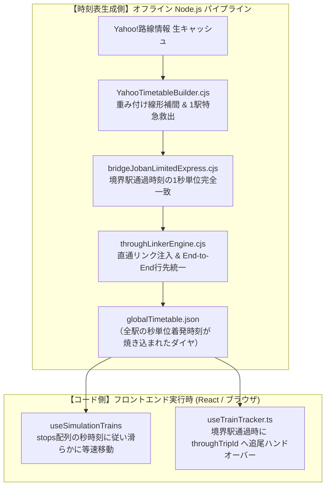

# 通過駅時刻補間・境界駅シームレス同期 技術仕様書

本ドキュメントは、Trainfo における**通過駅（`isPassing: true`）の秒単位時刻補間**、**境界駅を通過する特急・直通列車の1秒単位同期**、および**直通追尾ハンドオーバー**の数理的アルゴリズムと実装仕様をまとめた技術仕様書です。

---

## 1. 概要とアーキテクチャ設計

### 1.1 なぜ通過時刻の補間が必要なのか
鉄道の公式時刻表やウェブ上の乗換案内データ（Yahoo!路線情報・駅探等）には、以下の構造的課題が存在します：
1. **通過駅の通過時刻が未収録**: 一般の時刻表には「停車駅の発着時刻」のみが掲載され、途中にある通過駅の通過予定時刻はデータとして存在しません。
2. **直通特急の自社線内セグメント欠落**: 常磐線特急「ひたち」号のように、上野駅を出ると自線区間内（上野〜取手）をノンストップで走り抜ける列車は、自社線内に「上野」の1駅しか停車駅がないため、通常の「2駅以上停車する区間を自線トリップとする」判定で除外（破棄）されてしまいます。
3. **路線境界での時刻不整合**: 境界駅（例: 取手駅 JJ-10 / JN-01）を通過する場合、先行路線側と後続路線側で境界駅の通過時刻が1秒でも異なると、直通リンクが成立せず、追尾が途切れる原因となります。

### 1.2 責務分離（時刻表生成側 vs コード側）
Trainfo では、**「重い補間・時刻同期はすべてビルド時（時刻表生成側）に完了させ、クライアント（コード側）は軽量な描画・追尾に専念する」** という完全な責務分離を採用しています。



---

## 2. 重み付け線形補間（Weighted Linear Interpolation）アルゴリズム

### 2.1 基本原理
通過駅の時刻補間において、駅間を均等分割（単純平均）してしまうと、**「駅間が1km未満の区間も、10km以上ある長大区間も同じ所要時間で走る」** ことになり、地図上の列車速度が不自然に急加速・急減速してしまいます。

そこで Trainfo では、**「実際の駅間距離や線形を反映した標準所要秒数（重み $w$）」に基づく重み付け内分**を採用しています。

### 2.2 計算式
直前の停車駅（または既知駅）$A$ の出発秒を $T_A$、直後の停車駅 $B$ の到着秒を $T_B$ とします。  
その間にある通過駅 $X$ の通過予定秒 $T_X$ は以下の式で求められます：

$$T_X = T_A + (T_B - T_A) \times \frac{W_{A \to X}}{W_{A \to B}}$$

- $T_B - T_A$ : 区間全体の実際の運転所要時間（秒）
- $W_{A \to X}$ : 駅 $A$ から駅 $X$ までの駅間標準所要時間（重み）の累積合計
- $W_{A \to B}$ : 駅 $A$ から駅 $B$ までの駅間標準所要時間（重み）の総合計

### 2.3 駅間重みテーブルの定義例（常磐快速線）
各路線の設定ファイル（例: `scripts/lines/joban_rapid/config.cjs`）に、隣接駅間の標準所要秒数を定義します：

```javascript
baseSectionSeconds: {
  1: 240, // 上野 (JJ-01) -> 日暮里 (JJ-02) [4分00秒]
  2: 150, // 日暮里 (JJ-02) -> 三河島 (JJ-03) [2分30秒 - 駅間短]
  3: 150, // 三河島 (JJ-03) -> 南千住 (JJ-04) [2分30秒]
  4: 180, // 南千住 (JJ-04) -> 北千住 (JJ-05) [3分00秒]
  5: 480, // 北千住 (JJ-05) -> 松戸 (JJ-06)   [8分00秒 - 駅間約10.5km]
  6: 480, // 松戸 (JJ-06) -> 柏 (JJ-07)       [8分00秒 - 駅間約9.0km]
  7: 240, // 柏 (JJ-07) -> 我孫子 (JJ-08)     [4分00秒]
  8: 180, // 我孫子 (JJ-08) -> 天王台 (JJ-09) [3分00秒]
  9: 210, // 天王台 (JJ-09) -> 取手 (JJ-10)   [3分30秒 - 利根川橋梁]
}
```

### 2.4 計算例（特急ひたち11号: 上野 12:00:00発）
上野〜取手間の特急所要時間が約26分（1,560秒）の場合：
- **上野〜北千住**: 市街地で駅間が短いため、約8分で通過（`12:08:06`）。
- **北千住〜松戸**: 重みが480秒と大きいため、約5分半かけて走行し `12:13:30` に松戸を通過。
- **天王台〜取手**: `12:23:38` に天王台を通過し、`12:26:00` に境界の取手駅を通過。

この計算により、長大区間ではじっくり走り、過密区間ではテンポよく抜けていく実車通りのリアルな走行感が再現されます。

---

## 3. 自社線内1駅停車直通列車の救出仕様 (`singleStopRescueRules`)

### 3.1 課題
通常、ダイヤ合成スクリプト（`YahooTimetableBuilder.cjs`）は「自社線区間に2駅以上停車しない列車」を除外します。  
しかし、上野を出ると水戸までノンストップで走る特急ひたち号などは、常磐快速線内（上野〜取手）の停車駅が「上野」の1駅しかないため、このルールにより**約65便の特急が丸ごとドロップ**していました。

### 3.2 解決仕様
路線の `config.cjs` に `singleStopRescueRules` を宣言します：

```javascript
singleStopRescueRules: [
  {
    singleStationId: 'JJ-01',          // 自社線内の唯一の停車駅（上野）
    boundaryStationId: 'JJ-10',        // 補完すべき境界駅（取手）
    estimatedSectionSeconds: 1560,     // 上野〜取手 特急所要時間（約26分）
    throughStations: ['土浦', '石岡', '友部', '水戸', '勝田', '日立', '高萩', 'いわき', '仙台'],
  },
]
```

1. 列車が `singleStationId`（上野）にのみ停車し、他線区間の停車駅リストに `throughStations`（土浦・水戸方面）が含まれている場合、下り・上りの運行方向を自動判別します。
2. 境界駅（取手）を `isPassing: true`（通過駅）として `stops` の端点に動的追加します。
3. `knownMap`（既知駅マップ）に取手駅の通過時刻を登録し、中間駅（日暮里〜天王台）を重み付け線形補間します。

---

## 4. 境界駅通過特急の1秒単位同期仕様 (`bridgeJobanLimitedExpress`)

### 4.1 課題
境界駅（取手駅）を通過する特急列車は、先行区間（上野〜取手）の最終駅時刻と、後続区間（取手〜いわき）の始発駅時刻が独立して計算されると、数秒〜数分のズレが生じ、直通リンカーが結合に失敗します。

### 4.2 解決仕様
[scripts/bridgeJobanLimitedExpress.cjs](file:///c:/Users/Genbu/GitHub/github.com/GenbuHase/Trainfo/scripts/bridgeJobanLimitedExpress.cjs)（および房総特急用 `bridgeBosoLimitedExpress.cjs`、成田エクスプレス・あやめ用 `bridgeNexAndAyame.cjs`、小田急・御殿場線特急ふじさん用 `bridge_odakyu_gotemba.cjs`）が以下を実行します：

1. **特急判定の厳密化**:
   - 時刻表元データで `trainType === 'limited_express'` または `'limitedExp'` である列車のみを抽出（普通列車や中距離電車の誤判定を完全排除）。
2. **境界駅通過時刻の完全一致**:
   - **下り列車**: 快速線側の取手通過時刻（例: `12:26:00`）を確定させ、取手以北側の始発駅（JN-01）の時刻を同じ `12:26:00` に強制上書き。その後、取手から水戸（最初の停車駅）までの各駅を北側重みテーブル（`northWeights`）で線形補間。
   - **上り列車**: 取手以北側から取手駅へ到達した通過時刻を確定させ、快速線側の始発駅（JJ-10）の時刻を1秒単位で完全一致。
3. **ファイル安全書き込み (`safeWrite`)**:
   - Windows環境でのファイルロック競合を回避するため、リトライ処理（最大10回、バックオフ待機）付きで JSON を保存。

---

## 5. 直通リンカーとフロントエンド追尾ハンドオーバー

### 5.1 汎用直通リンカー (`throughLinkerEngine.cjs`)
境界駅（取手駅 JJ-10 / JN-01、上野駅 UT-02 / JJ-01 等）で接続するトリップペアを探索し、以下を注入します：
- 先行トリップ: `throughTripId`（後続列車ID）、`throughLineId`
- 後続トリップ: `prevTripId`（先行列車ID）、`prevLineId`
- **End-to-End 最終行先の統一**: 先行列車・後続列車すべての `customOrigin`（例: 品川）および `customDestination`（例: いわき）を全区間で統一。
- **公式列車番号の同期**: 片方が英字付き公式番号（例: `1178M`, `11M`）を持ち、他方が数字IDのみの場合に番号を伝播。

### 5.2 追尾ハンドオーバー判定 (`useTrainTracker.ts`)
列車が境界駅を高速通過する際、従来の「停車中判定」では追尾が切れるため、以下の複合条件で即座に後続トリップへバトンタッチします：

```typescript
const lastStop = found.stops[found.stops.length - 1];
const isAtLastStop = lastStop?.stationId === found.currentStationId;
// 通過駅の場合: 最後の駅に向かって走行中、または通過駅にいる
const isApproachingOrPassingLastStop =
  Boolean(lastStop?.isPassing) &&
  (found.nextStationId === lastStop?.stationId || found.currentStationId === lastStop?.stationId);

// 後続列車が既に始発駅を出て動いている場合
const isSuccessorRunning =
  successor.currentStationId !== successor.stops[0]?.stationId ||
  (successor.status === 'RUNNING' && successor.progressPercent > 0);

if (isAtLastStop || isApproachingOrPassingLastStop || isSuccessorRunning) {
  return successor; // 後続トリップへ即時ハンドオーバー
}
```

さらに、直通チェーン網羅探索（`getThroughChainTrips`）において、複数候補が存在する場合は時系列順でより進行方向（後続トリップ）の列車を優先選択します。

---

## 6. 保守・拡張チェックリスト

新しい路線や特急系統を追加・修正する際は、以下の原則を厳守してください：

- [ ] **種別の推測ハードコード禁止**: 列車番号の末尾（`M` や `H` 等）や列車名からアドホックに種別（特急等）を推測・書き換えてはならない。種別は必ず時刻表元データ（Yahoo!路線情報・駅探）の公式種別からマッピングすること。
- [ ] **重みテーブルの確認**: 新規路線を定義する際は、`baseSectionSeconds` に各駅間の標準所要秒数を設定すること（未定義の場合は均等配分となり加減速リアリズムが低下する）。
- [ ] **境界通過特急の救出**: 自社線内に1駅しか停車しない直通特急が存在する場合は、`config.cjs` の `singleStopRescueRules` に境界駅と所要秒数を登録すること。
- [ ] **全路線キャッシュ再生成パイプラインの実行**: ダイヤ変更時は `node scripts/rebuildAllTimetablesFromCache.cjs` を実行し、列車番号エンリッチメントと直通リンカー、駅時刻表再集約を一貫して適用すること。
