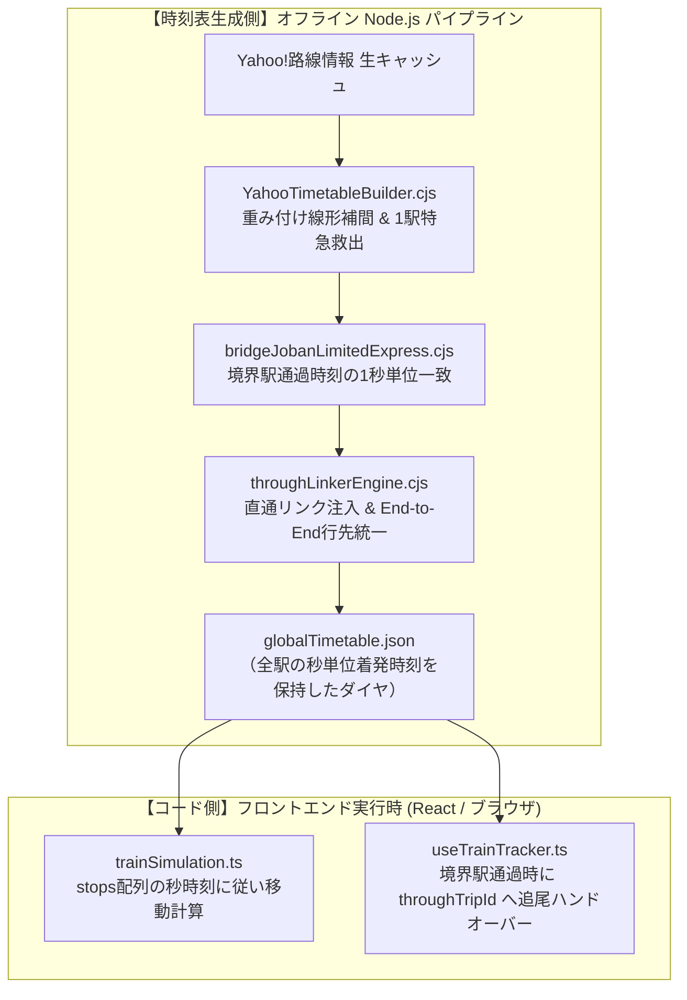

# 通過駅時刻補間・境界駅シームレス同期 技術仕様書

本ドキュメントは Trainfo における通過駅（`isPassing: true`）の秒単位時刻補間、境界駅を通過する特急・直通列車の1秒単位同期、および直通追尾ハンドオーバーの数理アルゴリズムと実装仕様をまとめた技術仕様書です。

---

## 1. 概要とアーキテクチャ設計

### 1.1 通過時刻の補間が必要な背景

鉄道の公式時刻表やウェブ上の乗換案内データには構造上の課題があります。まず一般の時刻表には停車駅の発着時刻のみが掲載されており、途中にある通過駅の通過予定時刻はデータとして存在しません。また常磐線特急ひたち号のように、上野駅を出ると自線区間内（上野〜取手）をノンストップで通過する列車は自社線内に上野の1駅しか停車駅がないため、通常の「2駅以上停車する区間を自線トリップとする」判定では除外されます。さらに境界駅（例: 取手駅 JJ-10 / JN-01）を通過する場合、先行路線側と後続路線側で境界駅の通過時刻が1秒でも異なると、直通リンクが成立せず追尾が途切れる原因となります。

### 1.2 責務分離（時刻表生成側とコード側）

Trainfo では補間と時刻同期をビルド時（時刻表生成側）に完了させ、クライアント（コード側）は描画と追尾に専念する責務分離を採用しています。



---

## 2. 重み付け線形補間アルゴリズム

### 2.1 基本原理

通過駅の時刻補間において駅間を均等分割（単純平均）すると、駅間が1km未満の区間も10km以上ある長大区間も同じ所要時間で走ることになり、地図上の列車速度が不自然に急加速・急減速します。そのため Trainfo では駅間距離や線形を反映した標準所要秒数（重み $w$）に基づく重み付け内分を採用しています。

### 2.2 計算式

直前の停車駅（または既知駅）$A$ の出発秒を $T_A$、直後の停車駅 $B$ の到着秒を $T_B$ とすると、その間にある通過駅 $X$ の通過予定秒 $T_X$ は以下の式で求めます。

$$T_X = T_A + (T_B - T_A) \times \frac{W_{A \to X}}{W_{A \to B}}$$

ここで $T_B - T_A$ は区間全体の実際の運転所要時間（秒）、$W_{A \to X}$ は駅 $A$ から駅 $X$ までの駅間標準所要時間（重み）の累積合計、$W_{A \to B}$ は駅 $A$ から駅 $B$ までの駅間標準所要時間（重み）の総合計を表します。

### 2.3 駅間重みテーブルの定義例（常磐線快速）

各路線の設定ファイル（例: `scripts/lines/jr_joban_rapid/config.cjs`）に、隣接駅間の標準所要秒数を定義します。

```javascript
baseSectionSeconds: {
  1: 240, // 上野 (JJ-01) -> 日暮里 (JJ-02) [4分00秒]
  2: 150, // 日暮里 (JJ-02) -> 三河島 (JJ-03) [2分30秒 - 駅間短]
  3: 150, // 三河島 (JJ-03) -> 南千住 (JJ-04) [2分30秒]
  4: 180, // 南千住 (JJ-04) -> 北千住 (JJ-05) [3分00秒]
  5: 480, // 北千住 (JJ-05) -> 松戸 (JJ-06)   [8分00秒 - 駅間約10.5km]
  6: 480, // 松戸 (JJ-06) -> 柏 (JJ-07)       [8分00秒 - 駅間約9.0km]
  7: 240, // 柏 (JJ-07) -> 我孫子 (JJ-08)     [4分00秒]
  8: 180, // 我孫子 (JJ-08) -> 天王台 (JJ-09) [3分00秒]
  9: 210, // 天王台 (JJ-09) -> 取手 (JJ-10)   [3分30秒 - 利根川橋梁]
}
```

### 2.4 計算例（特急ひたち11号: 上野 12:00:00発）

上野〜取手間の特急所要時間が約26分（1,560秒）の場合、重みに応じて各通過時刻を次のように算出します。上野〜北千住は市街地で駅間が短いため約8分で通過（`12:08:06`）し、北千住〜松戸は重みが480秒と大きいため約5分半かけて走行して `12:13:30` に松戸を通過する計算です。さらに天王台〜取手では `12:23:38` に天王台を通過し、`12:26:00` に境界の取手駅を通過します。

---

## 3. 自社線内1駅停車直通列車の救出仕様（`singleStopRescueRules`）

### 3.1 課題

ダイヤ合成スクリプト（`YahooTimetableBuilder.cjs`）は通常、自社線区間に2駅以上停車しない列車を除外します。しかし上野を出ると水戸までノンストップで走る特急ひたち号などは常磐快速線内（上野〜取手）の停車駅が上野の1駅しかないため、このルールにより約65便の特急が除外されていました。

### 3.2 解決仕様

路線の `config.cjs` に `singleStopRescueRules` を宣言します。

```javascript
singleStopRescueRules: [
  {
    singleStationId: 'JJ-01',          // 自社線内の唯一の停車駅（上野）
    boundaryStationId: 'JJ-10',        // 補完すべき境界駅（取手）
    estimatedSectionSeconds: 1560,     // 上野〜取手 特急所要時間（約26分）
    throughStations: ['土浦', '石岡', '友部', '水戸', '勝田', '日立', '高萩', 'いわき', '仙台'],
  },
]
```

列車が `singleStationId`（上野）にのみ停車し、他線区間の停車駅リストに `throughStations`（土浦・水戸方面）が含まれている場合は、下り・上りの運行方向を自動判別します。そのうえで境界駅（取手）を `isPassing: true`（通過駅）として `stops` の端点に動的追加し、`knownMap`（既知駅マップ）へ取手駅の通過時刻を登録したあと中間駅（日暮里〜天王台）を重み付け線形補間します。

---

## 4. 境界駅通過特急の1秒単位同期仕様

### 4.1 課題

境界駅（取手駅）を通過する特急列車は、先行区間（上野〜取手）の最終駅時刻と後続区間（取手〜いわき）の始発駅時刻が独立して計算されると数秒から数分のズレが生じ、直通リンカーの結合に失敗します。

### 4.2 解決仕様

`scripts/bridgeJobanLimitedExpress.cjs`（および房総特急用 `bridgeBosoLimitedExpress.cjs`、成田エクスプレス・あやめ用 `bridgeNexAndAyame.cjs`、小田急・御殿場線特急ふじさん用 `bridge_odakyu_gotemba.cjs`）が境界通過時刻を同期します。

まず時刻表元データで `trainType === 'limited_express'` または `'limitedExp'` である列車のみを抽出し、普通列車や中距離電車の誤判定を防ぎます。次に下り列車では快速線側の取手通過時刻（例: `12:26:00`）を確定させ、取手以北側の始発駅（`JN-01`）の時刻を同じ `12:26:00` に上書きしたうえで、取手から水戸（最初の停車駅）までの各駅を北側重みテーブル（`northWeights`）で線形補間します。逆に上り列車では取手以北側から取手駅へ到達した通過時刻を確定させ、快速線側の始発駅（`JJ-10`）の時刻を1秒単位で一致させる処理です。最後に Windows 環境でのファイルロック競合を回避するため、リトライ処理（最大10回、待機付き）を備えた `safeWrite` で JSON を保存します。

---

## 5. 直通リンカーとフロントエンド追尾ハンドオーバー

### 5.1 汎用直通リンカー（`throughLinkerEngine.cjs`）

境界駅（取手駅 `JJ-10` / `JN-01`、上野駅 `UT-02` / `JJ-01` 等）で接続するトリップペアを探索し、先行トリップに `throughTripId`（後続列車ID）および `throughLineId` を、後続トリップに `prevTripId`（先行列車ID）および `prevLineId` を付与します。同時に先行列車と後続列車の `customOrigin`（例: 品川）および `customDestination`（例: いわき）を全区間で統一し、片方が英字付き公式番号（例: `1178M`, `11M`）を持ち他方が数字IDのみの場合は公式列車番号を伝播します。

### 5.2 追尾ハンドオーバー判定（`useTrainTracker.ts`）

列車が境界駅を高速通過する際、従来の停車中判定では追尾が途切れるため、以下の複合条件で後続トリップへ引き継ぎます。

```typescript
const lastStop = found.stops[found.stops.length - 1];
const isAtLastStop = lastStop?.stationId === found.currentStationId;
// 通過駅の場合: 最後の駅に向かって走行中、または通過駅にいる
const isApproachingOrPassingLastStop =
  Boolean(lastStop?.isPassing) &&
  (found.nextStationId === lastStop?.stationId || found.currentStationId === lastStop?.stationId);

// 後続列車が既に始発駅を出て動いている場合
const isSuccessorRunning =
  successor.currentStationId !== successor.stops[0]?.stationId ||
  (successor.status === 'RUNNING' && successor.progressPercent > 0);

if (isAtLastStop || isApproachingOrPassingLastStop || isSuccessorRunning) {
  return successor; // 後続トリップへ即時ハンドオーバー
}
```

さらに直通チェーン網羅探索（`getThroughChainTrips`）において複数候補が存在する場合は、時系列順でより進行方向（後続トリップ）の列車を優先選択します。

---

## 6. 保守・拡張チェックリスト

新しい路線や特急系統を追加・修正する際は、以下の原則を守ります。

- [ ] 列車番号の末尾（`M` や `H` 等）や列車名から種別を推測・書き換えせず、時刻表元データ（Yahoo!路線情報・駅探）の公式種別からマッピングすること。
- [ ] 新規路線を定義する際は、`baseSectionSeconds` に各駅間の標準所要秒数を設定すること（未定義の場合は均等配分となり加減速が不自然になります）。
- [ ] 自社線内に1駅しか停車しない直通特急が存在する場合は、`config.cjs` の `singleStopRescueRules` に境界駅と所要秒数を登録すること。
- [ ] ダイヤ変更時は `node scripts/rebuildAllTimetablesFromCache.cjs` を実行し、列車番号補完、直通リンカー、駅時刻表再集約を一貫して適用すること。
