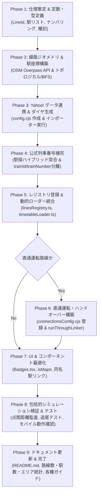
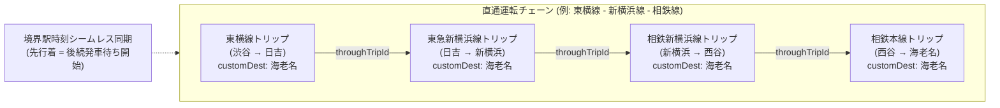
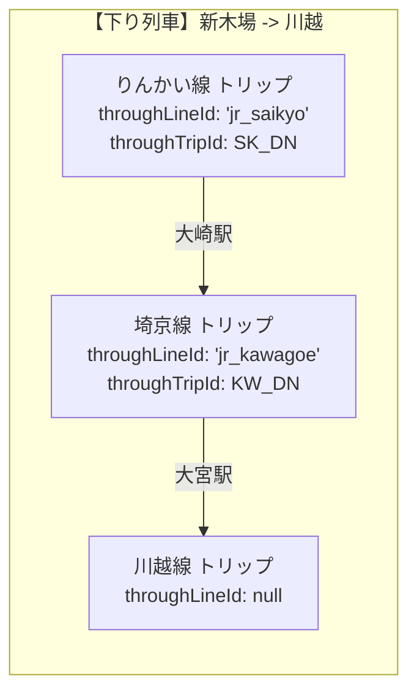
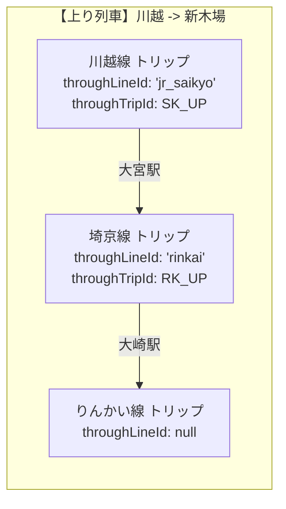

# Trainfo 路線追加プレイブック（標準手順書とチェックリスト）

本ドキュメントは Trainfo に新しい路線を追加する際の標準ワークフロー、データ構造、実装手順、不具合防止策をまとめたマニュアルです。
首都圏・北関東・甲信越・東北・東海・近畿・山陽エリアにまたがる66事業者・全276路線（ユニーク4,193駅 / 駅ID 4,992駅 / 延べ5,030駅）（JR東日本92路線、JR東海15路線、JR西日本33路線、東京メトロ9路線、東京都交通局6路線、東武鉄道13路線、西武鉄道11路線、京王電鉄7路線、京成電鉄8路線、京浜急行電鉄5路線、小田急電鉄3路線、東急電鉄9路線、横浜高速鉄道1路線、相模鉄道3路線、埼玉高速鉄道1路線、東葉高速鉄道1路線、横浜市交通局2路線、首都圏新都市鉄道1路線、東京臨海高速鉄道1路線、東京モノレール1路線、ゆりかもめ1路線、多摩都市モノレール1路線、千葉都市モノレール2路線、湘南モノレール1路線、埼玉新都市交通1路線、横浜シーサイドライン1路線、宇都宮ライトレール1路線、北総鉄道1路線、芝山鉄道1路線、秩父鉄道1路線、関東鉄道2路線、流鉄1路線、銚子電気鉄道1路線、小湊鉄道1路線、いすみ鉄道1路線、山万1路線、江ノ島電鉄1路線、小田急箱根2路線、伊豆箱根鉄道2路線、上信電鉄1路線、上毛電気鉄道1路線、真岡鐵道1路線、鹿島臨海鉄道1路線、ひたちなか海浜鉄道1路線、富士山麓電気鉄道1路線、伊豆急行1路線、野岩鉄道1路線、会津鉄道1路線、北越急行1路線、えちごトキめき鉄道2路線、しなの鉄道2路線、長野電鉄1路線、アルピコ交通1路線、上田電鉄1路線、IGRいわて銀河鉄道1路線、青い森鉄道1路線、仙台空港鉄道1路線、仙台市交通局2路線、三陸鉄道1路線、弘南鉄道2路線、津軽鉄道1路線、秋田内陸縦貫鉄道1路線、由利高原鉄道1路線、山形鉄道1路線、阿武隈急行1路線、福島交通1路線）の実装と、Yahoo! 乗換案内データソース共通基盤・駅探公式列車番号突合基盤・汎用直通リンカー基盤（391接続ペア）・併結運転リンカー基盤・オンデマンド動的時刻表ローダーで得られた知見を集約しています。

---

## 1. 路線拡張アーキテクチャ概要

Trainfo は複数事業者の路線が同一地図・同一シミュレーション基盤上で協調動作する構造を備えています。各路線は `src/data/lines/<lineId>/` 配下に自己完結したモジュールとして実装し、`src/data/linesRegistry.ts` に登録することでオンデマンド動的ローダー `src/data/timetableLoader.ts` を通じて統合される設計です。時刻表・ダイヤ生成パイプラインは `scripts/common/yahoo/` の汎用基盤により、路線ごとの設定ファイル（`scripts/lines/<lineId>/config.cjs`）を中心に完結し、相互直通運転は `scripts/common/throughLinker/` で照合・結合します。

```text
Trainfo/
├── docs/
│   ├── MAINTENANCE_GUIDE.md                   # 日常保守ガイド（コマンドリファレンス）
│   ├── ROUTE_EXPANSION_PLAYBOOK.md            # 本手順書（路線拡張プレイブック）
│   ├── PASSING_STOP_INTERPOLATION_SPEC.md     # 通過駅時刻補間・境界駅同期仕様書
│   ├── ASYMMETRIC_TRACK_ROUTING_GUIDELINES.md # 上下非対称・方向別軌道設計指針
│   ├── SHARED_SECTION_SYSTEM_ROUTING_GUIDE.md # 共用区間・運転系統ベース路線定義移行ガイド
│   ├── LINE_COLORS_GUIDELINES.md              # ラインカラー策定ガイドライン
│   └── ODPT_INTEGRATION_KNOWLEDGE.md          # ODPT連携ナレッジ・将来設計ガイド
├── scripts/
│   ├── runYahooImporter.cjs                   # Yahoo! 乗換案内 共通インポーター CLI
│   ├── runThroughLinker.cjs                   # 汎用直通リンカー CLI（全接続ペア結合）
│   ├── enrich_train_numbers.cjs               # 駅探ハイブリッド突合・公式列車番号補完
│   ├── common/
│   │   ├── yahoo/                             # 共通データ生成基盤
│   │   │   ├── YahooClient.cjs                # HTTPクライアントとキャッシュ制御
│   │   │   ├── YahooStationTimetableScraper.cjs # 駅時刻表スクレイパー
│   │   │   ├── YahooTrainDetailScraper.cjs    # 列車詳細（着発時刻）スクレイパー
│   │   │   └── YahooTimetableBuilder.cjs      # ダイヤ合成と通過・秒補間
│   │   └── throughLinker/                     # 汎用直通リンカー基盤
│   │       ├── connectionsConfig.cjs          # 全路線の直通ペア設定（391接続ペア）
│   │       └── throughLinkerEngine.cjs        # 直通トリップ探索・時刻補正エンジン
│   ├── lines/
│   │   └── <lineId>/
│   │       └── config.cjs                     # 路線固有のスクレイパー・ダイヤ設定
│   └── test_<boundary>_handover.ts            # 境界駅・追尾ハンドオーバー検証テスト
├── src/
│   ├── types/index.ts                         # LineId, TrainTypeKey などの型定義
│   ├── utils/
│   │   └── timeUtils.ts                       # 鉄道運行日基準（04:00起点）時刻変換ユーティリティ
│   ├── contexts/                              # グローバル状態管理（Simulation, Selection, Filter, UI）
│   ├── hooks/
│   │   └── useTrainTracker.ts                 # 直通列車自動追従フック
│   ├── data/
│   │   ├── linesRegistry.ts                   # 全路線の集約レジストリ・事業者表示順序・getAlternateStations
│   │   ├── timetableLoader.ts                 # オンデマンド動的時刻表ローダー（import.meta.glob による自動分割）
│   │   ├── timetableData.ts                   # 時刻表・駅発車標解決ユーティリティ
│   │   └── lines/
│   │       └── <lineId>/                      # 各路線のデータモジュール
│   │           ├── index.ts                   # LineDefinition（路線メタデータ統合）
│   │           ├── stations.ts                # 駅メタデータ（Station[]）
│   │           ├── trackGeometry.ts           # 線路幾何データ（TrackSegment[]）
│   │           ├── trainTypes.ts              # 列車種別設定（TrainTypeConfig）
│   │           ├── stationTimetables.json     # 各駅時刻表（動的ロード対象）
│   │           └── globalTimetable.json       # 全列車ダイヤ（動的ロード対象）
│   ├── components/
│   │   ├── Common/Badges.tsx                  # 駅ナンバリング・種別バッジ
│   │   ├── Debug/DebugLinesPage.tsx           # 路線・種別デバッグ一覧ページ
│   │   ├── Header/Header.tsx                  # ヘッダー・検索バー・ステータス表示
│   │   ├── Map/                               # Leaflet 地図描画・DisplayFilterDock・TrackingBar
│   │   │   └── hooks/                         # モジュラーカスタムフック群
│   │   ├── Modals/                            # 各種モーダルと TestRunModal/（試運転・臨時列車サブコンポーネント群）
│   │   └── Sidebar/StationDetail.tsx          # 駅詳細・同名駅/乗換路線切り替え
│   └── services/
│       ├── testTrainService.ts                # 試運転・臨時列車プラン作成・直通計算・プリセット管理
│       └── trainSimulation.ts                 # シミュレーション計算・直通追尾・重複除外
```

---

## 2. 路線追加の全9フェーズ手順



---

### Phase 1: 路線・駅の基本仕様策定と定数・型定義

1. 基本メタデータの決定
   - `lineId`: 英小文字のスネークケース（例: `tokyu_toyoko`, `sotetsu_main`, `odakyu_odawara`, `tsukuba_express`, `jr_saikyo`）を使用します。
   - `name`: 正式路線名称（例: `東急東横線`、`相鉄本線`、`小田急小田原線`、`JR八高線`、`JR信越本線（高崎～横川）`）を指定します。新幹線延伸による並行在来線三セク化（信越本線など）や系統分離（常磐線、東海道線、大糸線など）により物理的・運行系統的に分断されている線区では、`name` および `shortName` の双方に必ず区間名を含めてください（例: `name: 'JR信越本線（高崎～横川）'`, `shortName: '信越本線（高崎～横川）'`）。区間名を省くと表示路線ピッカー上で同名の路線が並び区別できなくなります。`lineId` も区間を含めた一意のID（`jr_shinetsu_takasaki_yokokawa`, `jr_shinetsu_naoetsu_niigata`, `jr_oito_east`, `jr_oito_west`, `jr_tokaido_atami_toyohashi`, `jr_tokaido_toyohashi_maibara`）とします。
   - `shortName`: 略称（例: `東横線`、`本線`、`小田原線`、`八高線`、`信越本線（高崎～横川）`）を指定します。
   - `operator`: 運行事業者名（例: `東急電鉄`、`相模鉄道`、`小田急電鉄`、`JR東日本`）を指定します。
   - `lineColor`: 公式ラインカラー（HEX値、例: `#da0442`, `#041452`, `#2288cc`, `#73c11d`）を指定します。同一線名でも管轄支社や運行エリアによってラインカラーが異なる場合があるため、既存の別区間設定からコピーせず当該線区の公式案内色を必ず個別に調査して適用してください。情報源は優先1位を [ニコニコ大百科「鉄道路線のラインカラー一覧」](https://dic.nicovideo.jp/a/%E9%89%84%E9%81%93%E8%B7%AF%E7%B7%9A%E3%81%AE%E3%83%A9%E3%82%A4%E3%83%B3%E3%82%AB%E3%83%A9%E3%83%BC%E4%B8%80%E8%A6%A7)、優先2位を [Wikipedia「日本の鉄道路線ラインカラー一覧」](https://ja.wikipedia.org/wiki/%E6%97%A5%E6%9C%AC%E3%81%AE%E9%89%84%E9%81%93%E3%83%A9%E3%82%A4%E3%83%B3%E3%82%AB%E3%83%A9%E3%83%BC%E4%B8%80%E8%A6%A7) とし、どちらにも存在しない場合は事業者のコーポレートカラー・代表車両帯色・直通先案内色から選定して理由を記録します。
   - `accentColor`: 看板速達種別、直通相手路線のシンボルカラー、車両帯のツートンカラー等から選定します（詳細は [docs/LINE_COLORS_GUIDELINES.md](./LINE_COLORS_GUIDELINES.md) を参照）。
   - `defaultBounds`: 初期表示バウンディングボックス（南西 `[lat, lng]`, 北東 `[lat, lng]`）を設定します。
   - `directionNames`: 上り・下りの方向名（正式名称・短縮名称）を設定します（例: `inbound: '渋谷方面'`, `outbound: '横浜方面'`）。
   - 駅ナンバリング仕様（`stationNumber` と `id`）: 鉄道事業者が公式に駅ナンバリングを導入しているか事前に確認します。`stationNumber?: string` は公式ナンバリングが存在する路線・駅のみ設定し（例: `'JU-01'`, `'TJ-01'`）、公式ナンバリングが存在しない線区・駅では必ず未定義（undefined）とします。`id: string` はシステム内部で駅を一意に識別する内部キー（例: `'SE-01'`, `'TD-01'`, `'JOE-01'`, `'CO-33'`）であり、公式駅ナンバリングではありません。

2. 型定義の拡張（`src/types/index.ts`）
   `LineId` 共用体に新しい路線IDを追加し、新路線固有の種別キーが必要な場合は `TrainTypeKey` に追加します。
   ```typescript
   export type LineId =
     | 'tobu_tojo'
     | 'tobu_ogose'
     | 'jr_saikyo'
     | 'jr_kawagoe'
     | 'rinkai'
     // ...
     | 'jr_wadamisaki'
     | (string & {});
   ```

3. 種別定義の作成（`src/data/lines/<lineId>/trainTypes.ts`）
   各種別の表示名、短縮名、背景色（`bgColor`）、文字色（`textColor`）、枠線色（`borderColor`）を定義します。基本方針として、各駅停車（`local`）は当該路線の `lineColor` と同色にするか、東武鉄道など公式停車駅案内図で専用色がある場合は公式色に合わせます。優等種別や直通種別は [docs/LINE_COLORS_GUIDELINES.md](./LINE_COLORS_GUIDELINES.md) および `src/data/trainTypePresets.ts` に従って統一します。

---

### Phase 2: 線路ジオメトリと駅座標の構築

列車が地図上を滑らかに走行するためのポリラインと駅座標を構築します。山間部・単線・地下トンネル・複線のいずれにおいても、OSM のノード接続関係に基づく連続線復元（トポロジカル / BFS 探索）を標準手順とします。

1. OSM Overpass API による線路データ取得
   対象路線のルートリレーションまたはウェイを取得して `scripts/cache/osm_<lineId>.json` に保存します。
   ```overpassql
   [out:json][timeout:60];
   relation["route"="train"]["name"~"りんかい線"];
   (._;>>;);
   out body;
   ```

2. トポロジカル・ノード接続探索による完全連続線の抽出
   リレーション内のウェイから端点ノードの隣接グラフを構築し、起点駅から終点駅までを順番に走査して1本の連続本線座標配列を生成します。駅間を始点と終点の2点だけで結んだり、等間隔に4〜5分割した直線補間座標で代替したりする実装は禁止します。駅構内や高架区間で接続が切れる場合は構内分岐ウェイや高架橋・橋梁ウェイのIDを明示的に連結し、必ず実線路に沿ったポリラインを生成してください。

3. 駅座標の配置と線路ポリラインへのスナップ（`stations.ts`）
   - 各路線の `stations.ts` の駅座標（`lat`, `lng`）は必ずその路線の線路セグメント（`TrackSegment`）の接続端点ノード（`coordinates[0]` または `coordinates[coordinates.length - 1]`）と一致（距離誤差 0.0m）させます。
   - `transfers` 配列には乗り換え可能な他社線・他路線名のみを記載し、自路線の名称を含めないでください。
   - ターミナル駅や乗換駅では同一駅名であっても路線ごとにホーム位置が数十〜数百メートル異なるため、他社線・JRの代表点や駅前広場ノードへ上書きせず、自路線の軌道ノード上に配置してください。
   - OSMデータから駅ノードを抽出する際は `n.startsWith(s.name)` のような前方一致を使わず（例えば「上野」検索時に「上野広小路」が誤マッチしてセグメント長が0mに退化します）、完全一致（`n === s.name` または `n === `${s.name}駅``）で判定してください。
   - 直通運転を行う共同使用駅・境界駅（押上駅、北千住駅、渋谷駅など）では、先行路線の終点と後続路線の始点を同一座標（ギャップ 0m）で直結させます。
   - 各駅に `stoppingTypes` 配列を設定します。この配列がダイヤ合成時の通過駅判定における唯一の参照元となります。
   ```typescript
   export interface Station {
     id: string;             // 例: 'R-01'
     lineId: LineId;         // 路線ID（必須）
     number: number;         // 1-based 連番
     name: string;           // 駅名
     nameKana: string;
     nameEn: string;
     lat: number;            // 自路線の線路セグメント端点と一致
     lng: number;            // 自路線の線路セグメント端点と一致
     transfers: string[];    // 乗換路線
     address: string;
     platforms: { inbound: string; outbound: string };
     stoppingTypes: TrainTypeKey[]; // 停車する種別の配列
     isMajor?: boolean;      // 広域ズーム表示駅
     facilities?: StationFacilities;
   }
   ```

4. 上下線別線区間・上下非対称路線の設計基準と実装手順
   新路線を追加する際は、上りと下りで経路・トンネル・経由駅が物理的に分離している区間（山岳ループ線・長大トンネル分離、勾配緩和別線、別線複線化、車両基地用地分離、地上／地下分離ホーム）が存在しないか必ず事前に調べます。該当区間では `direction: 'outbound'` と `direction: 'inbound'` にセグメントを分離し、土合駅や湯檜曽駅のように上下ホームが大きく離れる駅は `platformCoordinates` を定義します。地上ホームノードと地下ホームノードを単一グラフで探索して 170度以上の往復トゲが出ないよう、下り線用と上り線用で別々にノード探索・抽出してください。詳細は [docs/ASYMMETRIC_TRACK_ROUTING_GUIDELINES.md](./ASYMMETRIC_TRACK_ROUTING_GUIDELINES.md) を参照してください。

---

### Phase 3: Yahoo! 路線情報データ連携とダイヤ生成

Trainfo では `scripts/common/yahoo/` のデータソース共通基盤を採用し、途中駅待避・緩急接続での着発差分および終着駅の到着時刻を取得します。

1. 路線設定ファイルの作成（`scripts/lines/<lineId>/config.cjs`）
   ```javascript
   module.exports = {
     lineId: 'rinkai',
     name: '東京臨海高速鉄道りんかい線',
     stationsFilePath: 'src/data/lines/rinkai/stations.ts',
     outputPaths: {
       stationTimetables: 'src/data/lines/rinkai/stationTimetables.json',
       globalTimetable: 'src/data/lines/rinkai/globalTimetable.json',
     },
     stations: [
       { id: 'R-01', name: '新木場', yahooStationId: '22830', inGroupId: '1081', outGroupId: null },
       { id: 'R-02', name: '東雲', yahooStationId: '22748', inGroupId: '1081', outGroupId: '1080' },
       // 境界駅（大崎）: 上り（新木場方面）のみ保持、下りは直通先（埼京線）に委ねる
       { id: 'R-08', name: '大崎', yahooStationId: '22559', inGroupId: null, outGroupId: '1080' },
     ],
     stationNameAliases: {},
     trainTypeMap: {
       '各駅停車': 'local',
       '普通': 'local',
       '快速': 'rapid',
       '通勤快速': 'commuter',
     },
     defaultCars: 10,
     baseSectionSeconds: {
       1: 150, // R-01 -> R-02
       2: 120, // R-02 -> R-03
     },
   };
   ```
   Yahoo! ID は `https://transit.yahoo.co.jp/timetable/` で対象路線の駅時刻表ページを開き、URL（例: `https://transit.yahoo.co.jp/timetable/22559/1080?kind=1`）から `22559` を `yahooStationId`、`1080` を進行方向のグループID、逆方向ページの `1081` を反対方向のグループIDとして確認します。

2. インポーター CLI の実行
   ```bash
   node scripts/runYahooImporter.cjs --line <lineId>
   ```
   全駅の平日（`kind=1`）・土休日（`kind=4`）発車標から `stationTimetables.json` を出力し、ユニーク列車（`${dayKey}_${trainId}`）の全停車駅着発時刻を収集したうえで、`stations.ts` の `stoppingTypes` を参照して通過駅を特定し `globalTimetable.json` を生成します。

---

### Phase 4: 公式列車番号補完（自動注入と駅探ハイブリッド突合）

公式列車番号（例: `1001レ`, `2425T`, `1349M`, `B1853M`）を保持するため、`trainId`（直通判定用内部ID）と `trainNumber`（表示用公式列車番号）を分離して注入します。`YahooTimetableBuilder.cjs` は駅時刻表キャッシュ（`scripts/cache/yahoo/<lineId>/stations/`）の `vendorTrainId` を自動的に読み込んで公式列車番号を初期注入するため、主要路線では Phase 3 の実行時点で突合率 100.0% が達成されます。

キャッシュに `vendorTrainId` がない事業者（つくばエクスプレス等）や一部特別列車では、駅探との突合パイプラインを実行します。

1. 駅探の時刻表URL体系とパラメータ規定
   URL は `https://ekitan.com/timetable/railway/line-station/<lineCode>-<stationIndex>/<direction>?dw=<dw>` です。曜日コード `dw` は `dw=0` が平日ダイヤ、`dw=1` が土曜ダイヤ、`dw=2` が休日ダイヤ（日曜・祝日）を表します。土曜・休日ダイヤが共通の私鉄各線であっても、平日は必ず `dw=0`、休日は `dw=2` を指定してください（`dw=1` を平日として取得すると平日専用列車と土曜ダイヤ便が誤突合されます）。方向パラメータは、終端駅では存在する方向が常に `d1`（反対方向の `d2` は HTTP 404）、途中駅では `d1` が上り方面、`d2` が下り方面です。

2. 駅探スクレイピングスクリプトの設計（`scripts/fetch<Line>Ekitan.cjs`）
   各列車リンクの `tx` クエリパラメータから公式列車番号を抽出します。駅探の HTML には1ページ内に上下線双方の時刻表テーブル（`<table class="search-result-data ek-search-result">`）と方面タブ（`<li class="ek-direction_tab" data-ek-direction_name="...">`）がインデックス1対1で含まれるため、`d1` を1回取得するだけで全方面のテーブルを取得できます。方面判定では駅名自体への誤マッチを防ぐため、必ず「○○方面」単位で判定します。

3. 列車番号補完スクリプトの実行（`scripts/enrich_train_numbers.cjs`）
   - `trip.trainId = trip.trainId || trip.trainNumber;` で旧生IDを `trainId` に退避し、直通判定の識別子を維持します。
   - `normalizeTrainNumber` により末尾アルファベット付きや「レ」付きはそのままとし、6桁純数字（東急・みなとみらい線・東急新横浜線・相鉄直通等）は `XXX-XXXレ`、その他の純数字は末尾に「レ」を付与します。
   - 平日/休日のバケット振り分けは `const isHoli = row.dayKey ? row.dayKey === 'holiday' : row.dw !== 0;` とし、`dw=0` と `dw=2` を分離します。
   - Yahoo! と駅探の秒丸め等による1〜2分差を吸収するため許容誤差180秒の近接マッチを併用し、東急・相鉄等では上下線パリティ検証（下り奇数・上り偶数）も実施します。臨時特急は辞書マッピング（`SPECIAL_*`）で補完します。
   - 全駅の発車標アイテム（`dep.trainId` と `dep.no`）も同時に同期します。
   ```bash
   node scripts/enrich_train_numbers.cjs <lineId>
   ```

---

### Phase 5: レジストリ登録と動的ローダー統合

初期バンドルサイズを抑えるため、時刻表JSONは路線モジュール内で静的インポートせず `src/data/timetableLoader.ts` でオンデマンド読み込みを行います。

1. モジュール定義ファイルの作成（`src/data/lines/<lineId>/index.ts`）
   ```typescript
   import type { LineDefinition } from '../../../types';
   import { TOKYU_TOYOKO_STATIONS } from './stations';
   import { TOKYU_TOYOKO_TRACK_SEGMENTS } from './trackGeometry';
   import { TOKYU_TOYOKO_TRAIN_TYPES } from './trainTypes';

   export const tokyuToyokoLine: LineDefinition = {
     id: 'tokyu_toyoko',
     name: '東急東横線',
     shortName: '東横線',
     operator: '東急電鉄',
     lineColor: '#da0442',
     accentColor: '#ea5504',
     defaultCars: 8,
     defaultBounds: [
       [35.450, 139.600],
       [35.670, 139.720],
     ],
     directionNames: {
       inbound: '渋谷方面',
       outbound: '横浜方面',
       inboundFull: '上り 渋谷・副都心線方面',
       outboundFull: '下り 横浜・みなとみらい線方面',
       inboundShort: '渋谷方面',
       outboundShort: '横浜方面',
     },
     stations: TOKYU_TOYOKO_STATIONS,
     trackSegments: TOKYU_TOYOKO_TRACK_SEGMENTS,
     trainTypes: TOKYU_TOYOKO_TRAIN_TYPES,
     stationTimetables: { weekday: {}, holiday: {} },
     globalTimetable: [],
   };
   ```

2. 集約レジストリへの追加（`src/data/linesRegistry.ts`）
   作成した路線オブジェクトを `LINES_REGISTRY` に登録し、表示路線セレクターのエリア別分類（`kanto` / `koshinetsu` / `tohoku` / `tokai` / `kansai`）として `LINE_AREA_MAP` に追加します。新規事業者の場合は `OPERATOR_DISPLAY_ORDER` および `AREA_OPERATOR_ORDER` にも追加します。

3. オンデマンド動的ローダーの確認（`src/data/timetableLoader.ts`）
   `timetableLoader.ts` は Vite の `import.meta.glob('./lines/*/globalTimetable.json')` と `import.meta.glob('./lines/*/stationTimetables.json')`（Node.js `tsx` 実行時は動的 `import()` フォールバック）を使用しているため、`src/data/lines/<lineId>/` 配下に JSON を配置して `LINES_REGISTRY` に登録するだけで自動的に路線別チャンクへ分割・遅延ロードされます。

---

### Phase 6: 直通運転・境界駅ハンドオーバー設定（直通路線のみ）

単独完結路線の場合はスキップして Phase 7 へ進みます。直通路線では境界駅での時刻ギャップ（列車消失）と路線跨ぎ時の行先変化を防ぐため、シームレス時刻同期と End-to-End 行先解決を行います。



1. 境界駅の発車標データの住み分け
   境界駅（例: 大崎駅、日吉駅、新横浜駅）で両路線の発車標が重複しないよう、一方の路線には上り発車標のみ、他方の路線には下り発車標のみを持たせます（`inGroupId: null` または `outGroupId: null`）。`getCombinedStationTimetables` により、両路線選択時は上下線発車標が時刻順に統合されます。

2. 汎用直通リンカー基盤への接続ペア登録と実行
   `scripts/common/throughLinker/connectionsConfig.cjs` の `connections` 配列に上り・下りの接続ペアを追加し、`node scripts/runThroughLinker.cjs` を実行します。
   ```javascript
   {
     name: '新路線 -> 接続路線 (下り)',
     lineA: 'new_line',
     lineB: 'existing_line',
     stationA: 'NL-10',
     stationB: 'EL-01',
     dirA: 'outbound',
     dirB: 'outbound',
     maxTimeDiff: 300,
   },
   {
     name: '接続路線 -> 新路線 (上り)',
     lineA: 'existing_line',
     lineB: 'new_line',
     stationA: 'EL-01',
     stationB: 'NL-10',
     dirA: 'inbound',
     dirB: 'inbound',
     maxTimeDiff: 300,
   },
   ```
   `runThroughLinker.cjs` を実行すると、全276路線の `stations.ts` からの駅名マスタ収集、併結・分割運転リンク（`coupleAllExpress.cjs`）の構築、境界駅での時刻一致処理、直通チェーン最先端までの探索による `customDestination` と `customOrigin` の一括統一が自動処理されます。

3. 異なる駅コードを持つ境界接続駅の物理同一性対応と乗換案内
   路線ごとに駅IDが異なる境界駅でも、`src/services/trainSimulation.ts` の `isSamePhysicalStation` が駅名一致または距離 500m 以内を同一物理駅として判定し、境界停車中の引き継ぎを行います。境界駅の `stations.ts` の `transfers` 配列には相互の路線名を追加してください。

---

### Phase 7: UI・コンポーネント最適化

1. 駅ナンバリングバッジの配色設定（`src/components/Common/Badges.tsx`）
   `STATION_BADGE_COLORS` に登録できるのは、各鉄道事業者が公式に制定した駅ナンバリング記号および配色のみです。JR東日本新潟支社・東北本部管内や新幹線などの公式未制定路線では内部管理用駅IDのプレフィックスを登録せず、`stations.ts` の `stationNumber` も未定義のままにしてください。
   ```typescript
   TY: {
     borderColor: '#da0442',
     prefixColor: '#da0442',
     numColor: '#da0442',
   },
   SO: {
     borderColor: '#041452',
     prefixColor: '#041452',
     numColor: '#041452',
   },
   ```

2. 主要駅ハイライト・同名駅切替リンク・描画負荷対策
   - ズームアウト時にも常時表示させたいターミナル駅・乗換駅には、`stations.ts` で `isMajor: true` を付与します。
   - `getAlternateStations`（`src/data/linesRegistry.ts`）により同名駅の相互切り替えが動作するため、乗換駅の駅名表記に揺れがないことを確認します。
   - `src/components/Map/hooks/` 配下の各フックではインライン `filter: drop-shadow` や非選択マーカーでの常時アニメーションを避けて GPU 負荷を抑えています。

---

### Phase 8: 包括的シミュレーション検証とテスト

1. 型チェックとビルド検証（`npm run build`）および静的解析（`npm run lint`）を実行し、エラーがゼロであることを確認します。
2. `npm run audit:stations`、`npm run audit:paths`、`npm run audit:couplings`、`node scripts/audit_all_lines_status.cjs` を実行し、全駅座標の線路端点との距離誤差 `0.0m`、直線手抜きセグメントの不在、300m 以上の不自然な大ジャンプ不在、列車番号反映率を定量的に確認します。
3. 直通路線では `scripts/test_<boundary>_handover.ts` を作成・実行し、境界越境時の `resolveSelectedTrain` による追尾引き継ぎと自動路線追加が成功することを検証します。
4. ブラウザ上で早送り再生（10x / 30x）し、列車の逆走や瞬間移動、種別フィルター、駅発車標モーダル、列車詳細サイドバーの表示を確認します。

---

### Phase 9: ドキュメント更新と完了

統計スクリプトで最新の事業者数・総路線数・延べ駅数・ユニーク駅数・エリア別路線数を算出し、`README.md`、`docs/LINE_COLORS_GUIDELINES.md`、`docs/MAINTENANCE_GUIDE.md`、`docs/ROUTE_EXPANSION_PLAYBOOK.md` の各数値と路線一覧を同期したうえで、`git status` と `git diff` で意図しない変更が含まれていないことを確認します。

---

## 3. 直通運転・境界駅ハンドオーバー設計標準

複数路線を跨ぐ直通系統を扱う際のパターン別設計マトリクスです。

| 直通パターン | 代表例 | 境界駅 | 発車標データ設計 | 直通メタデータ設計 | 備考 |
| :--- | :--- | :--- | :--- | :--- | :--- |
| パターンA: 2路線直通 | 中央線と中央本線、中央線と青梅線、埼京線と川越線 | 高尾 (`JC-24`)、立川 (`JC-19`)、大宮 (`JA-26`) | 一方に上り、他方に下りのみ設定して重複ゼロで統合 | 境界でトリップ分割し `throughTripId`, `throughLineId`, `customDestination`, `customOrigin` を相互付与 | 境界越境時に相手路線を未選択でも自動追加して追尾継続 |
| パターンB: 3路線以上の貫通直通 | 川越線・埼京線・りんかい線、メトロ有楽町/副都心線・西武有楽町線・西武池袋線 | 大宮 (`JA-26`)、大崎 (`JA-08` / `R-08`)、小竹向原 (`Y-06`/`F-06` / `SI-37`)、練馬 (`SI-06`) | 各境界で発車標グループIDを上下片側のみに分離 | 進行方向前方指向連鎖（Forward-Pointing Chain）を採用し、中間路線は進行先の次路線のみを指向 | 双方向照合 `(prev.throughTripId === t.tripId \|\| t.throughTripId === prev.tripId)` により全線追尾 |
| パターンC: 接続・乗換境界（直通なし） | 大糸線 (JR東日本) と大糸線 (JR西日本)、中央本線と篠ノ井線 | 南小谷 (`OE-33` / `OW-01`)、塩尻 (`CO-61` / 篠ノ井線起点) | 各自の終着方向を `null` 設定し線内完結発車標として案内 | 直通メタデータは不要。`transfers` と同名駅切替リンクのみ提供 | 事業者・電化方式・運行系統が独立 |
| パターンD: 異経路・別ホーム直通 | 武蔵野線と川越線（臨時特急等） | 大宮 (`JU-07`地上 / `JA-26`地下) | 各路線の発車標に自線ホーム発着分をそのまま掲載 | ホーム・駅ID・方向が異なるため `throughTripId` / `throughLineId` を明示付与して接続 | 列車番号・方向による自動フォールバックが効かないため明示リンクが必要 |
| パターンE: 乗降制限・通過駅のみの直通特急 | S-TRAIN（平日豊洲〜小手指、土休日元町・中華街〜西武秩父） | 小竹向原、練馬 | 旅客乗降駅のみ発車標に掲載（運転停車駅は未掲載） | 専用の貫通トリップ合成スクリプト（`integrate_strain.cjs`）により各線に通過補間トリップを注入して前方指向連鎖を構築 | 中間路線で旅客停車が0〜1駅でも全区間を連続追尾 |

3路線以上が直通する場合の中間路線は、進行方向の前方（次に進む路線）のみを `throughTripId` に保持します。





---

## 4. 高精度線路ジオメトリ生成技術

OSMのルートリレーションに含まれるウェイは必ずしも起点から終点に向かって順番に並んでいるとは限らず、配列順序通りに連結すると往復トゲ（ヒゲ状逆戻り）、トンネルや橋梁の飛び越え、待避線への迷い込みが発生します。これを防ぐため、OSMノード隣接グラフを構築して起点駅ノードから終点駅ノードへの最短経路探索（BFS / Dijkstra）を行い、1本の連続した本線ノード配列を復元します。

```text
[Overpass API データ]
       |
       v
[ノード隣接グラフの構築 (Adjacency Graph)]
       |
       v
[起点駅ノードから終点駅ノードへの最短経路探索 (BFS)]
       |
       v
[1本の連続本線ノード配列 (continuousNodes)]
       |
       v
[各駅旅客ホーム座標のスナップ (snapStation)]
       |
       v
[駅間 TrackSegment の生成 (trackGeometry.ts)]
```

ウェイの端点（`nodes[0]` と `nodes[nodes.length - 1]`）が一致するウェイのみを連続して辿り、生成された全セグメントの点間距離を走査して 300m 以上の不自然なジャンプや 150度超の方位反転がないかを自動監査します。

---

## 5. 設計標準と不具合防止策 36箇条

これまでの路線実装とダイヤデータ移行で確立した、遵守すべき設計標準です。

### 1. ダイヤ補間における `stoppingTypes` 駆動

停車・通過判定に駅番号や固有ルールをコード側へハードコードすると、路線拡張時やダイヤ改正時に不整合が生じます。停車・通過判定は必ず `stations.ts` の `station.stoppingTypes.includes(trainType)` のみで行います。

### 2. Yahoo! 路線情報における平日・休日列車ID衝突の回避

Yahoo! の内部データでは、平日（`kind=1`）と土休日（`kind=4`）で同一の `trainId`（例: `44618`）が再利用される場合があります。ユニーク列車キーおよびキャッシュファイル名は必ず `${dayKey}_${trainId}` の複合キーで管理します。

### 3. 種別解決の最長一致スキャン

「普通 むさしの号」を部分一致で判定すると「普通」に誤判定され、固有の設定が失われます。種別名のマッチングはキー文字列の長さが長い順（降順）に走査し、具体的な種別名を優先して解決します。

### 4. 直通先種別の自社線内フォールバック

東武東上線に乗り入れる地下鉄直通列車（副都心線内「通勤急行」等）が東上線内の各駅停車区間で通過と誤認されるのを防ぐため、路線定義に存在しない他社線種別が渡された場合や自社線内で全駅停車となる区間では自社線内の標準種別（`local` 等）へフォールバックさせます。

### 5. 短絡線・特急・臨時列車の通過駅補間

武蔵野線の大宮支線（大宮〜武蔵浦和/南浦和）や貨物線経由の特急（鎌倉号、川越号等）、常磐線特急（ひたち・ときわ）で中間の通過駅が飛び越えられて列車がワープまたは除外されるのを防ぐため、`junctionPassingRules`、`singleStopRescueRules`、`directStops: true` を組み合わせて全経由駅を補間します。重み付け線形補間の計算式や境界駅1秒同期仕様は [docs/PASSING_STOP_INTERPOLATION_SPEC.md](PASSING_STOP_INTERPOLATION_SPEC.md) を参照してください。

### 6. 発着番線と駅ナンバリングの実態整合

同一駅名でも発着ホームが異なる場合（大宮駅地上ホーム発着のむさしの号・しもうさ号に対する埼京線地下ホーム `JA-26` 等）、列車が実際に発着するホームの所属路線ナンバリング（大宮地上ホームなら `JU-07`）を採用します。

### 7. 直通列車の路線間重複防止と駅案内

複数路線を跨ぐ直通系統では、各路線の駅発車標で正しく案内できるよう双方の時刻表データには列車を残しつつ、シミュレーション層（`trainSimulation.ts`）の `calculateActiveTrains` で「同一列車番号かつ共通の駅IDを含む」アクティブ列車を検出し、停車駅数が多い全線通し運行トリップを優先して重複描画を除外します。

### 8. 長大路線の負荷軽減と系統分離

東京近郊過密区間（`JC-01`〜`JC-24`）と山梨・長野中距離区間（`JC-25`〜`JC-32`, `CO-33`〜`CO-61`）のように境界駅（高尾）を境に運行頻度や両数が大きく変わる路線を単一モジュールで扱うと、常時多数の列車計算が発生して負荷が高まります。JR東日本の案内区分に合わせて「JR中央線（`jr_chuo`）」と「JR中央本線（`jr_chuo_main`）」に分離し、境界駅で `throughTripId` / `throughLineId` を付与して追尾を引き継ぎます。

### 9. 「普通」と「各駅停車」の種別分離とフィルタリング

中距離電車が走る路線では案内上の正式種別が「普通」であるため、`trainTypeMap` で `'普通': 'regular'`、`'各駅停車': 'local'` を分離します。ビルダーでは `regular` が `local` に上書きされないよう保護し、地図の種別絞り込みでは `regular` を各停系グループに含めます。

### 10. 往復トゲの検出と解消

OSM リレーション内のウェイ登録順序が乱れていると駅ホームの先から手前へ戻るV字型のトゲが発生するため、点間距離監査スクリプトで大ジャンプを検出し、トポロジカル探索（BFS）でウェイを連結します。

### 11. 旧スイッチバック線・側線と現行本線ホームの座標乖離防止

駅代表座標に旧駅舎や引き込み線を置くと本線セグメントが駅手前で分断され、駅ピンも線路から外れます。駅座標は必ず現行の旅客本線ホームのノード座標を採用し、全駅で軌道端点との距離乖離がないかを検証します。

### 12. 終着駅・他社線直通境界の決定基準

特急（あずさ・しなの）等が他社線へ直通する路線では、正式な線路名称および支社管轄（中央本線は塩尻まで、塩尻〜松本は篠ノ井線）に準拠し、終着駅で下りグループIDを `outGroupId: null` としてモジュールとしての整合性を保ちます。

### 13. 運行実態に合わせた区間定義と優等列車リレーション活用

篠ノ井線（塩尻〜篠ノ井）のようにほぼ全列車が信越本線に直通して長野駅まで運行する路線は、運行実態に合わせて長野駅まで（全19駅）を1モジュールとして定義し、全線を走る特急しなのリレーション（Relation `1983032`）等を活用して通し軌道を抽出します。

### 14. 運行事業者境界による路線モジュールの系統分離

大糸線のように同一名称でも電化方式・運行会社・車両運用が南小谷駅で独立している場合は、`jr_oito_east`（JR東日本）と `jr_oito_west`（JR西日本）の2系統に分離し、南小谷駅で同名駅リンクを提供します。

### 15. トポロジカル経路探索による単線・山間部線路の連結

単線・山間部では端点間距離の最近傍探索のみで連結すると短い橋梁のスキップや待避線への迷い込みが起きるため、OSMノード隣接グラフを構築して起点駅から終点駅への最短経路探索（BFS）で1本の本線軌道を復元します。

### 16. 直通運転路線の系統分離と越境自動ハンドオーバー

埼京線と川越線のように直通運転を行う路線も、単独閲覧ができるよう2系統モジュールに分離します。境界駅（大宮駅）で上り/下り発車標を住み分け、直通列車に `throughTripId` / `throughLineId` を付与して越境時の自動路線追加と追尾引き継ぎを有効にします。

### 17. 3路線直通における進行方向前方指向連鎖

川越線・埼京線・りんかい線のように3つ以上のモジュールを跨ぐ直通では、中間路線（埼京線）が進行方向の前方（下りは川越線、上りはりんかい線）のみを `throughTripId` に保持します。追尾時の双方向照合により全線を連続して追尾できます。

### 18. 第三セクター・私鉄相互直通における列車番号保持と行先表示

りんかい線など社境を越えて直通する路線では、Yahoo! の `trainId` が社境を越えて維持される特性を使ってペアリングし、`customDestination` と `customOrigin` を相互注入することで境界手前から最終目的地を表示できます。

### 19. 共用複々線区間を持つ2系統のダイヤ分離と列車番号完全一致リンク

東京メトロ有楽町線と副都心線のように起点から途中駅（和光市〜小竹向原）まで線路を共用し同一グループIDで発車標が提供される場合は、`shouldExcludeTrip` に固有駅リストを定義して相手路線の列車を除外したうえで `buildStationTimetablesFromTrips: true` により正規トリップのみから駅時刻表を再生成する設計です。さらに東武東上線との直通リンクは時刻幅での曖昧一致を使わず `trainNumber` と `isHoliday` の完全一致のみで1対1接続します。なお、和光市駅・新木場駅・渋谷駅・池袋駅では同名駅リンクも成立する仕組みです。

### 20. 旅客通過駅・運転停車を含む有料座席指定列車の貫通トリップ合成

S-TRAIN のように中間路線（西武有楽町線: 全3駅）で旅客停車が0〜1駅の列車は、通常のスクレイパーでは中間路線が欠落するため、専用スクリプト（`integrate_strain.cjs`）で運転停車を含む全停車時刻をマスタ定義し、全中間通過駅の時刻を区間距離比率で補間してメトロ・西武有楽町線・西武池袋線間の前方指向連鎖を構築します。駅発車標には旅客乗降可能駅のみを登録します。

### 21. 公式列車番号（`trainNumber`）と内部列車ID（`trainId`）の分離と正規化

Yahoo! の生数字IDを `trip.trainId`（内部参照・直通追尾キー）、表示用の公式番号を `trip.trainNumber` に分離します。`normalizeTrainNumber` では末尾アルファベット付きや「レ」付きを保持し、純数字には「レ」を付与します（非電化気動車は `D` 運用）。駅発車標アイテムにも `dep.no` と `dep.trainId` を同期します。

### 22. 駅探スクレイピングにおける1ページ多重テーブルと方面タブ判定

駅探の時刻表 HTML（`d1`）には1ページ内に上下双方のテーブル（`<table class="search-result-data ek-search-result">`）と方面タブ（`<li class="ek-direction_tab">`）が1対1で含まれるため、`d1` の1回の取得で全方面を抽出します。方面判定では駅名部分一致による誤判定を防ぐため必ず「○○方面」単位で判定し、臨時列車は `SPECIAL_*` 辞書で補完します。

### 23. ダイヤ再生成時の列車番号保護と冪等性

`runYahooImporter.cjs` や `rebuildAllTimetablesFromCache.cjs` を再実行しても公式列車番号が失われないよう、`YahooTimetableBuilder.cjs` と `enrich_train_numbers.cjs` で自動注入と既存ID退避（`trip.trainId = trip.trainId || trip.trainNumber;`）の冪等性を維持します。

### 24. 路線・駅固有処理のハードコード排除

UIコンポーネントやシミュレータ内に特定路線IDや特定駅番号の条件分岐を書かず、`LineDefinition.defaultCars`（標準編成両数）、先頭・末尾配列要素による始終着駅判定、`isLocalTrainType`（`src/data/trainTypes.ts`）による各停系種別判定など汎用メタデータで制御します。

### 25. 境界駅における時刻同期と発着ギャップゼロ保証

先行路線の終着駅到着時刻と後続路線の始発駅発車時刻の間に1〜3分の開きがあると、その間に列車ピンが地図上から消滅します。直通リンカーで先行トリップの終着時刻 `syncTime` と後続トリップの始発駅 `arrivalTime` を秒単位で一致させ、境界停車中の切れ目をなくします。

### 26. 直通チェーン全体の End-to-End 行先解決

3路線以上が直通する系統では直近路線の終点駅名を行先に設定せず、`throughTripId` を末尾まで探索してチェーン全体の最終終着駅を特定し、全区間のトリップの `customDestination` を統一します。

### 27. 境界駅の路線別駅ID差異と物理駅同一性判定

日吉（`TY-13` と `SH-03`）、新横浜（`SH-01` と `SO-52`）、渋谷（`TY-01` と `F-16`）、横浜（`TY-21` と `MM-01`）のように路線間で駅ID体系が異なる境界駅でも、`trainSimulation.ts` の `isSamePhysicalStation` が駅名一致または距離 0.5km 以内で同一物理駅と判定し、引き継ぎを保証します。

### 28. モバイル GPU 負荷軽減とマーカー CSS 最適化

数百個の列車マーカーが存在する状態でインライン `filter: drop-shadow(...)` や非表示要素の `animate-ping` を残すと、モバイルブラウザの GPU メモリが枯渇して画面が白く固まる原因となります。これを防ぐため `drop-shadow` を廃止して CSS `shadow-md` と `border` を用い、`.train-pulse` 要素は選択中の列車（`isSelected`）のみ DOM に生成し、`.train-div-icon` と `.station-div-icon` に `contain: layout style; will-change: transform;` を指定します。

### 29. Leaflet タイル白抜け防止と ResizeObserver デバウンス

Leaflet の `fadeAnimation: false` と `preferCanvas: true` を設定してタイル切替時の透過チラつきとベクターノード負荷を抑え、`ResizeObserver` には 150ms のデバウンスを入れて連続 `map.invalidateSize()` によるスタックを防ぎます。`.leaflet-container` には背景色 `#f1f5f9` を設定します。

### 30. 大規模駅マーカーのインスタンスキャッシュと差分更新

駅を選択するたびに全駅マーカーを破棄・再生成するとメインスレッドが固まるため、駅マーカーインスタンスを `Map` でキャッシュし、駅選択時は対象駅の CSS クラス（`ring-4`, `scale-125` 等）の差分更新のみを行います。

### 31. 動的時刻表ローディングと統合時刻表メモ化

全路線の `stationTimetables.json` と `globalTimetable.json` は `index.ts` で静的インポートせず `src/data/timetableLoader.ts` の `import.meta.glob` により動的チャンク分割し、選択路線と直通先路線のみオンデマンド読み込みします。`SimulationContext.tsx` でも統合時刻表配列をメモ化し、毎フレームの再結合を避けます。

### 32. 駅探スクレイピングにおける曜日パラメータ `dw` の規定

駅探の URL パラメータは `dw=0` が平日、`dw=1` が土曜、`dw=2` が休日です。`dw=1` を平日として取得すると平日専用列車と土曜ダイヤ便が誤突合されるため、スクレイパーでは必ず平日 `dw=0`・休日 `dw=2` を指定し、エンリッチメント側のバケット判定も `const isHoli = row.dayKey ? row.dayKey === 'holiday' : row.dw !== 0;` とします。

### 33. 公式駅ナンバリングと内部管理用駅IDの混同防止

システム内部の駅識別子（例: `SE-01`, `TD-01`, `BW-01`, `BE-01`, `JOE-01`, `SN-01`, `CO-33`）と公式駅ナンバリングを混同してはいけません。JR東日本新潟支社・東北本部管内や新幹線などの公式駅ナンバリング未制定路線では、`stations.ts` の `stationNumber` を未定義とし、`Badges.tsx` の `STATION_BADGE_COLORS` にも非公式プレフィックスを登録しないでください。

### 34. 同名駅における自線軌道上配置と駅名完全一致原則

ターミナル駅・乗換駅（大手町、新宿、永田町、飯田橋、渋谷、池袋等）では路線ごとに実際のホーム位置が数十〜350m以上離れるため、他社線の代表座標や駅前広場ノードを流用せず、必ず自路線の線路セグメント端点と一致（誤差 0.0m）させます。また OSM ノード照合時は前方一致（`startsWith`）を禁止して完全一致のみを採用し、「上野」に「上野広小路」が誤マッチしてセグメントが退化する不具合を防ぎます。

### 35. 直通境界駅における構内線路ギャップゼロ保証

相互直通運転を行う共同使用駅（押上駅、北千住駅、渋谷駅など）では、先行路線の終点セグメントに駅構内を通過して後続路線の始点ノードへ接続するノード群を含め、先行終点と後続始点および境界駅の `lat`, `lng` を距離誤差 `0.0000m` で一致させます。

### 36. 路線追加・ダイヤ改訂完了時のドキュメント同期

新路線の追加・統廃合やダイヤ改訂の完了時には統計スクリプトで最新の事業者数・総路線数・延べ駅数・ユニーク駅数・エリア別路線数を算出し、`README.md`、`docs/LINE_COLORS_GUIDELINES.md`、`docs/MAINTENANCE_GUIDE.md`、`docs/ROUTE_EXPANSION_PLAYBOOK.md` を同期します。

---

## 6. 新路線追加 クイックチェックリスト

### Phase 1: 基本仕様と型定義

- [ ] `lineId`, `name`, `operator`, `defaultCars` を決定する
- [ ] 公式駅ナンバリング制定状況を確認する（未制定路線では `stationNumber` を未定義にする）
- [ ] 公式 `lineColor` と `accentColor` を [docs/LINE_COLORS_GUIDELINES.md](./LINE_COLORS_GUIDELINES.md) に基づいて決定する
- [ ] `src/types/index.ts` の `LineId` 共用体に新路線IDを追加する
- [ ] `src/data/lines/<lineId>/trainTypes.ts` を作成する

### Phase 2: 線路ジオメトリと駅座標構築

- [ ] OSM Overpass API で路線のリレーション・ウェイを取得し `scripts/cache/` に保存する
- [ ] トポロジカル探索（BFS）スクリプトで連続した本線ノード列を復元する
- [ ] 自線ホーム軌道上に駅座標を配置し、セグメント端点との距離誤差 0m（`0.0m`）を確認する
- [ ] 駅名照合で前方一致（`startsWith`）による誤マッチがないことを確認する
- [ ] 直通路線の場合は直通境界駅で先行路線終点と後続路線始点が `0.0000m`（0m）で直結していることを確認する
- [ ] `src/data/lines/<lineId>/stations.ts`（`lineId` と `stoppingTypes` 必須）と `trackGeometry.ts` を出力する
- [ ] 軌道セグメントの点間距離監査（300m以上のジャンプ、往復トゲ、退化セグメント不在）を通過する

### Phase 3: Yahoo! データ連携とダイヤ生成

- [ ] Yahoo! 路線情報で全駅の `yahooStationId`, `inGroupId`, `outGroupId` を確認する
- [ ] `scripts/lines/<lineId>/config.cjs` を作成する
- [ ] `node scripts/runYahooImporter.cjs --line <lineId>` を実行し、`stationTimetables.json` と `globalTimetable.json` を生成する

### Phase 4: 公式列車番号補完（必要な路線のみ）

- [ ] 駅探の `lineCode` と各駅インデックスを確認し、`scripts/fetch<Line>Ekitan.cjs` で平日 `dw=0`・休日 `dw=2` を厳守して取得する
- [ ] `scripts/enrich_train_numbers.cjs` に対象路線の突合設定を追加し、`node scripts/enrich_train_numbers.cjs <lineId>` を実行して `trainNumber`・`trainId`・`stationTimetables.json` を同期する

### Phase 5: レジストリ登録と動的ローダー統合

- [ ] `src/data/lines/<lineId>/index.ts` を作成する（時刻表フィールドは空で初期化）
- [ ] `src/data/linesRegistry.ts` の `LINES_REGISTRY` と `LINE_AREA_MAP`（新規事業者なら `OPERATOR_DISPLAY_ORDER` 等も）に追加する
- [ ] `src/data/timetableLoader.ts` から動的ロードできることを確認する

### Phase 6: 直通運転・ハンドオーバー構築（直通路線のみ）

- [ ] 境界駅の Yahoo! グループIDを片側のみに設定する
- [ ] `scripts/common/throughLinker/connectionsConfig.cjs` に上り・下りの接続ペアを追加し、`node scripts/runThroughLinker.cjs` を実行する
- [ ] 境界駅の到着・停車開始時刻の秒単位一致と、直通チェーンの `customDestination`・`customOrigin` 統一を確認する
- [ ] 境界駅の `stations.ts` の `transfers` に相互路線名を追加する

### Phase 7: UIとコンポーネント最適化

- [ ] 公式制定路線のみ `src/components/Common/Badges.tsx` の `STATION_BADGE_COLORS` に記号と配色を追加する
- [ ] `stations.ts` の主要駅に `isMajor: true` を設定し、乗換駅の駅名表記が一致していることを確認する

### Phase 8: 検証とテスト

- [ ] `npm run build` および `npm run lint` でエラーがゼロであることを確認する
- [ ] `npm run audit:stations`、`npm run audit:paths`、`npm run audit:couplings`、`node scripts/audit_all_lines_status.cjs` を実行する
- [ ] ブラウザの `/#debug` 画面で配色・バッジを確認し、早送り（10x / 30x）とモバイル表示で境界駅連続走行・時刻表・列車詳細の動作を確認する

### Phase 9: ドキュメント更新と完了

- [ ] `README.md`、`docs/LINE_COLORS_GUIDELINES.md`、`docs/MAINTENANCE_GUIDE.md`、`docs/ROUTE_EXPANSION_PLAYBOOK.md` の総路線数（全262路線等）・駅数・路線一覧を更新する
- [ ] `git status` と `git diff` で不要な差分がないことを確認する

---

## 7. 設定ファイルと自動化スクリプトテンプレート集

### 1. Yahoo! インポーター設定テンプレート（`scripts/lines/<lineId>/config.cjs`）

```javascript
module.exports = {
  lineId: '<lineId>',
  name: '<正式路線名>',
  stationsFilePath: 'src/data/lines/<lineId>/stations.ts',
  outputPaths: {
    stationTimetables: 'src/data/lines/<lineId>/stationTimetables.json',
    globalTimetable: 'src/data/lines/<lineId>/globalTimetable.json',
  },
  stations: [
    { id: '<PREFIX>-01', name: '<駅名1>', yahooStationId: 'xxxxx', inGroupId: null, outGroupId: 'yyyy' },
    { id: '<PREFIX>-02', name: '<駅名2>', yahooStationId: 'xxxxx', inGroupId: 'zzzz', outGroupId: 'yyyy' },
    // ...
  ],
  stationNameAliases: {
    // 例: '浅草(ＴＸ)': '浅草'
  },
  trainTypeMap: {
    '各駅停車': 'local',
    '普通': 'local', // 中距離線区は 'regular'
    '快速': 'rapid',
    '通勤快速': 'commuter_rapid',
    '特急': 'limitedExp',
  },
  defaultCars: 10,
  baseSectionSeconds: {
    1: 120,
    2: 150,
  },
};
```

### 2. 直通メタデータ自動付与スクリプトテンプレート（`scripts/link_<lineA>_<lineB>.cjs`）

```javascript
const fs = require('fs');
const path = require('path');

const lineAPath = path.resolve('src/data/lines/<lineA>/globalTimetable.json');
const lineBPath = path.resolve('src/data/lines/<lineB>/globalTimetable.json');

const lineATrips = JSON.parse(fs.readFileSync(lineAPath, 'utf8'));
const lineBTrips = JSON.parse(fs.readFileSync(lineBPath, 'utf8'));

// 下り直通（lineA -> lineB）
const aOutToBoundary = lineATrips.filter(t => t.direction === 'outbound' && t.destinationStationId === '<BOUNDARY_STATION_A>');
const bOutFromBoundary = lineBTrips.filter(t => t.direction === 'outbound' && t.originStationId === '<BOUNDARY_STATION_B>');

for (const a of aOutToBoundary) {
  const b = bOutFromBoundary.find(target => target.trainNumber === a.trainNumber && target.isHoliday === a.isHoliday);
  if (b) {
    a.throughTripId = b.tripId;
    a.throughLineId = '<lineB>';
    a.customDestination = b.customDestination || '<FINAL_DESTINATION>';
    b.customOrigin = a.customOrigin || '<ORIGINAL_ORIGIN>';
  }
}

// 上り直通（lineB -> lineA）
const bInToBoundary = lineBTrips.filter(t => t.direction === 'inbound' && t.destinationStationId === '<BOUNDARY_STATION_B>');
const aInFromBoundary = lineATrips.filter(t => t.direction === 'inbound' && t.originStationId === '<BOUNDARY_STATION_A>');

for (const b of bInToBoundary) {
  const a = aInFromBoundary.find(target => target.trainNumber === b.trainNumber && target.isHoliday === b.isHoliday);
  if (a) {
    b.throughTripId = a.tripId;
    b.throughLineId = '<lineA>';
    b.customDestination = a.customDestination || '<FINAL_DESTINATION>';
    a.customOrigin = b.customOrigin || '<ORIGINAL_ORIGIN>';
  }
}

fs.writeFileSync(lineAPath, JSON.stringify(lineATrips, null, 2), 'utf8');
fs.writeFileSync(lineBPath, JSON.stringify(lineBTrips, null, 2), 'utf8');
console.log('直通メタデータ付与完了');
```

### 3. ハンドオーバー自動検証テストテンプレート（`scripts/test_<boundary>_handover.ts`）

```typescript
import { calculateActiveTrains } from '../src/services/trainSimulation';
import { formatTrainNumber, timeStringToSeconds } from '../src/data/timetableData';
import type { ActiveTrain } from '../src/types';

function resolveSelectedTrain(
  activeTrains: ActiveTrain[],
  selectedTrainId: string | null,
  lastSelectedTrain: ActiveTrain | null
): ActiveTrain | null {
  if (!selectedTrainId) return null;
  const found = activeTrains.find((t) => t.tripId === selectedTrainId);
  if (found) return found;

  const prev = lastSelectedTrain;
  if (prev) {
    const successor = activeTrains.find((t) => {
      if (t.tripId === prev.tripId) return false;
      if (
        (prev.throughTripId && t.tripId === prev.throughTripId) ||
        (t.throughTripId && t.throughTripId === prev.tripId)
      ) {
        return true;
      }
      return false;
    });
    if (successor) return successor;
  }
  return null;
}
```

### 4. 駅探時刻表スクレイピングスクリプトテンプレート（`scripts/fetch<Line>Ekitan.cjs`）

```javascript
const fs = require('fs');

const STATIONS = [
  { id: '<PREFIX>-01', name: '<駅名1>', code: '<lineCode>-0' },
  { id: '<PREFIX>-02', name: '<駅名2>', code: '<lineCode>-1' },
];

function sleep(ms) {
  return new Promise((r) => setTimeout(r, ms));
}

function parseTableChunk(tableHtml) {
  const departures = [];
  const trMatches = tableHtml.match(/<tr[^>]*class="[^"]*ek-hour_line[^"]*"[^>]*>[\s\S]*?<\/tr>/gi) || [];

  for (const tr of trMatches) {
    const hourMatch = tr.match(/<td>\s*(\d{2})\s*<\/td>/i);
    if (!hourMatch) continue;
    const hour = hourMatch[1];

    const liMatches = tr.match(/<li[^>]*class="[^"]*ek-train-tooltip[^"]*"[\s\S]*?<\/li>/gi) || [];
    for (const li of liMatches) {
      const typeMatch = li.match(/data-tr-type="([^"]+)"/i);
      const destMatch = li.match(/data-dest="([^"]+)"/i);
      const minMatch = li.match(/<span[^>]*class="[^"]*time-min[^"]*"[^>]*>\s*(\d{2})\s*<\/span>/i);
      const hrefMatch = li.match(/href="([^"]+)"/i);

      if (!minMatch) continue;
      const rawType = typeMatch ? typeMatch[1].trim() : '普通';
      const destination = destMatch ? destMatch[1].trim() : '';
      const minute = minMatch[1];
      const href = hrefMatch ? hrefMatch[1] : '';

      let trainNo = '';
      const txMatch = href.match(/tx=([0-9a-zA-Z\-_]+)/i);
      if (txMatch) {
        const parts = txMatch[1].split('-');
        trainNo = parts[parts.length - 1];
      } else {
        trainNo = `${hour}${minute}`;
      }

      const hNum = parseInt(hour, 10);
      const mNum = parseInt(minute, 10);
      departures.push({
        h: hNum,
        m: mNum,
        time: minute,
        sec: hNum * 3600 + mNum * 60,
        t: rawType,
        d: destination,
        no: trainNo,
        rawType,
      });
    }
  }

  departures.sort((a, b) => a.sec - b.sec);
  return departures;
}

function judgeDirection(tabName, st) {
  if (tabName.includes('<下り主要行先>方面')) return 'outbound';
  if (tabName.includes('<上り主要行先>方面')) return 'inbound';
  return null;
}

async function scrapeStation(st, dw) {
  let outbound = [];
  let inbound = [];
  const url = `https://ekitan.com/timetable/railway/line-station/${st.code}/d1?dw=${dw}`;
  try {
    const res = await fetch(url, {
      headers: {
        'User-Agent': 'Mozilla/5.0 (Windows NT 10.0; Win64; x64) AppleWebKit/537.36 (KHTML, like Gecko) Chrome/120.0.0.0 Safari/537.36',
      },
    });
    if (!res.ok) throw new Error(`HTTP ${res.status}`);
    const html = await res.text();
    const tabs = [...html.matchAll(/class="[^"]*ek-direction_tab[^"]*"[^>]*data-ek-direction_name="([^"]+)"/gi)].map((m) => m[1]);
    const tables = [...html.matchAll(/<table[^>]*class="[^"]*ek-search-result[^"]*"[^>]*>([\s\S]*?)<\/table>/gi)].map((m) => m[1]);

    for (let i = 0; i < tables.length; i++) {
      const tabName = tabs[i] || '';
      const deps = parseTableChunk(tables[i]);
      const dir = judgeDirection(tabName, st);
      if (dir === 'outbound') outbound = deps;
      else if (dir === 'inbound') inbound = deps;
    }
  } catch (e) {
    console.error(`Error fetching ${st.id}: ${e.message}`);
  }
  return { outbound, inbound };
}
```

### 5. 公式列車番号エンリッチメントスクリプトテンプレート（`scripts/enrich_train_numbers.cjs`）

```javascript
const fs = require('fs');
const path = require('path');

function normalizeTrainNumber(rawNo) {
  if (!rawNo) return '';
  const trimmed = rawNo.trim();
  if (trimmed.includes('+')) {
    return trimmed.split('+').map((p) => normalizeTrainNumber(p.trim())).join(' + ');
  }
  if (/[a-zA-Zレ]$/.test(trimmed) || trimmed.includes('-')) {
    return trimmed;
  }
  if (/^\d+$/.test(trimmed)) {
    return `${trimmed}レ`;
  }
  return trimmed;
}

function enrichLine(lineId, ekitanDataPath) {
  const globalPath = path.resolve(`src/data/lines/${lineId}/globalTimetable.json`);
  const stationPath = path.resolve(`src/data/lines/${lineId}/stationTimetables.json`);
  const trips = JSON.parse(fs.readFileSync(globalPath, 'utf8'));
  const stationTimetables = JSON.parse(fs.readFileSync(stationPath, 'utf8'));
  const ekitanData = JSON.parse(fs.readFileSync(ekitanDataPath, 'utf8'));
  const trainIdToOfficialNo = new Map();

  for (const trip of trips) {
    const lookupId = trip.trainId || trip.trainNumber;
    trip.trainId = lookupId;
    const dayKey = trip.isHoliday ? 'holiday' : 'weekday';
    const dayData = ekitanData[dayKey] || {};
    let officialNo = null;

    if (!officialNo) {
      const originDeps = dayData[trip.originStationId]?.[trip.direction] || [];
      const originStop = trip.stops.find((s) => s.stationId === trip.originStationId);
      if (originStop && originStop.departureTime) {
        const [h, m] = originStop.departureTime.split(':').map((v) => parseInt(v, 10));
        const matched = originDeps.find((d) => d.h === h && d.m === m);
        if (matched && matched.no) {
          officialNo = normalizeTrainNumber(matched.no);
        }
      }
    }

    if (!officialNo) {
      for (const stop of trip.stops) {
        if (!stop.departureTime) continue;
        const [h, m] = stop.departureTime.split(':').map((v) => parseInt(v, 10));
        const stDeps = dayData[stop.stationId]?.[trip.direction] || [];
        const matched = stDeps.find((d) => d.h === h && d.m === m);
        if (matched && matched.no) {
          officialNo = normalizeTrainNumber(matched.no);
          break;
        }
      }
    }

    if (officialNo) {
      trip.trainNumber = officialNo;
      trainIdToOfficialNo.set(lookupId, officialNo);
    }
  }

  for (const stId of Object.keys(stationTimetables)) {
    for (const dir of ['inbound', 'outbound']) {
      for (const day of ['weekdays', 'holidays']) {
        const deps = stationTimetables[stId]?.[dir]?.[day] || [];
        for (const dep of deps) {
          const rawId = dep.trainId || dep.no;
          dep.trainId = rawId;
          if (trainIdToOfficialNo.has(rawId)) {
            dep.no = trainIdToOfficialNo.get(rawId);
          }
        }
      }
    }
  }

  fs.writeFileSync(globalPath, JSON.stringify(trips, null, 2), 'utf8');
  fs.writeFileSync(stationPath, JSON.stringify(stationTimetables, null, 2), 'utf8');
  console.log(`${lineId} の公式列車番号エンリッチメント完了`);
}
```

### 6. 統合直通リンカースクリプトテンプレート（`scripts/link_<lineA>_<lineB>.cjs`）

```javascript
const fs = require('fs');

function timeToSec(t) {
  if (!t) return null;
  const parts = t.split(':').map(Number);
  let h = parts[0];
  if (h < 4) h += 24;
  return h * 3600 + parts[1] * 60 + (parts[2] || 0);
}

function extractYahooTrainId(tripId) {
  if (!tripId) return null;
  const parts = tripId.split('_');
  return parts[parts.length - 1];
}

const STATION_NAMES = {};

function linkLinePair({
  lineAId,
  lineBId,
  tripsA,
  tripsB,
  stationAId,
  stationBId,
  dirA,
  dirB,
  linkName,
  maxTimeDiff = 360,
}) {
  let linkedCount = 0;
  const candidatesB = tripsB.filter((tB) => {
    if (tB.direction !== dirB) return false;
    const firstStop = tB.stops[0];
    return firstStop && firstStop.stationId === stationBId;
  });

  for (const tA of tripsA) {
    if (tA.direction !== dirA) continue;
    const lastStop = tA.stops[tA.stops.length - 1];
    if (!lastStop || lastStop.stationId !== stationAId) continue;
    if (tA.throughTripId) continue;

    const tASec = timeToSec(lastStop.arrivalTime || lastStop.departureTime);
    const yIdA = extractYahooTrainId(tA.tripId);
    const noA = tA.trainNumber;

    let bestB = null;
    let minDiff = Infinity;

    for (const tB of candidatesB) {
      if (tA.isHoliday !== tB.isHoliday) continue;
      if (tB.prevTripId) continue;

      const firstStop = tB.stops[0];
      const tBSec = timeToSec(firstStop.departureTime || firstStop.arrivalTime);
      const diff = Math.abs(tBSec - tASec);
      const yIdB = extractYahooTrainId(tB.tripId);
      const noB = tB.trainNumber;

      if (yIdA && yIdB && yIdA === yIdB && diff <= maxTimeDiff) {
        bestB = tB;
        break;
      }
      if (noA && noB && noA === noB && diff <= 180 && diff < minDiff) {
        minDiff = diff;
        bestB = tB;
      } else if (diff <= 120 && diff < minDiff) {
        minDiff = diff;
        bestB = tB;
      }
    }

    if (bestB) {
      tA.throughTripId = bestB.tripId;
      tA.throughLineId = lineBId;
      bestB.prevTripId = tA.tripId;
      bestB.prevLineId = lineAId;

      const syncTime = lastStop.arrivalTime || lastStop.departureTime;
      lastStop.departureTime = syncTime;
      bestB.stops[0].arrivalTime = syncTime;
      linkedCount++;
    }
  }

  console.log(`[${linkName}] 接続完了: ${linkedCount} 本`);
  return linkedCount;
}

function resolveAllChainDestinations(allTripsMap) {
  function resolveChainDestination(startTrip) {
    let curr = startTrip;
    const visited = new Set([curr.tripId]);
    while (curr.throughTripId && allTripsMap.has(curr.throughTripId)) {
      const next = allTripsMap.get(curr.throughTripId);
      if (visited.has(next.tripId)) break;
      visited.add(next.tripId);
      curr = next;
    }
    const lastStop = curr.stops[curr.stops.length - 1];
    const finalStationName = STATION_NAMES[curr.destinationStationId] || (lastStop ? STATION_NAMES[lastStop.stationId] : null);
    let dest = curr.customDestination;
    if (dest) dest = dest.replace(/\(相鉄・小田急\)/g, '').trim();
    return dest || finalStationName || '行先不明';
  }

  const resolvedChains = new Set();
  for (const [tripId, trip] of allTripsMap.entries()) {
    if (resolvedChains.has(tripId)) continue;
    if (!trip.throughTripId && !trip.prevTripId) continue;

    let head = trip;
    const visitedBack = new Set([head.tripId]);
    while (head.prevTripId && allTripsMap.has(head.prevTripId)) {
      const p = allTripsMap.get(head.prevTripId);
      if (visitedBack.has(p.tripId)) break;
      visitedBack.add(p.tripId);
      head = p;
    }

    const chain = [];
    let curr = head;
    const visitedFwd = new Set();
    while (curr && !visitedFwd.has(curr.tripId)) {
      visitedFwd.add(curr.tripId);
      chain.push(curr);
      if (curr.throughTripId && allTripsMap.has(curr.throughTripId)) {
        curr = allTripsMap.get(curr.throughTripId);
      } else {
        break;
      }
    }

    const finalDest = resolveChainDestination(head);
    for (const t of chain) {
      resolvedChains.add(t.tripId);
      t.customDestination = finalDest;
    }
  }
}
```
