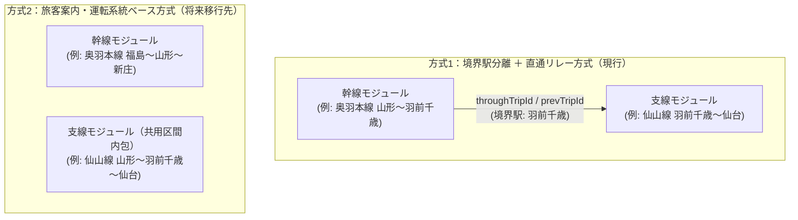

# 共用区間および運転系統ベース路線定義（方式1・方式2）設計・移行ガイドライン

本ドキュメントは、Trainfo において他路線と線路を共用して主要ターミナルへ乗り入れる路線（例：仙山線の羽前千歳～山形、仙台空港アクセス線の名取～仙台、男鹿線の追分～秋田など）のデータ定義方式について、**現行の「方式1（境界駅分離＋直通リレー方式）」から将来の「方式2（旅客案内・運転系統ベース／共用区間内包方式）」へ移行するための設計仕様および作業手順**をまとめた技術ドキュメントです。

---

## 1. 背景と基本方針

鉄道における「路線の区間」には、以下の2つの異なる定義が存在します。

1. **線路戸籍（事業基本計画）上の区間**:
   - 分岐駅（境界駅）を起点・終点とする物理的な路線区間。
   - 例：仙山線は「仙台 ～ 羽前千歳」、男鹿線は「追分 ～ 男鹿」、仙台空港線は「名取 ～ 仙台空港」、大湊線は「野辺地 ～ 大湊」（※大湊線は戸籍上も独立だが快速は八戸発着）。
2. **旅客案内・運転系統上の区間**:
   - 実際の列車が発着し、駅の発車標・路線図・乗換案内（Yahoo! 路線情報等）で一体として案内される運行区間。
   - 例：仙山線は全列車が奥羽本線に乗り入れて「**仙台 ～ 山形**」で運行。男鹿線は全列車が「**秋田 ～ 男鹿**」で運行。仙台空港アクセス線は全列車が「**仙台 ～ 仙台空港**」で運行。

### 基本方針
- **現状（暫定運用）**: 東北新設路線等は **方式1（境界駅分離＋直通リレー方式）** で実装済み。
- **将来目標**: ユーザーが1つの路線を選択しただけで直感的に始発から終着ターミナルまでの全運行区間を把握できるよう、特殊なバイパス系統（上野東京ライン・仙石東北ライン）を除き、順次 **方式2（旅客案内・運転系統ベース）** へ統一・移行する。

---

## 2. 方式1と方式2のアーキテクチャ比較

| 比較観点 | 方式1：境界駅分離＋直通リレー方式 | 方式2：旅客案内・運転系統ベース（共用区間内包） |
| :--- | :--- | :--- |
| **データ定義範囲** | 分岐駅（境界駅）までの独自区間のみを定義 | 乗り入れ先の主要ターミナルまでの共用区間を含めて定義 |
| **路線単独選択時の表示** | 分岐駅～ターミナル間（例：名取～仙台）が表示されない（※列車クリック時に自動有効化） | **その路線を1つ選ぶだけで主要ターミナルまで路線・駅・列車が完結表示される** |
| **複数路線選択時の軌道・駅** | 線路ポリライン・駅マーカーが一切重複しない | 共用区間でポリライン・駅ピンが重なるため、描画層の重複排除（Dedup）が推奨される |
| **複数路線選択時の列車ピン** | 境界駅で先行トリップから後続トリップへバトンタッチ | `trainSimulation.ts` の同一列車番号排除（`hasSeenTrainNumber`）により重複ピンを自動抑止 |
| **直通リンカー設定** | `connectionsConfig.cjs` に境界駅の中途駅接続（`allowMidStation`）が必須 | 同一路線内でターミナルまで完走するため、境界駅での直通リンカー設定が不要（または最小限） |

---

## 3. 全136路線における現状分類と移行対象一覧

全136路線を監査し、現在の実装方式と将来の移行対象を以下の3カテゴリに分類しています。

### カテゴリA：現在「方式1」で実装されており、将来「方式2」へ移行する対象路線（計14路線）

#### ① 東北エリア（優先移行対象：8路線）

| # | 路線ID (`lineId`) | 路線名 | 現在の定義区間（方式1） | 方式2 移行後の定義区間 | 内包する共用区間（相手路線・駅数） |
| :--- | :--- | :--- | :--- | :--- | :--- |
| 1 | `sendai_airport` | 仙台空港アクセス線 | 名取 ～ 仙台空港 (4駅) | **仙台 ～ 名取 ～ 仙台空港 (9駅)** | `tohoku_fukushima_sendai` の 仙台～名取（仙台、長町、太子堂、南仙台、名取：5駅） |
| 2 | `senzan` | JR仙山線 | 仙台 ～ 羽前千歳 (17駅) | **仙台 ～ 羽前千歳 ～ 山形 (20駅)** | `ou_fukushima_shinjo` の 羽前千歳～山形（羽前千歳、北山形、山形：3駅） |
| 3 | `oga` | JR男鹿線 | 追分 ～ 男鹿 (9駅) | **秋田 ～ 追分 ～ 男鹿 (13駅)** | `ou_akita_aomori` の 秋田～追分（秋田、泉外旭川、土崎、上飯島、追分：5駅） |
| 4 | `kamaishi` | JR釜石線 | 花巻 ～ 釜石 (24駅) | **盛岡 ～ 花巻 ～ 釜石 (32駅)** | `tohoku_ichinoseki_morioka` の 盛岡～花巻（盛岡、仙北町、岩手飯岡、矢巾、古館、紫波中央、日詰、石鳥谷、花巻：9駅） |
| 5 | `kesennuma` | JR気仙沼線 | 前谷地 ～ 柳津 (6駅) | **小牛田 ～ 前谷地 ～ 柳津 (8駅)** | `ishinomaki` の 小牛田～前谷地（小牛田、上涌谷、涌谷、前谷地：4駅） |
| 6 | `gono` | JR五能線 | 東能代 ～ 川部 (43駅) | **東能代 ～ 川部 ～ 弘前 (45駅)** | `ou_akita_aomori` の 川部～弘前（川部、撫牛子、弘前：3駅）※リゾートしらかみの秋田・青森直通は引き続きリンカー併用可 |
| 7 | `ominato` | JR大湊線 | 野辺地 ～ 大湊 (11駅) | **八戸 ～ 野辺地 ～ 大湊** (または青森直通) | `aoimori` の 八戸～野辺地（10駅）※快速しもきた等の系統に合わせる場合 |
| 8 | `tohoku_rifu` | JR東北本線（利府支線） | 岩切 ～ 利府 (3駅) | **仙台 ～ 岩切 ～ 利府 (5駅)** | `tohoku_sendai_ichinoseki` の 仙台～岩切（仙台、東仙台、岩切：3駅） |

#### ② 関東・甲信越・北陸エリア（6路線）

| # | 路線ID (`lineId`) | 路線名 | 現在の定義区間（方式1） | 方式2 移行後の定義区間 | 内包する共用区間（相手路線・駅数） |
| :--- | :--- | :--- | :--- | :--- | :--- |
| 9 | `hokuhoku` | 北越急行ほくほく線 | 六日町 ～ 犀潟 (12駅) | **越後湯沢 ～ 六日町 ～ 犀潟 ～ 直江津 (17駅)** | `joetsu`（越後湯沢～六日町：4駅）＋ `shinetsu_naoetsu_niigata`（犀潟～直江津：3駅） |
| 10 | `ryomo` | JR両毛線 | 小山 ～ 新前橋 (18駅) | **小山 ～ 新前橋 ～ 高崎 (21駅)** | `joetsu` の 新前橋～高崎（新前橋、井野、高崎問屋町、高崎：4駅） |
| 11 | `aizu` | 会津鉄道会津線 | 西若松 ～ 会津高原尾瀬口 (21駅) | **会津若松 ～ 西若松 ～ 会津高原尾瀬口 (23駅)** | `tadami` の 会津若松～西若松（会津若松、七日町、西若松：3駅） |
| 12 | `togane` | JR東金線 | 大網 ～ 成東 (5駅) | **千葉 ～ 大網 ～ 成東** (検討) | `sotobo` の 千葉～大網（直通快速・普通用） |
| 13 | `itsukaichi` | JR五日市線 | 拝島 ～ 武蔵五日市 (7駅) | **立川 ～ 拝島 ～ 武蔵五日市** (検討) | `ome` の 立川～拝島（直通列車用） |
| 14 | `narita` | JR成田線 | 佐倉 ～ 松岸 / 成田空港 / 我孫子 | **千葉 ～ 佐倉 ～ 松岸 / 成田空港** (検討) | `sobu_main` の 千葉～佐倉 |

---

### カテゴリB：すでに「方式2（共用区間内包）」で実装済みの既存路線一覧

以下の路線ペアは、現在のコードベースにおいて既に方式2（共用区間を両路線に重複定義）で実装されています。方式1から方式2へ移行する際のレファレンス実装として参照できます。

| 路線ペア | 共用駅数 | 共用区間の駅一覧 | 実装の特徴 |
| :--- | :--- | :--- | :--- |
| **`joban_iwaki_sendai`** × **`tohoku_fukushima_sendai`** | **7駅** | 岩沼、館腰、名取、南仙台、太子堂、長町、仙台 | 常磐線（いわき～仙台）側に岩沼～仙台の駅・軌道を完全収録。常磐線単独ONで仙台まで完走。 |
| **`fukutoshin`** × **`yurakucho`** | **9駅** | 和光市、地下鉄成増、地下鉄赤塚、平和台、氷川台、小竹向原、千川、要町、池袋 | 両路線とも和光市～池袋の全駅を保持。 |
| **`takasaki`** × **`utsunomiya`** | **6駅** | 上野、尾久、赤羽、浦和、さいたま新都心、大宮 | 高崎線・宇都宮線の双方が上野～大宮間を保持。 |
| **`hachiko`** × **`takasaki`** | **2駅** | 倉賀野、高崎 | 八高線が倉賀野～高崎間を内包し、高崎まで単独完走。 |
| **`joetsu`** × **`shinetsu_naoetsu_niigata`** | **2駅** | 宮内、長岡 | 上越線が宮内～長岡間を内包し、長岡まで単独完走。 |
| **`sotetsu_jr_direct`** × **`yokosuka`** / **`shonan_shinjuku`** | **3～5駅** | 羽沢横浜国大 ～ 武蔵小杉 ～ 西大井 ～ 大崎 ～ 新宿 | 相鉄・JR直通線がJR乗り入れ区間を内包。 |
| **`ou_fukushima_shinjo`** × **`yamagata_shinkansen`** | **11駅** | 福島 ～ 米沢 ～ 山形 ～ 新庄（主要停車駅） | ミニ新幹線と在来線の共用区間を双方で保持。 |
| **`tazawako`** × **`akita_shinkansen`** | **5駅** | 盛岡、雫石、田沢湖、角館、大曲 | ミニ新幹線と田沢湖線の共用区間を双方で保持。 |

---

### カテゴリC：現行の「方式1（独自区間分離＋直通リレー）」を恒久維持する路線

以下の路線は、長大幹線同士を中継する「バイパス運転系統」であるか、既に主要ターミナルを起点としており他路線への直通がごく一部の出入庫便に限られるため、方式2には移行せず現行の方式1構造を恒久維持します。

1. **`ueno_tokyo`（JR上野東京ライン）**: 東京 ～ 上野（2駅）のみを定義し、東海道線と宇都宮線・高崎線・常磐線を直通リレー。
2. **`senseki_tohoku`（JR仙石東北ライン）**: 塩釜 ～ 高城町（2駅・接続線）のみを定義し、東北本線（仙台～塩釜）と仙石線（高城町～石巻）を直通リレー。
3. **`tsugaru`（JR津軽線）**: 青森 ～ 三厩（18駅）で主要ターミナル（青森駅）まで完結しており、奥羽本線（新青森・津軽新城）への直通は一部便のみのため現行維持。
4. **`ishinomaki`（JR石巻線）**: 小牛田 ～ 女川（14駅）が基本運転系統であり、東北本線（仙台方面）との直通は一部便のみのため現行維持。

---

## 4. 方式1から方式2への具体的移行手順（ステップバイステップ）

対象路線（例：`sendai_airport` や `senzan`、`oga` 等）を方式1から方式2へ切り替える際は、以下の5ステップで作業を行います。

### Step 1: `stations.ts` への共用区間駅の追加
1. 共用相手となる幹線（例：`sendai_airport` の場合は `tohoku_fukushima_sendai`）の `stations.ts` から、共用区間（例：仙台、長町、太子堂、南仙台）の駅データを取得する。
2. 対象路線の `id` プレフィックス（例：`SAT-01` ～ `SAT-09`）で連番を振り直す。
3. **【重要】座標の完全一致**:
   - `lat` および `lng` は、幹線側の同名駅と **小数点以下まで完全に同一の数値** を設定する。
   - これにより、`src/data/linesRegistry.ts` の同名駅判定（`getAlternateStations`）および地図上のマーカー重複排除が正確に機能する。
4. `transfers` 配列に共用相手の路線名が含まれていることを確認する。

### Step 2: `trackGeometry.ts` への共用区間ポリラインの追加
1. 幹線側の `trackGeometry.ts` から、共用区間の各駅間セグメントの `coordinates` 配列をそのままコピーする。
   - **【注意】進行方向（始点・終点）の向き**:
     - 幹線側と対象路線で駅の並び順（`fromStationId` → `toStationId`）が逆になる場合は、`coordinates.slice().reverse()` で座標配列を反転させる。
2. OSM Overpass API から別個に再生成するのではなく、**既存幹線の `coordinates` を厳密に流用する**ことで、両路線を同時表示した際にもポリラインの隙間やはみ出しが発生しない。
3. `src/data/lines/<lineId>/index.ts` の `defaultBounds` を、追加したターミナル駅が含まれるよう拡張する。

### Step 3: スクレイパー設定（`scripts/lines/<lineId>/config.cjs`）の更新とダイヤ再生成
1. `config.cjs` の `stationMap` や `targetStationIds` に共用区間の駅が含まれることを確認する。
   - Yahoo! 路線情報の元データ（`.cache/yahoo/` 内の列車詳細キャッシュ）には、元々乗り入れ先のターミナル（仙台や山形、秋田など）までの全停車駅時刻が収録されているため、**キャッシュを再利用して `node scripts/runYahooImporter.cjs <lineId>` を実行するだけ**で、ターミナルまで一体化した `globalTimetable.json` および `stationTimetables.json` が即座に生成される。
2. 境界駅で分割されていた列車が1本の完結した `TimetableTrip` になるため、境界駅での不要な乗り換え表示や時刻ギャップが解消される。

### Step 4: 幹線側の重複補完便の整理と `connectionsConfig.cjs` の更新
1. 方式1のために幹線側へ追加していた「支線直通列車の片道補完トリップ」がある場合：
   - 幹線単独を選択した際にも直通列車を走らせたい場合は幹線側に残してよい（後述の `trainSimulation.ts` が同時選択時の重複ピンを自動排除するため）。
2. [`scripts/common/throughLinker/connectionsConfig.cjs`](file:///c:/Users/Genbu/GitHub/github.com/GenbuHase/Trainfo/scripts/common/throughLinker/connectionsConfig.cjs) から、不要となった分岐駅（名取、羽前千歳、追分、花巻等）での直通接続ルールを削除し、`node scripts/runThroughLinker.cjs` を再実行する。
   - ※ただし、さらに先の別路線へ直通する列車（例：五能線「リゾートしらかみ」が東能代から奥羽本線秋田まで行く場合など、共用区間を超える直通）については、新しい境界駅（例：弘前や東能代）での接続ルールとして残す。

### Step 5: 描画レイヤーの重複排除（Dedup）最適化（推奨改善）
方式2の路線が増えると、複数路線を同時選択した際に共用区間でポリラインや駅マーカーが重なります。現在稼働中の機構と、移行時に併せて導入すべき描画最適化は以下の通りです。

1. **走行列車ピンの重複排除（実装済み）**:
   - [`src/services/trainSimulation.ts`](file:///c:/Users/Genbu/GitHub/github.com/GenbuHase/Trainfo/src/services/trainSimulation.ts) 内の `hasSeenTrainNumber` 判定により、同一の公式列車番号（`trainNumber`）を持つ列車が複数路線で同時刻にアクティブになった場合、先頭1編成のみを描画して重複ピンを自動的に排除する仕組みが既に稼働している。
   - **注意点**: 共用区間を走る同一列車は、幹線側と支線側で同じ `trainNumber`（例：`1825M` 等）またはリンクされた `tripId` を持つように維持すること。
2. **軌道ポリラインの重複描画抑止（将来拡張）**:
   - [`src/components/Map/hooks/useTrackPolylines.ts`](file:///c:/Users/Genbu/GitHub/github.com/GenbuHase/Trainfo/src/components/Map/hooks/useTrackPolylines.ts) にて、複数路線選択時に同一の駅名ペア（`fromName` - `toName`）かつ同一座標のセグメントが既に描画されている場合、2本目以降のポリライン描画をスキップ（または破線/オフセット化）する Dedup フィルタを追加すると、3重重複区間（仙台～名取など）でも描画負荷と視覚的ノイズを完全にゼロにできる。
3. **駅マーカーの重複描画抑止（将来拡張）**:
   - [`src/components/Map/hooks/useStationMarkers.ts`](file:///c:/Users/Genbu/GitHub/github.com/GenbuHase/Trainfo/src/components/Map/hooks/useStationMarkers.ts) にて、同一駅名かつ座標距離が極小（例：15m以内）の駅が複数選択路線に含まれる場合、代表1つのマーカーのみを DOM に生成する（クリック時は既存の `StationDetail.tsx` の乗換路線タブで全路線分の時刻表を切り替え閲覧可能）。

---

## 5. 移行時の検証チェックリスト

方式2への移行を実施した際は、以下の項目を確認してください。

- [ ] 対象路線を**単独で選択**した際、乗り入れ先の主要ターミナル（仙台・山形・秋田・盛岡など）まで線路・駅・列車が途切れず表示されること。
- [ ] 共用相手の幹線と**同時に選択**した際、同一列車が2重ピンになって重なり走行しないこと（`trainSimulation.ts` の重複排除確認）。
- [ ] 共用区間の駅をクリックした際、サイドバー（[`StationDetail.tsx`](file:///c:/Users/Genbu/GitHub/github.com/GenbuHase/Trainfo/src/components/Sidebar/StationDetail.tsx)）の路線切り替えタブに幹線と支線の双方が表示され、それぞれの時刻表が正しく閲覧できること。
- [ ] `npm run lint` および `npm run build` が警告・エラーなしで通過すること。
